# WhatsApp oficial - Consumo Meta: quanto a Meta cobra pelas suas mensagens

Quem usa a API oficial do WhatsApp paga à Meta por mensagem entregue. A conta chega depois, no Business Manager, e muitas vezes não fica claro de onde veio cada valor: qual número gastou mais, que tipo de mensagem pesou na fatura, quem da equipe enviou.

A tela **Consumo Meta** reúne essas respostas dentro do SprintHub. Ela mostra quantas mensagens foram grátis e quantas foram cobradas, quanto isso custou, como está a franquia gratuita de cada número no mês e quem enviou as mensagens cobradas.

### Como acessar

`Menu de serviços (ícone de grade, na barra lateral) >> Analisar >> Consumo Meta (WhatsApp)`

A tela aparece para administradores e para quem tem a permissão **Consumo Meta (WhatsApp oficial)** no seu grupo de permissões. Ela não vem liberada para todos porque mostra o custo por usuário da equipe. Se você não encontrar a tela no menu, peça a um administrador para incluir essa permissão no seu grupo.

Ela vale só para números do **WhatsApp oficial**, ou seja, contas da API e de Coexistence. Números conectados pelo WhatsApp Web não aparecem, porque a Meta não cobra por eles.

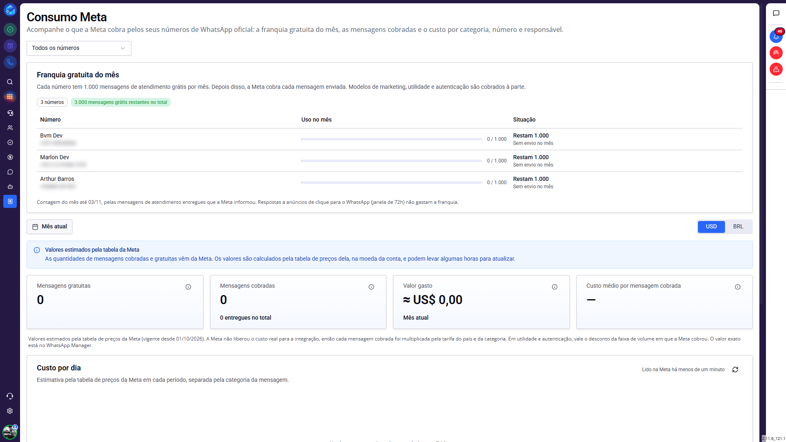

> **Dica: deixe a tela à mão.** No menu de serviços, clique na estrela ao lado de "Consumo Meta (WhatsApp)". Ela passa a aparecer como atalho na barra lateral, e você não precisa mais abrir o menu.

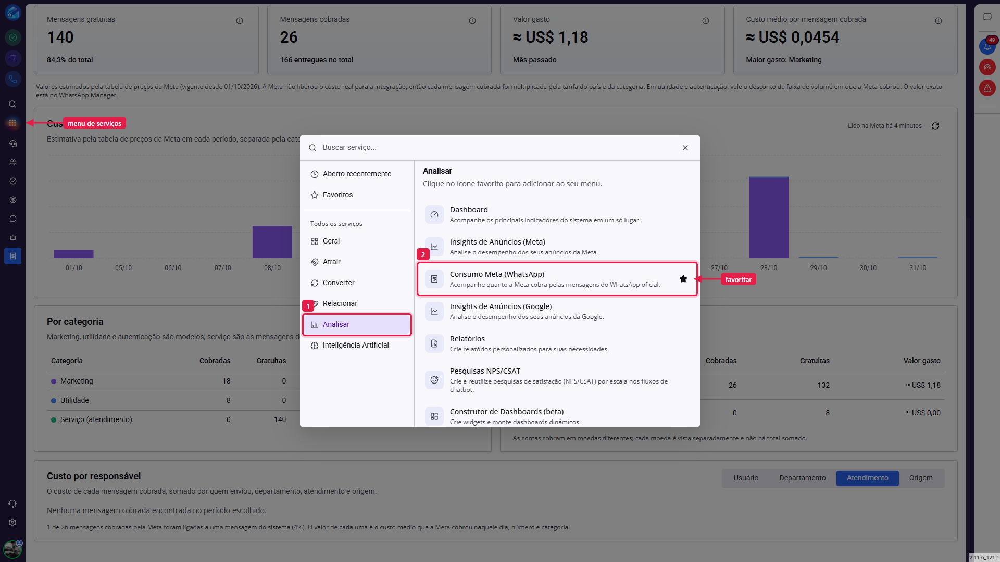

### Como a Meta cobra as mensagens?

Antes de ler os números da tela, vale entender a regra, porque é ela que explica por que uma mensagem foi cobrada e outra não.

A Meta cobra **por mensagem entregue**, e o preço depende de dois fatores: a **categoria** da mensagem e o **país** do número que recebeu. As categorias são:

- **Marketing:** modelos de divulgação, como uma oferta ou um lembrete de carrinho abandonado. São sempre cobrados.
- **Utilidade:** modelos ligados a algo que o cliente fez, como a confirmação de um pedido ou a atualização de uma entrega.
- **Autenticação:** modelos com código de acesso ou de verificação. São sempre cobrados.
- **Serviço (atendimento):** as mensagens livres que a sua equipe envia dentro da janela de 24 horas, depois que o cliente fala com você.

Quem decide se cada mensagem foi cobrada é a Meta, e ela informa isso mensagem por mensagem. A tela mostra exatamente o que a Meta marcou como cobrado, sem tentar adivinhar.

Duas situações deixam a mensagem grátis e costumam gerar dúvida:

- **Respostas a anúncios.** Quando o cliente chega por um anúncio de clique para o WhatsApp e você responde, abre-se uma janela de 72 horas em que tudo o que você enviar é grátis, inclusive modelos.
- **A franquia de atendimento.** Cada número tem 1.000 mensagens de serviço grátis por mês. Ela está explicada logo abaixo.

### O que é a franquia gratuita do mês?

Desde 1º de outubro de 2026, a Meta cobra também as mensagens de atendimento, mas cada número de WhatsApp oficial tem **1.000 mensagens de serviço grátis por mês**. A cobrança começa na 1.001ª mensagem do mês.

O card **Franquia gratuita do mês** mostra como está cada número:

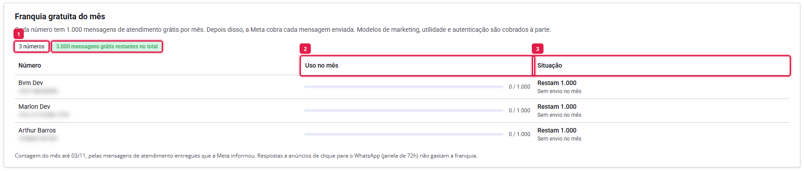

1. **Resumo:** quantos números você tem, quantas mensagens grátis ainda restam somando todos eles e, quando houver, quantos números já esgotaram a franquia, quantos estão perto do limite e quantas mensagens foram cobradas além dela.
2. **Uso no mês:** a barra e a conta "usadas / 1.000". A barra fica verde, passa a amarela quando restam 20% ou menos e fica vermelha quando a franquia acaba.
3. **Situação:** quantas mensagens grátis ainda restam e o ritmo médio do número, como "~4/dia". Depois que a franquia acaba, mostra o dia em que ela esgotou e quantas mensagens já foram cobradas no mês.

Os números mais urgentes aparecem primeiro: os que já esgotaram, depois os que estão perto do limite, depois os que têm menos folga. Com muitos números, a tela mostra os cinco mais urgentes, e o botão "Ver todos" abre o resto. A partir de seis números aparece também uma busca, que procura pelo nome do número ou, se você digitar só algarismos, pelo telefone.

> **Atenção: a franquia é de cada número e não acumula.** Duas contas não somam as franquias, e o que sobrar em um mês não passa para o seguinte. A contagem volta a zero à meia-noite do dia 1º, no fuso horário da conta na Meta.

> **Atenção: respostas a anúncios não gastam a franquia.** As mensagens enviadas dentro da janela de 72 horas de um anúncio de clique para o WhatsApp são grátis e não entram na conta das 1.000.

#### O aviso de forma de pagamento

Quando algum número já esgotou a franquia, ou está num ritmo que deve esgotá-la antes do fim do mês, aparece um aviso amarelo: **"Confira a forma de pagamento na Meta"**.

Ele existe porque a Meta só entrega as mensagens de atendimento depois das 1.000 grátis se a conta tiver uma forma de pagamento cadastrada na Central de Cobrança dela. Sem pagamento cadastrado, a sua equipe continua respondendo pelo SprintHub, mas as mensagens deixam de chegar ao cliente. O aviso é a hora de conferir isso, antes que aconteça.

### Como escolher o período e a moeda?

Abaixo da franquia ficam o filtro de período e, quando necessário, o seletor de moeda. Tudo o que vem depois deles na tela, ou seja, os cards, o gráfico, as tabelas e o rateio, segue o que estiver escolhido aqui.

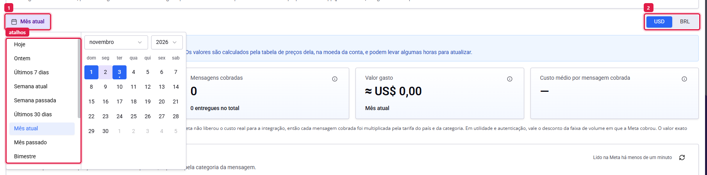

1. **Período:** a tela abre no **Mês atual**, do dia 1º até hoje. Os atalhos à esquerda resolvem os casos mais comuns, como "Mês passado" para fechar o mês anterior, e o calendário permite escolher qualquer intervalo.
2. **Moeda:** aparece quando você tem contas na Meta cobradas em moedas diferentes, por exemplo uma em dólar e outra em real. Cada moeda é vista separada, porque somar dólar com real daria um número que não existe em nenhuma fatura.

No topo da tela, o filtro **Todos os números** vale para a página inteira, inclusive a franquia. Use-o para olhar um número só.

> **Atenção: a Meta guarda só o último ano.** Se você escolher um período que comece há mais de um ano, a tela ajusta o início automaticamente e avisa.

### Diferença prática: a franquia e o resto da tela

A franquia e os outros painéis olham para períodos diferentes, e isso explica por que os números nem sempre "batem" entre eles:

**Franquia gratuita do mês** → sempre o mês corrente, até hoje. Ela não muda com o filtro de período nem com o seletor de moeda, porque é uma regra por número e não envolve dinheiro.

**Cards, gráfico, tabelas e rateio** → o período e a moeda que você escolheu. Se você escolher "Mês passado", eles mostram o mês anterior, enquanto a franquia continua mostrando o mês atual.

### O que os cards mostram?

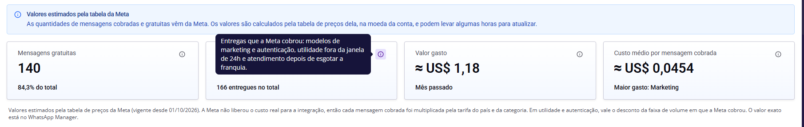

- **Mensagens gratuitas:** as entregas sem cobrança no período, como o atendimento dentro da franquia e as respostas a anúncios, e quanto elas representam do total.
- **Mensagens cobradas:** as entregas que a Meta cobrou, como modelos de marketing e de autenticação e o atendimento depois de esgotar a franquia.
- **Valor gasto:** quanto as mensagens cobradas custaram no período, na moeda da conta.
- **Custo médio por mensagem cobrada:** o valor gasto dividido pelas mensagens cobradas, e a categoria que mais pesou no período.

Cada card tem um ícone de informação. Passe o mouse sobre ele para ver a explicação do que entra naquele número.

> **Atenção: o custo médio é uma média.** Como cada categoria e cada país têm um preço diferente, nenhuma mensagem custa exatamente esse valor. Para saber quanto custa uma mensagem de marketing ou de utilidade, use a tabela Por categoria, mais abaixo.

### Por que os valores aparecem como estimados?

Quando a tela mostra o aviso azul **"Valores estimados pela tabela da Meta"** e os valores vêm com o sinal **≈**, é porque a Meta não informou o custo para a integração. Isso acontece, por exemplo, quando a conta é cobrada pela linha de crédito de um parceiro.

Nesse caso, a quantidade de mensagens continua vindo da própria Meta, e só o valor é calculado: cada mensagem cobrada é multiplicada pelo preço que a Meta publica para aquele país e aquela categoria, na moeda da conta. Em utilidade e autenticação, a conta usa o preço da faixa de volume em que a Meta cobrou a mensagem (explicado abaixo). O rodapé dos cards informa desde quando vale a tabela de preços usada.

> **Atenção: o valor exato está no WhatsApp Manager.** A estimativa usa a tabela oficial e costuma ficar muito próxima da fatura, mas quem fecha a conta é a Meta. Para conferir centavo a centavo, ou para resolver uma divergência de cobrança, use o WhatsApp Manager.

> **Atenção: os valores podem levar algumas horas para aparecer.** A Meta demora um pouco para consolidar o consumo. Uma mensagem enviada agora pode ainda não aparecer na tela.

#### O desconto por volume

Em utilidade e autenticação, quem envia muito paga menos. A Meta soma as mensagens cobradas do mês de todas as contas da mesma empresa na Meta, separadas por país e categoria. A partir de certas quantidades, o preço cai. No Brasil, por exemplo, a utilidade tem preço cheio até 250 mil mensagens no mês e fica mais barata depois disso.

Você não precisa fazer nada: a Meta informa em qual faixa cobrou cada mensagem, e a estimativa já usa o preço daquela faixa. Marketing e atendimento não têm esse desconto.

### Como ler o gráfico de custo por dia?

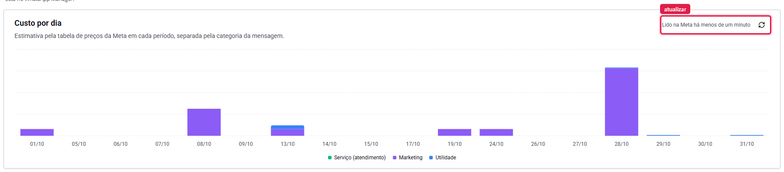

O gráfico mostra quanto foi gasto em cada dia do período, com as cores separando as categorias. É o lugar para achar o dia em que um disparo de marketing pesou, ou para comparar semanas. Em períodos maiores que 90 dias, ele passa a mostrar o custo por mês.

No canto do card fica a hora da última leitura na Meta, como "Lido na Meta há 4 minutos". A tela guarda a leitura por até uma hora, para não consultar a Meta a cada clique. O botão ao lado busca os dados de novo na hora, quando você precisa do número mais recente.

### Quais categorias e números concentram o gasto?

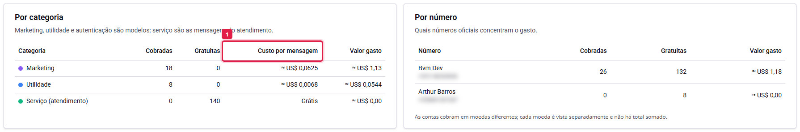

**Por categoria** separa marketing, utilidade, autenticação e serviço, com as mensagens cobradas, as gratuitas e o valor gasto de cada uma. A coluna **Custo por mensagem** (1) mostra o preço real de uma mensagem daquela categoria no período. É a resposta para "quanto me custa um modelo de marketing?". Quando a categoria não teve nenhuma mensagem cobrada, a coluna mostra **Grátis**.

**Por número** mostra quais números oficiais concentram o gasto. Use para descobrir qual operação, loja ou equipe está puxando a conta para cima.

### Quem enviou as mensagens cobradas?

O card **Custo por responsável** reparte o custo das mensagens cobradas por quem as enviou. As abas no alto mudam o ponto de vista:

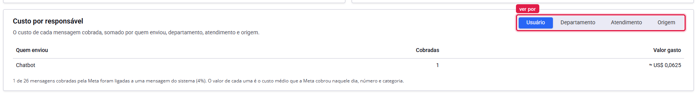

- **Usuário:** quanto cada pessoa da equipe gastou. As mensagens enviadas pelo chatbot aparecem como uma linha própria.
- **Departamento:** o custo somado por departamento.
- **Atendimento:** os atendimentos que mais custaram. Clique em uma linha para abrir o atendimento e ver a conversa.
- **Origem:** de onde a mensagem saiu: de um atendimento, de uma automação (do CRM, do SAC, de um chatbot, de um agente de IA, de um formulário e outras), do celular pelo app WhatsApp Business ou fora de qualquer atendimento.

Exemplos de uso:

- Descobrir qual departamento dispara mais modelos de marketing antes de rever o orçamento do mês.
- Ver se uma automação nova está enviando mais modelos cobrados do que o esperado.
- Encontrar o atendimento que gerou um custo alto e entender o que aconteceu na conversa.

> **Atenção: o rateio cobre só o que o SprintHub consegue ligar a uma mensagem.** A Meta informa o total cobrado, e o sistema procura, entre as mensagens enviadas pelos seus números, quais foram cobradas. As mensagens que ele não encontra registradas, como as enviadas por outro sistema ligado ao mesmo número, ficam de fora do rateio, mas continuam nos cards e nas tabelas. O rodapé do card diz quantas das mensagens cobradas foram ligadas, por exemplo "14 de 41 mensagens cobradas (34%)".

> **Atenção: o valor de cada mensagem no rateio é uma média.** A Meta informa o custo por dia, número e categoria, e não por mensagem. Por isso, cada mensagem do rateio recebe o custo médio daquele dia, número e categoria.

### Como ver o consumo de um número a partir das contas?

Em `Configurações >> Configurações de Contas`, nas abas **WhatsApp API** e **WhatsApp Coexistence**, cada número oficial tem o botão **Consumo na Meta** (1):

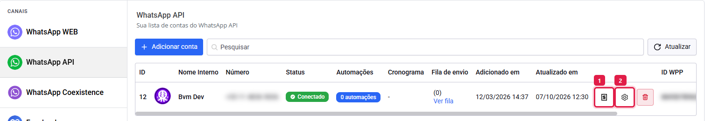

Ele abre a tela num painel lateral, já filtrada por aquele número. Assim você confere a franquia e o gasto de um número sem sair das configurações:

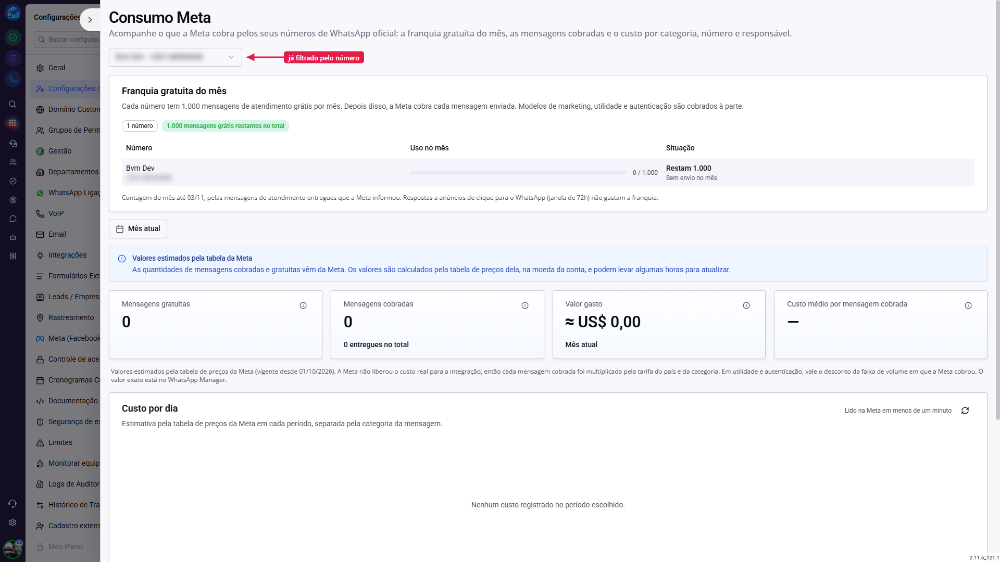

### Como destacar as mensagens cobradas no chat do SAC?

Além da tela de consumo, você pode fazer o próprio chat mostrar quais mensagens a Meta cobrou. Isso ajuda a equipe a perceber, na hora de responder, que aquele modelo custou dinheiro.

A configuração é feita por número. Em `Configurações >> Configurações de Contas`, clique no botão de editar da conta (o (2) da imagem anterior) e procure os dois campos:

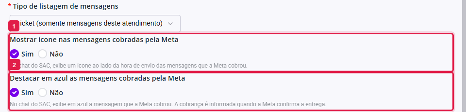

- **Mostrar ícone nas mensagens cobradas pela Meta:** com "Sim", o chat do SAC mostra um ícone ao lado da hora de envio das mensagens cobradas. Ao passar o mouse sobre ele, aparece "Mensagem cobrada pela Meta" e a categoria.
- **Destacar em azul as mensagens cobradas pela Meta:** com "Sim", a mensagem cobrada aparece numa bolha azul, no lugar da cor normal.

Você pode ligar um, o outro ou os dois. Depois de escolher, clique em **Salvar**.

> **Atenção: os dois campos vêm desligados.** Eles começam como "Não" em toda conta, para a cor do chat não mudar sem aviso. Ligar o destaque azul muda a cor dos modelos cobrados, que antes apareciam em verde.

> **Atenção: a marcação aparece quando a Meta confirma a entrega.** A Meta só informa que uma mensagem foi cobrada depois de entregá-la. Logo depois do envio, a mensagem ainda aparece normal e ganha o ícone ou a cor quando a confirmação chega.

### Conclusão

A tela Consumo Meta responde três perguntas diferentes, e vale saber onde olhar para cada uma:

- **"Vou pagar pelo atendimento este mês?"** → a franquia gratuita, no topo da tela. Fique de olho no aviso de forma de pagamento quando algum número estiver perto das 1.000.
- **"Quanto gastei e com o quê?"** → os cards e as tabelas Por categoria e Por número, no período que você escolher.
- **"Quem gerou esse custo?"** → o rateio por responsável, que aponta usuário, departamento, atendimento ou automação.

Os valores servem para acompanhar e decidir. Para a cobrança exata, a referência continua sendo o WhatsApp Manager da Meta.
