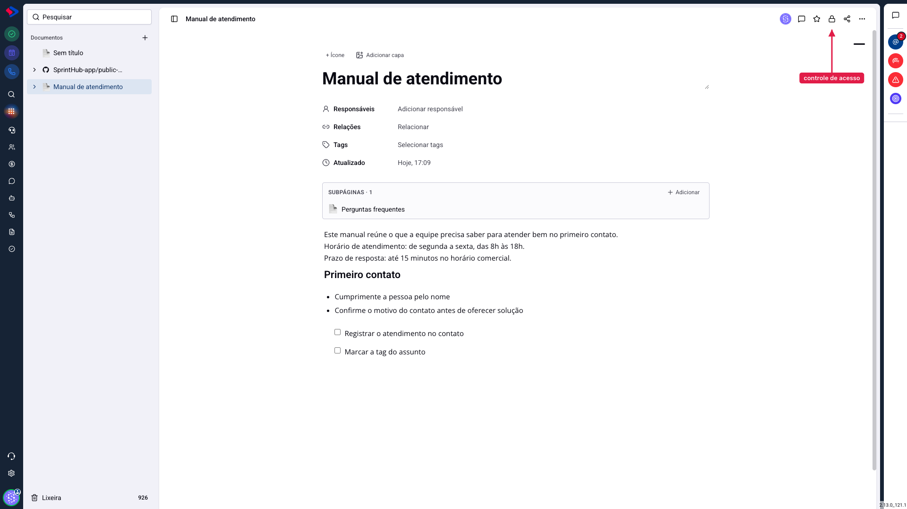
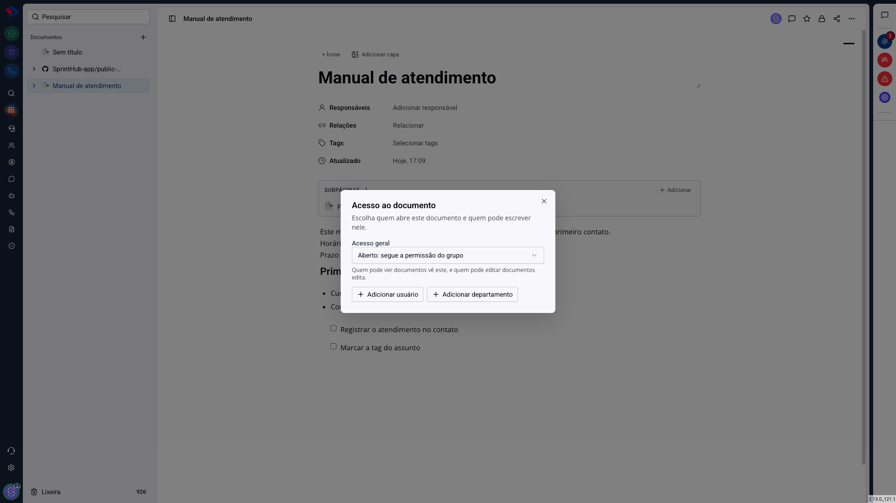
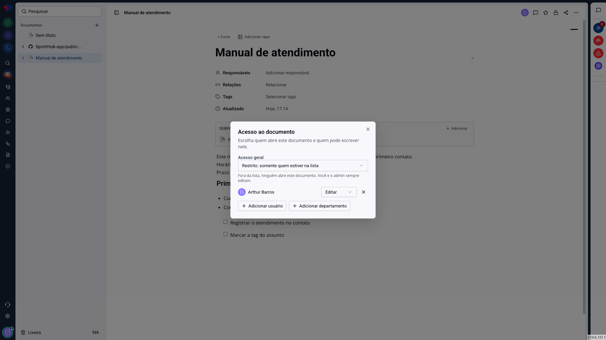

# Documentos - Quem vê e quem edita

Todo documento tem duas camadas de controle, e as duas precisam liberar para alguém escrever. A primeira é a permissão do grupo, configurada pelo administrador: ela diz se a pessoa pode ver, criar, editar ou excluir documentos **no sistema todo**. A segunda é o acesso daquele documento específico, que é o que este artigo explica.

Entender a soma das duas evita a confusão mais comum: colocar um colega na lista do documento e ele continuar sem conseguir escrever. Se o grupo dele não dá permissão de editar documentos, a lista do documento não resolve. O acesso do documento **restringe**, nunca concede algo que o grupo não deu.

## Como acessar

Abra o documento e clique no **cadeado**, no canto superior direito.

## As duas formas de acesso geral

**Aberto: segue a permissão do grupo.** É como todo documento nasce. Quem pode ver documentos no SprintHub vê este, e quem pode editar edita. Use para material de equipe: manual, procedimento, política, qualquer coisa que a empresa inteira pode ler.

**Restrito: somente quem estiver na lista.** Fora da lista, ninguém abre o documento, nem para ler. Use para o que é de um grupo: um contrato em negociação, uma avaliação de desempenho, um plano que ainda não foi comunicado.

## Os papéis de quem está na lista

No modo restrito, cada pessoa ou departamento entra com um papel:

**Ver**: abre e lê o documento, e pode comentar. Não altera o texto.

**Editar**: lê e escreve.

É assim que se compartilha um documento só para leitura: modo restrito, e as pessoas com o papel "Ver".

## Pessoas e departamentos

**Adicionar usuário** entra com uma pessoa específica. **Adicionar departamento** entra com o departamento inteiro, e vale também para os subdepartamentos, a menos que você desligue essa opção.

Quando alguém se encaixa pelos dois caminhos, por exemplo está na lista como "Ver" e no departamento marcado como "Editar", **o papel da pessoa é o que vale**. Isso existe para que dar "somente leitura" a uma pessoa de um departamento que edita realmente funcione.

> **Atenção: ninguém se tranca do lado de fora.** Ao fechar um documento, você entra automaticamente na lista como editor. Sem isso, dava para restringir um documento de outra pessoa e perder o acesso na mesma hora, sem volta.

## Quem passa por cima de tudo

Três situações ignoram a lista:

**O administrador** vê e edita qualquer documento.

**Quem criou** o documento continua com acesso a ele.

**Os responsáveis** (o campo "Responsáveis", no topo da página) sempre veem e editam. Faz sentido: quem responde por um conteúdo não pode ficar sem acesso a ele.

## O que o acesso não controla

**O link público.** Se o documento tiver link público ligado, quem tem o endereço lê o conteúdo sem login e sem passar pela lista de acesso. São dois assuntos diferentes, e por isso ficam em botões diferentes: o cadeado é permissão, o compartilhar é distribuição.

**A exportação.** Quem pode ler o documento pode exportá-lo ou simplesmente copiar o texto da tela. O acesso define quem entra, não impede quem já entrou de levar o conteúdo.

> **Atenção ao duplicar.** A cópia leva as mesmas regras de acesso do original. Isso é proposital: antes, um documento restrito a três pessoas virava uma cópia aberta, com o mesmo conteúdo dentro, visível para a empresa inteira.

## Conclusão

Na prática, a decisão é uma só: este conteúdo é da empresa ou de um grupo? Se é da empresa, deixe aberto. Se é de um grupo, mude para restrito e monte a lista, lembrando de dar "Ver" a quem só precisa ler.

E guarde a regra que resolve a maioria das dúvidas de suporte: o acesso do documento restringe, nunca amplia. Se a pessoa não tem permissão de editar documentos no grupo dela, nenhuma configuração aqui vai dar.
