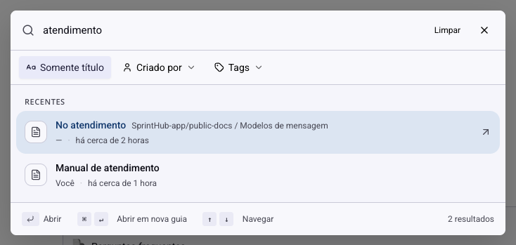
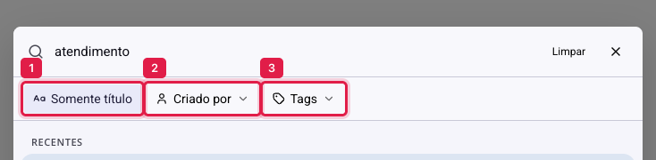

# Documentos - Encontrar um documento

A lista lateral funciona bem com vinte documentos. Com duzentos, rolar a árvore deixa de ser caminho. A busca encontra pelo que você lembra: um pedaço do título, uma palavra que estava no meio do texto, quem escreveu, a tag que você usou.

## Como acessar

No topo da lista de documentos, clique em **Pesquisar**.

## O que a busca procura

Por padrão, ela olha quatro coisas ao mesmo tempo: o **título**, o **conteúdo** do documento, o **autor** e as **tags**.

Isso explica um resultado que surpreende: um documento aparece na busca por "boleto" mesmo sem "boleto" no título, porque a palavra está no corpo do texto. Não é erro, é o comportamento desejado, e é o que resolve o caso mais comum de todos, o de lembrar do assunto mas não do nome da página.

Abaixo de cada resultado, a busca mostra o caminho do documento (a página mãe, quando existe), quem o criou e quando foi atualizado. Esse caminho é o que diferencia duas páginas com nomes parecidos em áreas diferentes.

## Os três filtros

**Somente título** (1) restringe a busca ao nome da página. Ligue quando a palavra for comum e o conteúdo trouxer resultado demais: "cliente" aparece em quase tudo, mas é título de poucos.

**Criado por** (2) filtra pelo autor. Útil quando você sabe quem escreveu e não lembra de mais nada.

**Tags** (3) filtra pelas tags do documento. Combinado com a tag que a equipe usa para um tema, vira um índice.

Os filtros funcionam juntos e também sem nenhuma palavra digitada: só "Criado por" já lista tudo daquela pessoa.

## Recentes

Os resultados vêm em dois grupos. **Recentes** reúne o que foi atualizado nos últimos sete dias; **Todos os documentos**, o resto.

Esse corte é o que faz a busca acertar na primeira tentativa no dia a dia: o documento que você procura quase sempre é um em que alguém mexeu esta semana.

## Navegar pelo teclado

A busca é feita para não precisar do mouse: as setas movem a seleção, **Enter** abre o documento, e o atalho indicado no rodapé abre em uma nova guia, o que serve para comparar duas páginas lado a lado.

## Dentro do documento: o sumário

Achado o documento, ainda falta achar o trecho. À direita do conteúdo há uma coluna de tracinhos: um para cada cabeçalho da página, com o do trecho atual destacado. Passe o mouse e eles viram um sumário com os títulos; clique em um para pular até lá.

> **Atenção.** O sumário é montado a partir dos **cabeçalhos** do texto. Um documento longo escrito só com parágrafos e negrito não gera sumário nenhum: para a página ficar navegável, os títulos de seção precisam ser cabeçalhos de verdade, inseridos pelo menu de blocos.

## Conclusão

Para encontrar rápido, o caminho é quase sempre o mesmo: digite a palavra que você lembra do conteúdo, não o título que você acha que a página tem. A busca olha o texto inteiro, e é isso que a torna melhor do que vasculhar a árvore.

E se a sua equipe tem muitos documentos, combinem três ou quatro tags e usem sempre as mesmas. Com tag consistente, o filtro faz em um clique o que a palavra-chave faz em três tentativas.
