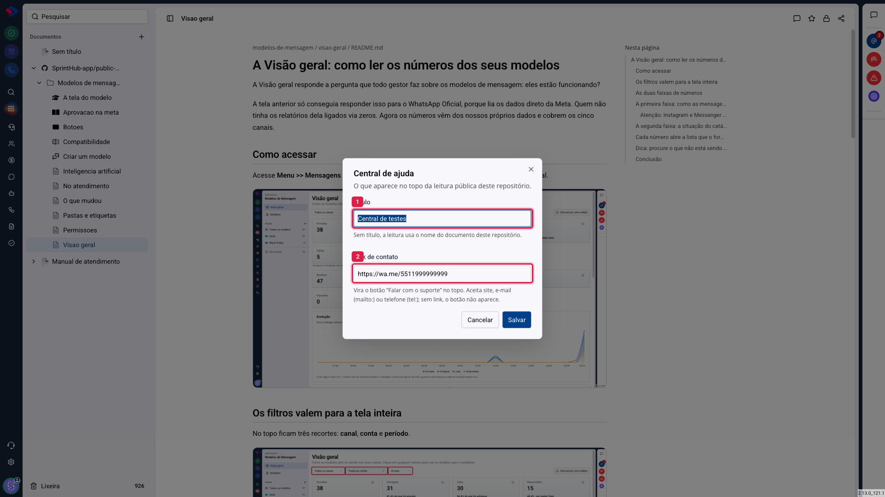
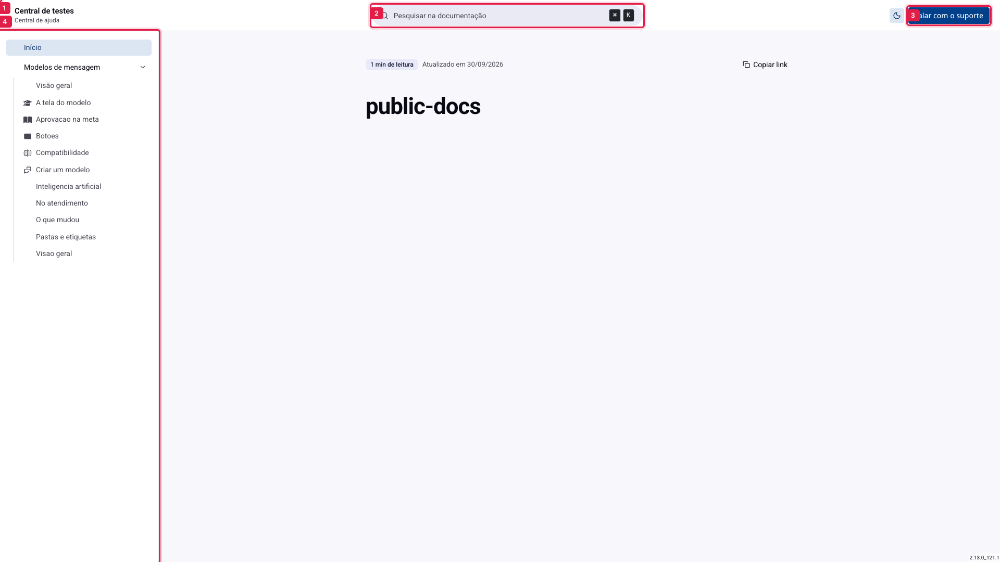
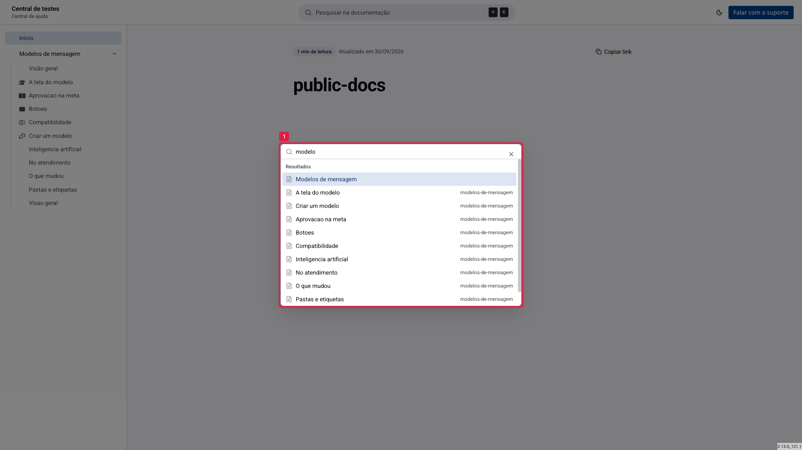

# Documentos - A central de ajuda pública

Quando você liga o link público de um repositório conectado, o que nasce não é uma página solta: é uma **central de ajuda** completa, com lista de artigos, busca, tema claro e escuro e endereço próprio. É o lugar para onde você manda um cliente que perguntou "como faço tal coisa?".

Quem acessa não precisa de login, não vê os seus documentos internos e não consegue editar nada.

## Como acessar

Primeiro, ligue o link público do repositório: abra o espelho (o item com o ícone do GitHub, na lista de documentos), clique em **compartilhar** e ligue o **link público**. O endereço gerado é a sua central.

Depois, configure o que aparece no topo dela: no menu de três pontos do repositório, escolha **Central de ajuda**.

**1. Título**: o nome que aparece no alto da página. Sem ele, a central usa o nome do documento do repositório, que normalmente é `conta/repositório` e não diz nada para quem está de fora. Vale preencher com o nome da sua empresa ou do produto.

**2. Link de contato**: vira o botão **"Falar com o suporte"**, no canto superior direito. Aceita um site, um e-mail (`mailto:`) ou um telefone (`tel:`); um `wa.me` também funciona. Sem link, o botão não aparece.

## Como a central se apresenta

**1. O título** que você configurou. Ele também é um botão: clicar nele volta para a abertura.

**2. A busca**, no centro do topo, é a porta de entrada de quem chega por um link e não conhece a estrutura.

**3. O botão de contato**, quando configurado. Ao lado dele fica o alternador de tema claro e escuro.

**4. A lista de artigos**, à esquerda. As pastas de primeiro nível do repositório viram seções que abrem e fecham, o arquivo de abertura de cada pasta vira "Visão geral", e o que está solto na raiz fica antes das seções. Nada ali mostra caminho de arquivo: quem lê não precisa saber onde o markdown mora.

## A busca

Clique na caixa do topo ou use `Ctrl+K` (ou `⌘K`, no Mac). A tecla `/` também abre.

Ela procura pelo nome do artigo e pela seção onde ele está, ignora acento e aceita as palavras em qualquer ordem. Cada resultado mostra em que seção o artigo mora, que é a informação que falta quando se busca em uma documentação grande.

Antes de digitar, a caixa já lista os primeiros artigos, então ela nunca abre vazia.

## O que o leitor encontra em cada artigo

Além do texto, cada artigo mostra o tempo estimado de leitura, a data da última atualização e um botão **Copiar link**. O endereço copiado aponta para **aquele artigo**, e não para a abertura da central: é o link que você manda para alguém quando quer apontar um assunto específico.

No fim do artigo, há os cartões de **anterior** e **próximo**, na mesma ordem da lista lateral, para quem está lendo em sequência.

> **Atenção ao que a central publica.** Ela mostra **todos** os arquivos do repositório conectado, exceto os que você ocultar. Antes de divulgar o endereço, percorra a lista e esconda o que não é para o público: rascunho, anotação interna, arquivo de configuração do gerador. A ferramenta para isso tem artigo próprio.

> **Atenção ao prazo de atualização.** O conteúdo é guardado por algumas horas para a central responder rápido. Um ajuste feito no GitHub pode levar um tempo até aparecer para o visitante.

## No celular

Em tela estreita, a lista de artigos vira uma gaveta, que abre pelo botão **Artigos** no topo, e a gaveta traz a própria busca. O artigo ocupa a tela inteira.

## Conclusão

A central resolve o problema de publicar documentação sem construir um site: você escreve no GitHub, conecta o repositório uma vez, liga o link público e divulga o endereço.

Duas configurações fazem diferença no resultado e custam um minuto: dar um **título** que o cliente reconheça, e apontar o **link de contato** para onde você realmente atende. Sem o segundo, o visitante que não achou a resposta fica sem saída.
