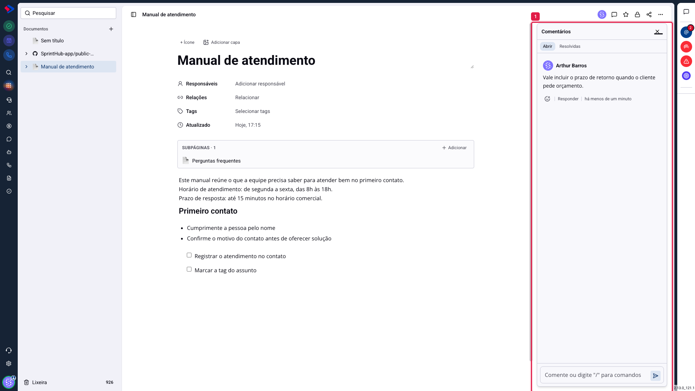
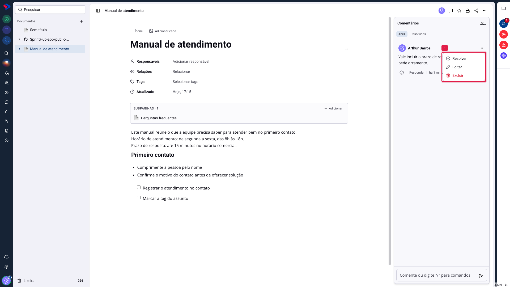
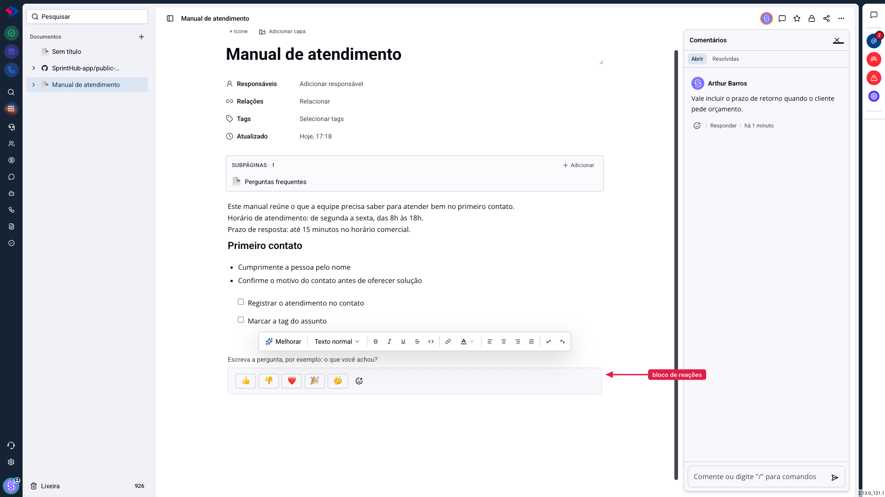

# Documentos - Comentários, respostas e reações

Comentar é a forma de discutir um documento sem alterar o texto dele. Quem revisa deixa a observação do lado; quem escreve resolve e segue. É diferente de editar: o comentário fica num painel próprio, não entra no conteúdo, e some da lista quando é resolvido.

Há também um segundo recurso, parecido no nome e diferente no uso: o **bloco de reações**, que vai dentro do texto e serve para colher opinião, inclusive de quem lê a página pública sem ter login.

## Como acessar

Abra o documento e clique no ícone de **comentários**, no canto superior direito. O painel abre à direita.

## Escrever um comentário

O campo fica no rodapé do painel. Escreva e envie pelo botão ao lado. O comentário aparece com o seu nome, a sua foto e o tempo decorrido.

O campo aceita os mesmos comandos do editor: digite `/` para formatar, inserir lista ou mencionar alguém.

**Mencionar notifica.** Ao escrever `@` e escolher uma pessoa, ela recebe notificação de que foi citada naquele documento. É o caminho para pedir uma revisão a alguém específico, em vez de escrever e esperar que a pessoa entre no documento por conta própria.

## As ações de cada comentário

Passe o mouse sobre o comentário e três ações aparecem.

**Reagir**: responde com um emoji, sem escrever nada. Serve para concordar sem encher o painel de "ok".

**Responder**: abre uma resposta abaixo daquele comentário, mantendo a conversa agrupada em vez de espalhada.

**Opções**, no menu de três pontos:

- **Resolver**: tira o comentário da aba "Abrir" e o guarda na aba "Resolvidas". Use quando o ponto levantado já foi atendido no texto. O comentário não é apagado: continua consultável.
- **Editar**: corrige o que você escreveu. Só o autor edita o próprio comentário, sem prazo: um comentário antigo continua editável por quem o escreveu. O comentário editado passa a mostrar a marca de **editado**, então a correção não passa despercebida por quem já tinha lido.
- **Excluir**: apaga o comentário.

## As duas abas

**Abrir** mostra o que ainda está em discussão. **Resolvidas** guarda o que já foi tratado. É a forma de uma revisão longa não virar um painel infinito: resolva conforme for atendendo, e o que sobra na primeira aba é exatamente o que falta.

## O bloco de reações

O bloco de reações é outra coisa. Ele fica **dentro do texto**, e não no painel lateral. Para inserir, digite `/` no corpo do documento e escolha **Reações**.

O bloco traz uma pergunta, que você escreve ("o que você achou?", por exemplo), e um conjunto de emojis. Os padrão são 👍 👎 ❤️ 🎉 🤔, e você pode trocá-los pelo "+" ao lado, ou remover os que não quiser. O último emoji não sai, porque um bloco sem emoji nenhum não teria como receber reação.

**O ponto que faz o bloco valer a pena: ele funciona na página pública, para quem não tem login.** Publique um documento com link público, ponha um bloco de reações no fim, e quem ler poderá responder sem criar conta. O sistema conta cada pessoa uma vez e mostra o total.

> **Atenção.** O bloco mostra a contagem de cada emoji, não quem reagiu. Isso vale também para você: não há como listar as pessoas por trás dos números, justamente porque a mesma página é lida por gente de fora.

## A diferença prática

**Comentário** é conversa entre quem tem acesso ao documento. Fica no painel lateral, aceita menção, resposta e resolução, e não aparece para quem lê o link público.

**Bloco de reações** é opinião em um clique, dentro do texto, aberta para quem estiver lendo, inclusive sem login.

Na prática: use comentário para revisar um material com a equipe antes de publicar; use bloco de reações para medir se o material publicado está ajudando.

## Conclusão

A maior parte do trabalho acontece na aba "Abrir": comentar, mencionar quem precisa olhar, e resolver conforme for ajustando o texto. Resolver é o passo que costuma ser esquecido, e é o que mantém o painel útil.

Se o documento for para fora, vale terminar com um bloco de reações. É o único recurso do módulo que dá retorno de quem não é da sua empresa.
