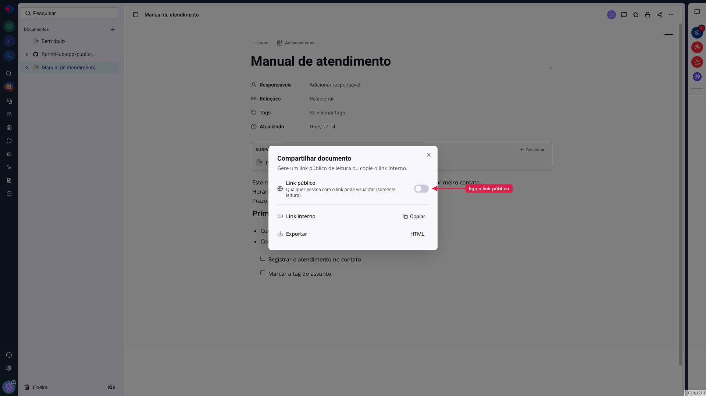
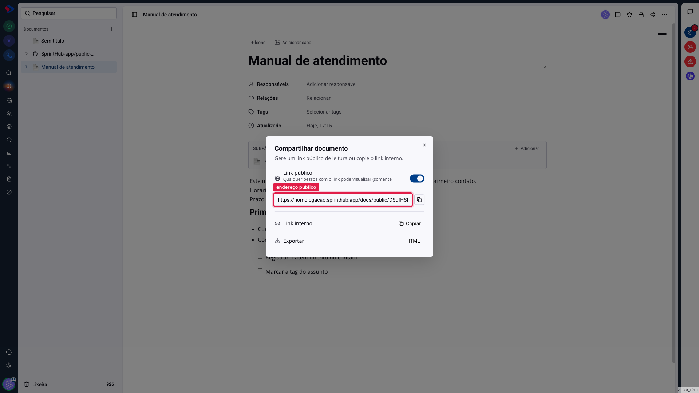
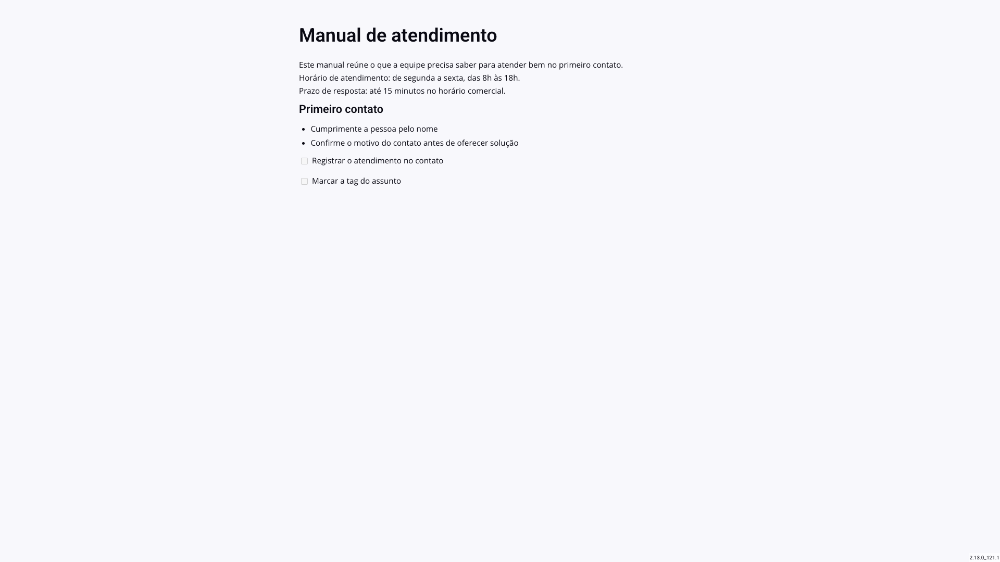

# Documentos - Compartilhar: link público, link interno e exportação

Há três formas de tirar um documento de dentro da sua tela, e elas servem a públicos diferentes. O link interno é para colegas. O link público é para quem não tem login no SprintHub. A exportação é para quem precisa do arquivo.

A escolha errada aqui tem consequência real: o link público funciona sem senha, para qualquer pessoa que tiver o endereço.

## Como acessar

Abra o documento e clique no ícone de **compartilhar**, no canto superior direito.

## Link interno

É o endereço do documento dentro do sistema. Quem recebe precisa ter login no SprintHub **e** acesso àquele documento; se não tiver, vai ver uma mensagem de documento não encontrado.

É o link do dia a dia: mandar para um colega no chat interno, colar numa tarefa, citar numa oportunidade. Use o botão **Copiar**, ao lado de "Link interno".

## Link público

O botão liga ou desliga uma página pública para aquele documento.

Com ele ligado, o sistema gera um endereço próprio. Qualquer pessoa com esse endereço abre o conteúdo, **sem login e sem fazer parte da sua empresa**. A página é somente leitura: ninguém edita, comenta ou vê os campos internos do documento.

Repare no que muda: a página pública mostra só o título e o conteúdo. Responsáveis, tags, relações, histórico e a lista de documentos ficam de fora.

> **Atenção.** Qualquer pessoa com o endereço lê o documento, inclusive quem recebeu o link encaminhado de outra pessoa. O endereço não é adivinhável, mas também não é secreto depois de enviado. Não publique documento com dado de cliente, valor de contrato ou informação de pessoal.

> **Atenção ao desligar.** Desligar o botão derruba a página na hora, e quem tiver o endereço passa a ver erro. Ligar de novo gera o endereço novamente. Mandar o documento para a lixeira também derruba o link público.

## Exportar

O botão **HTML** baixa o conteúdo do documento como arquivo, pronto para abrir no navegador ou anexar em um e-mail. O arquivo sai com o conteúdo que está na tela, sem os campos internos.

A exportação depende da permissão de exportar documentos. Como o arquivo é montado a partir do que você já está vendo, ela controla quem vê o botão, não quem alcança o texto: quem pode ler o documento sempre pode copiar o conteúdo.

## Qual usar em cada caso

**Colega da empresa precisa ler ou editar** → link interno. Ele já tem login, e o acesso do documento decide o que ele pode fazer.

**Cliente, fornecedor ou candidato precisa ler** → link público. Ele não tem login, e você não quer criar um para isso.

**Alguém precisa do arquivo** (para anexar num processo, guardar fora do sistema, imprimir) → exportar.

## Conclusão

O link interno é o caminho padrão, e deveria ser a primeira escolha sempre que a pessoa tiver login. O link público resolve o caso em que não tem, mas é uma porta aberta: antes de ligá-lo, releia o documento pensando em quem nunca viu o conteúdo e não deveria ver tudo que está ali.

Quando a necessidade for publicar bastante material para fora, e não um documento isolado, existe um caminho melhor do que ligar vários links públicos: conectar um repositório e usar a central de ajuda, que tem artigo próprio.
