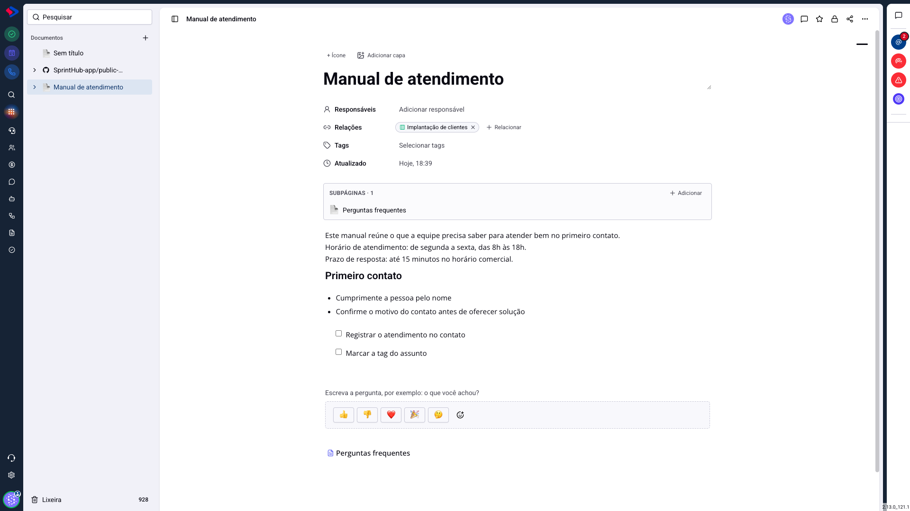
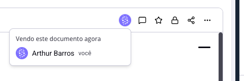
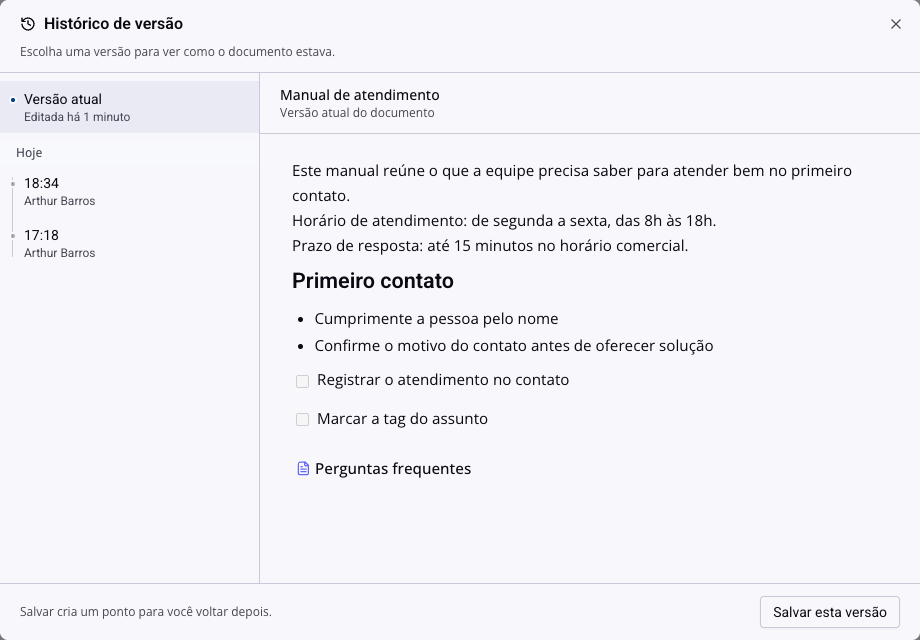

# Documentos - Quando duas pessoas editam a mesma página

O documento salva sozinho, sem botão. Isso é confortável até o dia em que duas pessoas abrem a mesma página ao mesmo tempo, e alguém pergunta para onde foi o parágrafo que tinha acabado de escrever.

Este artigo explica como o sistema se comporta nessa situação, o que ele protege e o que não protege.

## Como acessar

Qualquer documento do módulo **Documentos**.

## O que o sistema faz

O editor **não** junta a escrita de duas pessoas em tempo real, como num editor colaborativo. O funcionamento é outro, e segue duas regras simples:

**Enquanto você está escrevendo, nada do servidor entra na sua tela.** Isso protege o que você está digitando: o texto que um colega salvou não aparece no meio da sua frase nem apaga o que você escreveu.

**Quando você para de escrever, a tela recebe o que o outro salvou.** A página se atualiza sozinha com a versão mais nova, sem recarregar.

A consequência prática é a regra que importa: **quem salva por último é quem fica**. Se vocês dois mexeram no mesmo parágrafo, a versão de quem salvou depois substitui a anterior.

> **Atenção.** O sistema não avisa que isso aconteceu. Não há mensagem de conflito, nem marca no texto. Por isso a prevenção vale mais do que o conserto: antes de mexer num documento importante, confira se tem alguém nele.

## Quem está vendo agora

No canto superior direito do documento ficam os avatares de quem está com a página aberta naquele momento. Passe o mouse e a lista mostra os nomes, com um "você" ao lado do seu.

É o indicador a olhar antes de começar a editar. Se tem um colega ali, duas saídas funcionam melhor do que escrever junto:

- combinar pelo chat quem edita agora e quem edita depois;
- deixar a sua contribuição como **comentário**, e quem está editando incorpora.

A segunda é a mais segura em documento que está sendo revisado: comentário nunca disputa com o texto de ninguém.

## Como voltar atrás

Se o estrago aconteceu, o histórico de versão é a rede de segurança. Nos três pontos do documento, **Histórico de versão** lista as versões guardadas, com a hora e o nome de quem salvou.

Clicando em uma versão, você vê como o documento estava naquele momento e pode restaurá-la.

Antes de restaurar, vale copiar o trecho perdido e colar no documento atual, em vez de restaurar a versão inteira: a restauração desfaz **tudo** que veio depois, inclusive o que o seu colega escreveu de bom.

## Trabalhar em paralelo sem conflito

Três hábitos resolvem quase todos os casos:

**Divida por subpágina.** Duas pessoas escrevendo em páginas diferentes nunca se atrapalham. Um documento mãe com uma subpágina por seção é mais fácil de manter em equipe do que uma página única gigante.

**Use comentário para revisar.** Quem revisa comenta, quem escreve incorpora. É mais lento no papel e mais rápido na prática, porque ninguém refaz trabalho.

**Olhe os avatares.** São dois segundos, e evitam a única situação em que o sistema realmente perde texto.

## Conclusão

A escrita em documento aqui é feita para um autor de cada vez, com revisão por comentário. Dentro desse modelo, o salvamento automático é uma vantagem: ninguém perde conteúdo por esquecer de salvar.

Fora dele, em quatro pessoas no mesmo parágrafo, o resultado vai depender de quem parou de digitar por último. Se o seu time precisa escrever junto de verdade, divida o documento em subpáginas antes de começar.
