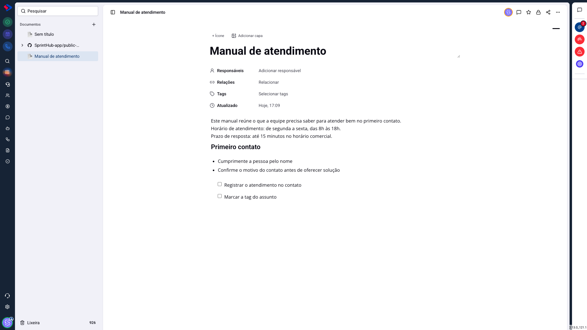
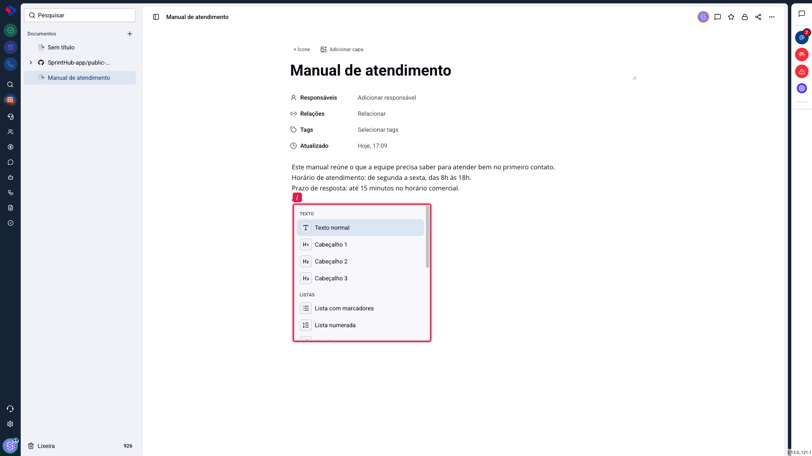
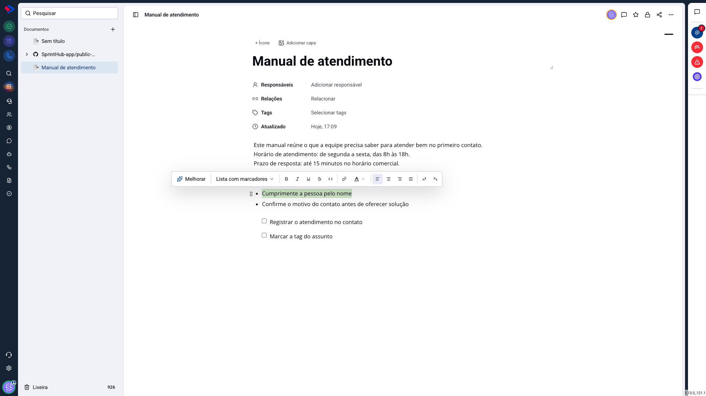
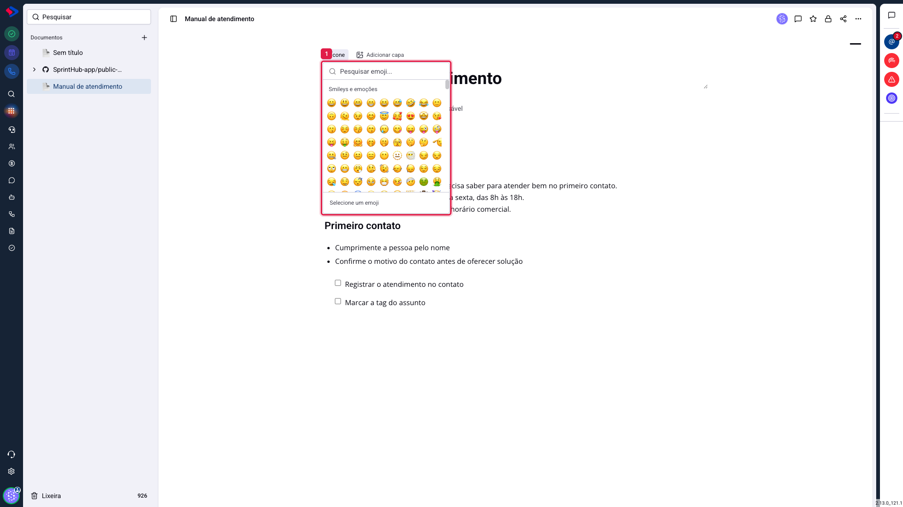

# Documentos - Como escrever: blocos, comandos e formatação

O editor de Documentos funciona por **blocos**. Cada parágrafo, cabeçalho, lista ou tabela é um bloco independente, e você escolhe o tipo de cada um conforme vai escrevendo. Isso é diferente de um editor comum, onde você formata o texto depois de escrever: aqui você diz o que aquele pedaço é.

Na prática, a diferença aparece em duas coisas. Você monta a estrutura sem tirar as mãos do teclado, digitando `/` para trocar de bloco. E o documento sai organizado por natureza, porque cabeçalho é cabeçalho e lista é lista, não texto com tamanho diferente.

## Como acessar

Abra qualquer documento em **Documentos** e clique na área abaixo dos campos. O cursor aparece e você já pode escrever.

## O menu de comandos: a tecla `/`

Digite `/` em uma linha vazia e o menu de blocos abre. Continue digitando para filtrar (por exemplo, `/lista`), e pressione Enter para inserir.

Os blocos disponíveis, agrupados como aparecem no menu:

**Texto normal**: o parágrafo comum. Serve para voltar um bloco ao normal depois de tê-lo transformado em outra coisa.

**Cabeçalho 1, 2 e 3**: os títulos das seções. Use o 1 para o assunto principal, o 2 para as divisões e o 3 para subdivisões. Eles não são só letra maior: é por eles que o sumário lateral do documento se monta.

**Lista com marcadores** e **Lista numerada**: para enumerar itens. Use a numerada quando a ordem importa (um passo a passo) e a de marcadores quando não importa (uma relação de critérios).

**Checklist**: a lista com caixas de marcar. Boa para um roteiro que alguém vai seguir e ir conferindo.

**Citação**: destaca um trecho com uma barra lateral. Serve para uma regra que veio de outro lugar, a fala de um cliente ou um aviso que você quer separar do corpo do texto.

**Bloco de código**: texto em fonte monoespaçada, sem formatação automática. É o lugar certo para um endereço de API, um trecho de configuração ou qualquer coisa que não possa ser "corrigida" pelo editor.

**Tabela**: cria uma tabela editável, com linhas e colunas que você acrescenta depois.

**Divisor**: uma linha horizontal que separa assuntos dentro da mesma página.

**Imagem**: envia um arquivo do seu computador e o insere no texto.

**Reações**: insere um bloco onde quem lê pode reagir com emoji, inclusive na página pública. Tem artigo próprio.

**Mencionar**: insere uma referência a uma pessoa, um documento, uma tarefa, um contato, uma oportunidade ou um atendimento. A pessoa mencionada é notificada; os demais viram um link que abre o registro.

## A barra de formatação

Selecione um trecho de texto e uma barra aparece logo acima dele.

Da esquerda para a direita, ela traz:

**Melhorar**: envia o trecho selecionado para a inteligência artificial e troca **apenas aquele trecho** pelo resultado. Serve para reescrever, resumir ou traduzir sem mexer no resto do documento. O botão depende de a sua instância ter o Copiloto liberado.

**O tipo do bloco**: o seletor que mostra o que aquele bloco é ("Lista com marcadores", no exemplo) e permite trocá-lo sem passar pelo menu de barra.

**Negrito, itálico, sublinhado e tachado**: a formatação de sempre, também pelos atalhos `Ctrl+B`, `Ctrl+I` e `Ctrl+U`.

**Código**: marca um pedaço no meio da frase como código, útil para um nome de campo ou um comando.

**Link**: transforma a seleção em link.

**Cor do texto**: muda a cor do trecho.

**Alinhamento**: à esquerda, centralizado, à direita ou justificado.

**Sobrescrito e subscrito**: para notas e fórmulas.

## Ícone e capa

Acima do título ficam **+ Ícone** e **Adicionar capa**. O ícone é um emoji que aparece junto do nome na lista de documentos, e é o jeito mais rápido de reconhecer uma página no meio de dezenas. A capa é uma faixa de imagem no alto da página.

> **Dica.** Em uma lista grande, o ícone vale mais do que parece. Um 📘 para manuais, um ⚙️ para rotinas técnicas e um 📊 para relatórios resolvem a localização visual sem ninguém precisar ler os nomes.

## O texto salva sozinho

Não há botão de salvar. O editor grava o conteúdo pouco depois de você parar de digitar, e o campo "Atualizado" mostra a hora da última gravação.

> **Atenção ao documento protegido.** Se alguém ligou a proteção do documento (o cadeado, no menu de opções), o conteúdo entra em modo somente leitura e o que você digitar não será gravado. O aviso aparece acima do texto.

## Conclusão

Quem está começando precisa de três comandos: `/` para trocar o tipo do bloco, a seleção para formatar, e Enter para seguir escrevendo. O resto se descobre no caminho.

Se o documento vai ser lido por outras pessoas, vale um cuidado: use cabeçalhos de verdade em vez de texto em negrito para separar as seções. É o que faz o sumário funcionar e o que torna o documento navegável quando ele crescer.
