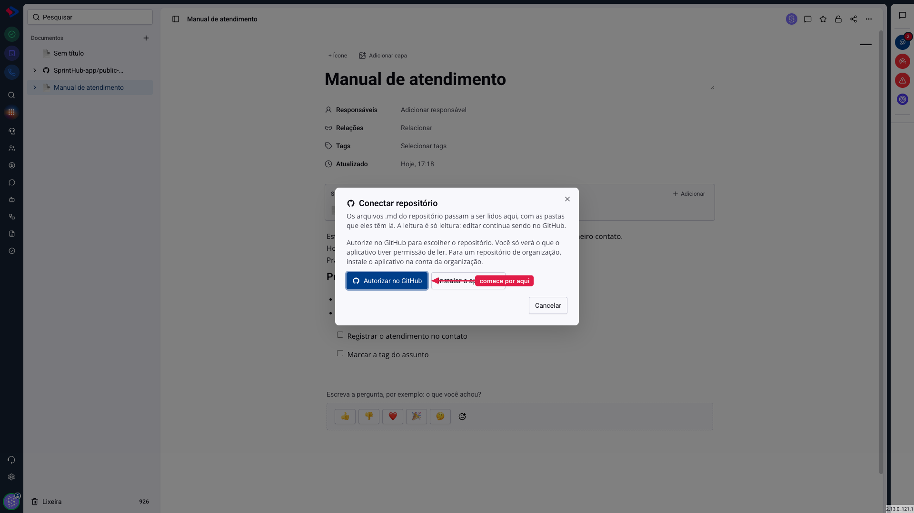
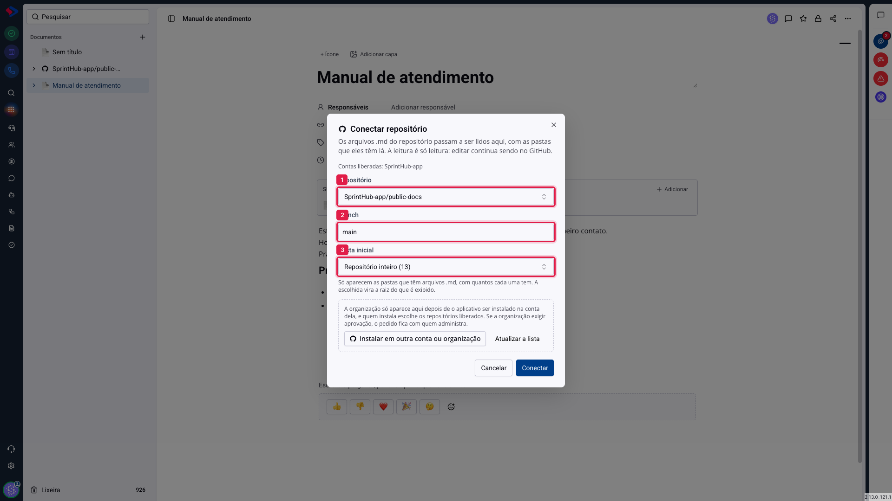
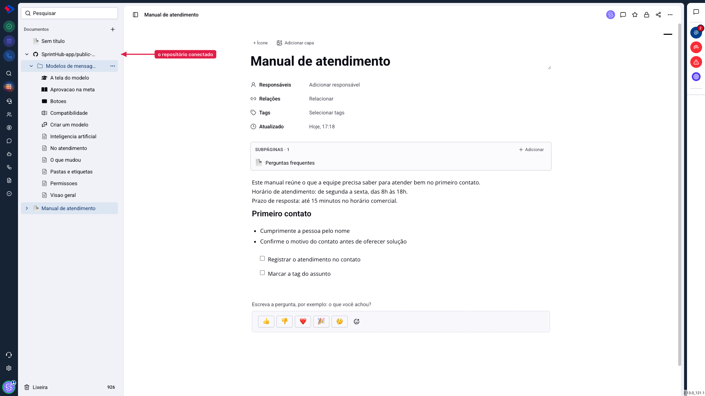

# Documentos - Conectar um repositório do GitHub

Se a sua documentação já é escrita em arquivos `.md` dentro de um repositório do GitHub, não é preciso copiar nada para o SprintHub. Você conecta o repositório, e os arquivos passam a ser lidos aqui, com as mesmas pastas que eles têm lá.

A regra que vale lembrar o tempo todo: **a leitura é só leitura**. Quem escreve continua escrevendo no GitHub, pelo processo que a equipe já usa. O SprintHub mostra o conteúdo, controla quem vê, permite comentar e, se você quiser, publica tudo numa central de ajuda pública.

## Como acessar

Em **Documentos**, clique no **+** ao lado de "Documentos" e escolha **Conectar repositório**.

Se essa opção não aparecer, são duas as causas possíveis: a integração com o GitHub não foi configurada na sua instância, ou o seu grupo de permissões não tem "conectar repositório". Fale com quem administra o sistema.

## Passo 1: autorizar no GitHub

Clique em **Autorizar no GitHub**. Você vai para o GitHub, confirma, e volta para esta tela. A autorização serve para o sistema saber **o que você enxerga** no GitHub: ela não dá acesso permanente nem guarda a sua senha.

**Se o repositório for de uma organização**, há um passo a mais: o aplicativo precisa estar instalado na conta da organização, e quem instala escolhe quais repositórios ficam liberados. É o que o botão **Instalar em outra conta ou organização** faz. Se a organização exigir aprovação, o pedido fica com quem administra, e o repositório só aparece na lista depois disso.

## Passo 2: escolher o que será lido

**1. Repositório**: a lista traz o que o aplicativo tem permissão de ler nas contas liberadas. O nome vem no formato `conta/repositório`.

**2. Branch**: o sistema preenche com o branch padrão do repositório (normalmente `main`). Troque se a sua documentação vive em outro.

**3. Pasta inicial**: define a raiz do que será mostrado. "Repositório inteiro" lê tudo; escolher `docs`, por exemplo, faz o conteúdo começar dali, e o caminho `docs/` some do que aparece na tela. A lista só oferece pastas que têm arquivos `.md`, com a contagem de cada uma.

Clique em **Conectar**.

## O que acontece depois

O repositório vira um item na lista de documentos, com o ícone do GitHub, e **cada arquivo vira uma página de verdade**. Isso importa: por serem páginas, os arquivos aceitam comentário, controle de acesso e link público, como qualquer documento escrito aqui.

As pastas do repositório viram pastas na lista, e o `README.md` de cada uma é a página daquela pasta, como acontece no próprio GitHub.

> **Atenção ao que não é lido.** Só entram arquivos `.md` e `.markdown`. Imagens referenciadas no texto aparecem normalmente; o resto do repositório (código, configuração, pastas sem documentação) fica de fora.

> **Atenção ao tempo da primeira conexão.** Um repositório com dezenas de arquivos leva alguns segundos para montar a lista toda, porque cada arquivo vira uma página. Repositórios grandes podem levar mais.

## Como o conteúdo se mantém atualizado

Quando alguém faz um commit no GitHub, o conteúdo aqui acompanha. O sistema verifica se o repositório mudou e atualiza o que for preciso: arquivo novo vira página nova, arquivo renomeado troca de nome, arquivo apagado sai da lista.

O texto de cada página fica em cache por algumas horas, então uma alteração pode levar um pouco para aparecer.

## Conclusão

A conexão com o GitHub serve a um caso específico e resolve bem: documentação técnica que já é mantida em arquivos, por gente que prefere escrever em markdown e revisar por pull request.

Se a sua equipe não tem essa rotina, não vale conectar um repositório só para usar o recurso: escrever direto no módulo é mais simples e permite editar na hora.
