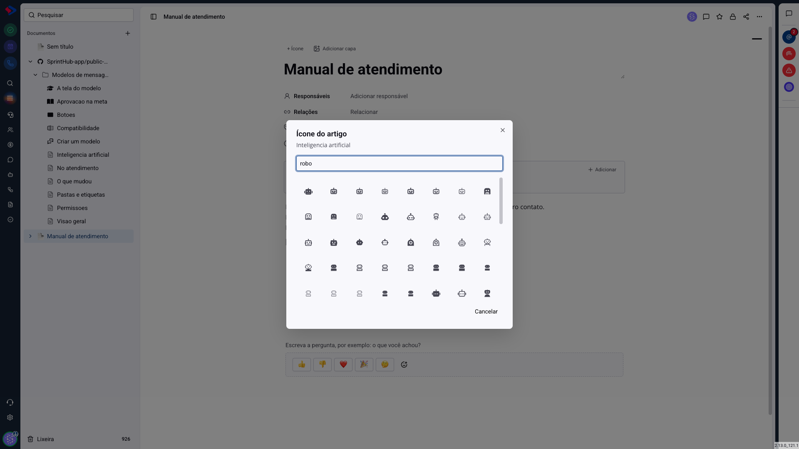
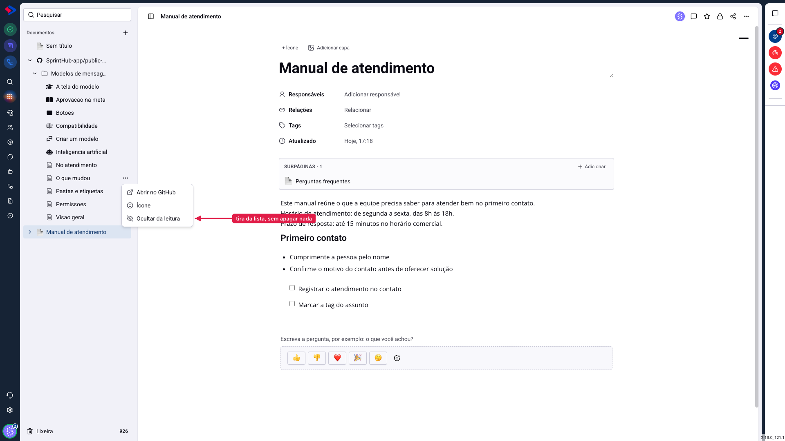
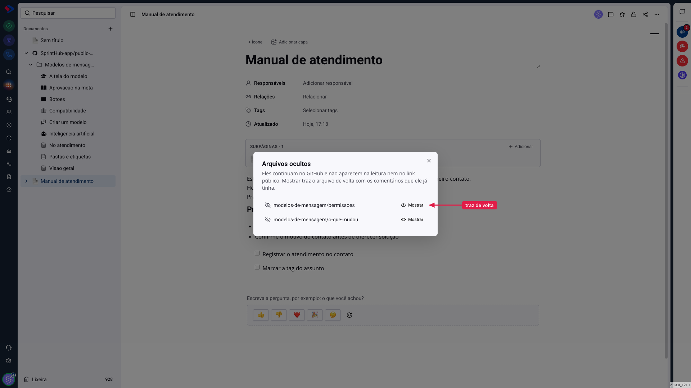

# Documentos - Ícones e arquivos ocultos em um repositório

Um repositório de documentação tem coisas que não são documentação: rascunho, modelo de página, arquivo de configuração do gerador, pasta de imagens. E tem arquivos cujos nomes não ajudam ninguém a encontrar o assunto. Duas ferramentas resolvem isso sem mexer no repositório: **o ícone** e **ocultar da leitura**.

As duas ficam no mesmo lugar e valem o mesmo princípio: são decisões suas sobre **como o conteúdo é apresentado**, não alterações no GitHub. Nada do que você fizer aqui muda um arquivo lá.

## Como acessar

Na lista de **Documentos**, abra o repositório conectado, passe o mouse sobre um arquivo ou pasta e clique no menu de três pontos.

## O ícone

Escolha **Ícone** e a janela de busca abre.

Digite o tema que você procura. A busca entende português para os ícones mais comuns de uma central de ajuda ("vídeo", "configuração", "dúvida", "robô") e, além deles, pesquisa o catálogo inteiro do Iconify, que tem dezenas de milhares de desenhos.

> **Dica.** Para o catálogo completo, o termo precisa estar em inglês: "botao" não acha nada, "button" acha. A lista oferecida antes de digitar e os primeiros resultados são sempre os ícones escolhidos a dedo para documentação, com busca em português.

O ícone aparece **nos dois lugares** em que o arquivo aparece: na lista do painel e na central de ajuda pública. Para tirar, abra a janela de novo e clique em "Tirar o ícone".

Pastas também aceitam ícone, e o ícone da pasta vira o ícone da seção na central.

## Ocultar da leitura

Escolha **Ocultar da leitura** no menu do arquivo ou da pasta.

O arquivo sai da lista do painel e da central pública na mesma hora. Ele **continua no GitHub**, intocado, e o endereço direto dele aqui também para de responder, então não adianta alguém ter guardado o link.

Esconder uma **pasta** esconde tudo que está dentro dela, que é como a maioria das pessoas espera que funcione ao clicar em "ocultar" numa pasta.

## Trazer de volta

A lista do que está escondido fica no menu do repositório, em **Arquivos ocultos**, com a contagem ao lado.

**Mostrar** devolve o arquivo à lista, com os comentários e o link público que a página já tinha. Esconder não apaga nada: a página é apenas arquivada, e volta inteira.

## O que vale a pena esconder

Na prática, antes de divulgar uma central, vale percorrer a lista e esconder:

- o **sumário do gerador** (`SUMMARY.md`), que serve à ferramenta e não ao leitor;
- arquivos de **instrução para a equipe** que vivem no repositório de documentação;
- **rascunhos** e páginas em construção;
- pastas de **configuração**, como `.gitbook`.

> **Atenção.** O que você esconde some para todo mundo, inclusive para a sua equipe dentro do painel. Se a intenção é publicar para fora mas continuar lendo internamente, esconder não é a ferramenta certa: nesse caso, mantenha o arquivo visível e controle a divulgação do endereço público.

## Conclusão

As duas ferramentas existem porque o repositório pertence a quem escreve o código, e a apresentação pertence a quem cuida da documentação. Você ajusta a vitrine sem precisar de um commit, e sem pedir nada a ninguém.

Comece escondendo o que claramente não é artigo, e deixe os ícones para depois: eles valem mais quando a lista já está limpa.
