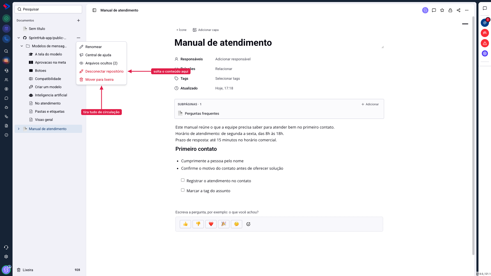
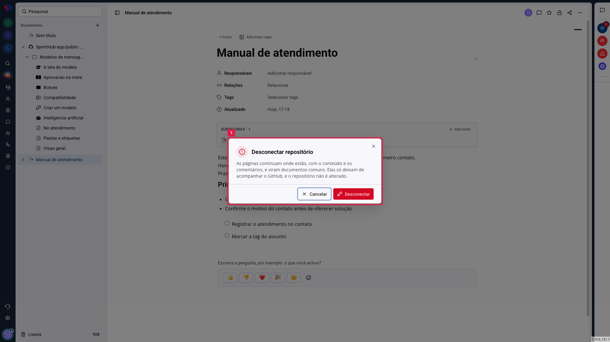

# Documentos - Desconectar um repositório

Chega o dia em que o repositório sai de cena: a equipe mudou de ferramenta, o projeto acabou, ou a documentação vai passar a ser escrita aqui mesmo. Há duas saídas para isso, e elas fazem coisas bem diferentes.

## Como acessar

Na lista de **Documentos**, abra o menu de três pontos do repositório conectado (o item com o ícone do GitHub).

## Desconectar: o conteúdo fica

**Desconectar repositório** desfaz o vínculo e **mantém as páginas**. Elas param de acompanhar o GitHub e viram documentos comuns, com o conteúdo que tinham no momento da desconexão.

O que acontece com cada parte:

**O texto fica.** O conteúdo que estava sendo lido do GitHub é gravado nas páginas, que passam a ser editáveis aqui como qualquer documento.

**Os comentários ficam**, nas mesmas páginas.

**O repositório não é alterado.** Nada é apagado, movido ou commitado no GitHub. Ele simplesmente deixa de ser a origem do que você lê aqui.

**As páginas deixam de se atualizar.** A partir dali, um commit no GitHub não muda mais nada no SprintHub, e uma edição feita aqui não volta para o repositório.

> **Atenção ao tempo.** Em repositórios com muitas páginas, soltar o conteúdo leva alguns minutos, porque cada página precisa guardar o próprio texto e as imagens. O sistema faz isso em etapas; acompanhe até concluir, em vez de fechar a tela no meio.

## Mover para lixeira: tudo sai de circulação

**Mover para lixeira** é a outra saída, e faz o oposto: tira o repositório e todas as páginas dele da lista de uma vez, como acontece com qualquer documento que vai para a lixeira.

O conteúdo não é destruído e dá para restaurar depois, mas enquanto estiver na lixeira:

- as páginas somem da lista para todo mundo;
- o **link público cai**, e a central de ajuda para de responder.

## Qual escolher

**Vai parar de usar o GitHub, mas o conteúdo continua valendo** → desconectar. As páginas viram documentos normais, editáveis aqui, e a central de ajuda continua funcionando a partir delas.

**O material inteiro saiu de uso** → lixeira. É o caminho para tirar tudo de circulação de uma vez, com possibilidade de voltar atrás.

**Vai continuar usando, mas um arquivo específico não deve aparecer** → nenhum dos dois: esconda aquele arquivo. Tem artigo próprio.

## Conectar de novo

Nada impede reconectar o mesmo repositório depois. Vale saber de uma particularidade útil: as páginas que ficaram guardadas voltam a ser reconhecidas, em vez de nascerem do zero. Comentários e endereços que aquelas páginas tinham são reaproveitados.

## Conclusão

A escolha é entre guardar o conteúdo aqui e tirar tudo de cena. Na dúvida, prefira **desconectar**: ela preserva o que a equipe escreveu e é reversível no sentido que importa, já que você pode reconectar ou simplesmente seguir editando as páginas aqui.

A lixeira resolve o caso em que ninguém mais deveria ver aquilo, e tem o efeito colateral de derrubar a central pública na hora.
