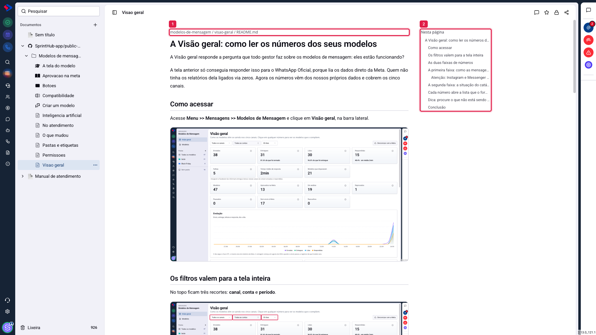
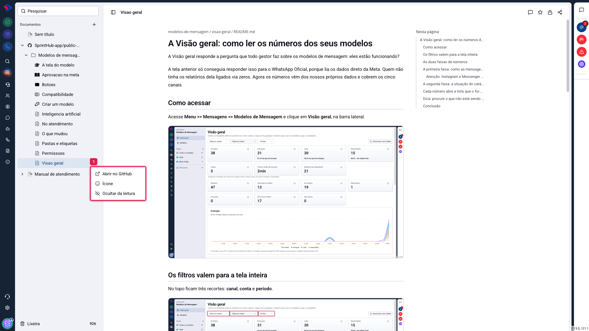

# Documentos - Como ler um repositório conectado

Depois de conectar um repositório, ele vira um item na lista de documentos e os arquivos `.md` passam a ser páginas que você abre, lê e comenta. Este artigo explica o que muda em relação a um documento escrito aqui, e o que você pode fazer com cada arquivo.

## Como acessar

Na lista de **Documentos**, clique na seta ao lado do nome do repositório (ele tem o ícone do GitHub) e navegue pelas pastas até o arquivo.

## A página de um arquivo

**1. O caminho do arquivo**, no topo, mostra onde ele mora no repositório. É o que responde "de onde veio este texto".

**2. O sumário "Nesta página"**, à direita, lista os títulos do arquivo. Clicar em um deles rola até a seção. Ele se monta sozinho a partir dos cabeçalhos do markdown.

O conteúdo é renderizado como no GitHub: cabeçalhos, listas, tabelas, blocos de código com destaque, citações e imagens. As imagens do repositório são servidas pelo próprio SprintHub, então aparecem normalmente mesmo quando o repositório é privado.

**Os links internos funcionam.** Um link para outro arquivo do mesmo repositório abre a página correspondente aqui, em vez de levar você ao GitHub.

## O que você pode fazer em um arquivo

**Abrir no GitHub**: leva ao arquivo no repositório, que é onde se edita.

**Ícone**: escolhe o ícone daquele arquivo na lista. Tem artigo próprio.

**Ocultar da leitura**: tira o arquivo da lista sem apagar nada no GitHub. Tem artigo próprio.

Além do menu, o arquivo é uma página como as outras: aceita **comentários**, tem **controle de acesso** e pode ganhar **link público**.

## O que não dá para fazer

**Editar o texto.** A página é somente leitura, e isso é proposital: o conteúdo pertence ao repositório, e duas verdades para o mesmo texto seria pior do que uma. Para corrigir algo, use "Abrir no GitHub".

**Criar subpágina dentro do repositório.** O que vive embaixo do repositório são os arquivos que existem nele. Para acrescentar uma página, crie o arquivo no GitHub.

## Como o conteúdo se atualiza

A cada commit no repositório, o sistema acompanha: arquivo novo vira página, arquivo renomeado muda de nome, arquivo apagado sai da lista. O texto de cada página fica guardado por algumas horas para a leitura ser rápida, então uma alteração recente pode levar um pouco para aparecer.

> **Atenção ao arquivo apagado no GitHub.** Quando um arquivo some do repositório, a página dele sai da lista, mas não é destruída: os comentários e o link público daquela página continuam guardados. Se o arquivo voltar, a página volta com tudo que tinha.

## Conclusão

A leitura de repositório resolve o caso de a documentação já existir em markdown e ser mantida por quem trabalha no GitHub. O ganho não é escrever de outro jeito: é dar à equipe inteira, inclusive a quem nunca abriu o GitHub, um lugar onde esse material é legível, comentável e, se você quiser, publicável.

Se a sua intenção é publicar esse conteúdo para clientes, o passo seguinte é a central de ajuda, que tem artigo próprio.
