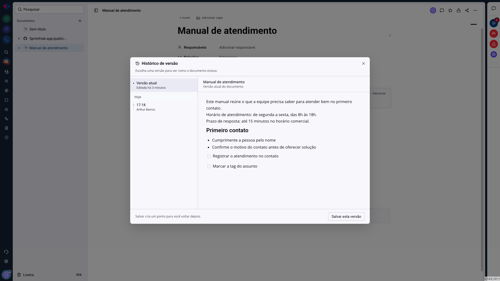
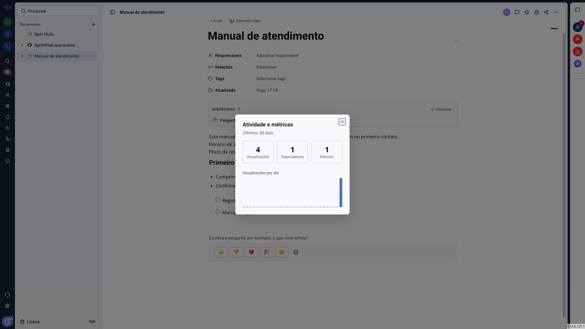

# Documentos - Histórico de versão, atividade e presença

Três recursos respondem a perguntas que aparecem quando um documento passa a ser usado de verdade: "quem mexeu nisso?", "dá para voltar como estava?" e "alguém está lendo?".

## Como acessar

Abra o documento e clique no menu de **três pontos**, no canto superior direito. **Histórico de versão** e **Atividade e métricas** estão ali.

## Histórico de versão

O histórico guarda fotografias do documento ao longo do tempo. À esquerda fica a régua, com a versão atual no topo e as anteriores agrupadas por dia, cada uma com a hora e quem editou. À direita, a prévia do conteúdo daquela versão.

Clique em uma versão para ver como o documento estava naquele momento. A prévia é só leitura, e trocar de versão na lista não altera nada.

**Salvar esta versão** cria um ponto de retorno no momento atual. Use antes de uma reescrita grande: é o que garante que dá para voltar.

**Restaurar esta versão** aparece quando você seleciona uma versão anterior. Ele traz aquele conteúdo de volta para o documento. Antes de restaurar, o sistema guarda a versão atual automaticamente, então a restauração também tem volta.

> **Atenção.** A restauração troca o conteúdo inteiro do documento pelo da versão escolhida. Não existe restauração parcial: se você só quer um parágrafo antigo, abra a versão na prévia e copie o trecho.

## Atividade e métricas

A tela resume os últimos 30 dias em três números:

**Visualizações**: quantas vezes o documento foi aberto.

**Espectadores**: quantas pessoas diferentes o abriram. Dez visualizações de uma pessoa contam como dez visualizações e um espectador.

**Editores**: quantas pessoas diferentes alteraram o conteúdo.

Abaixo, o gráfico de **visualizações por dia** mostra a distribuição no período.

Esses números dizem se o material está sendo usado. Um procedimento com zero visualização no mês provavelmente não foi comunicado, ou foi substituído por outra coisa e ninguém avisou.

## Presença: quem está vendo agora

Quando mais de uma pessoa abre o mesmo documento, as fotos de quem está com ele aberto aparecem no canto superior direito, ao lado dos botões de ação. Passe o mouse sobre um avatar para ver o nome.

É um aviso prático, não um bloqueio: se você vir que um colega está na mesma página, converse antes de reescrever o mesmo parágrafo.

> **Atenção à edição simultânea.** Duas pessoas podem escrever no mesmo documento ao mesmo tempo, e o sistema não mescla as alterações palavra por palavra. Em caso de edição concorrente no mesmo trecho, a última gravação é a que fica. Por isso a presença existe: para a combinação acontecer antes.

## Conclusão

O histórico é a rede de segurança de quem mantém documentos vivos: antes de uma reescrita grande, salve uma versão, e você passa a poder experimentar sem medo.

As métricas servem a outra pergunta, a de quem administra a documentação: o que a equipe realmente consulta. É o dado que diz quais materiais merecem atualização e quais já não interessam a ninguém.
