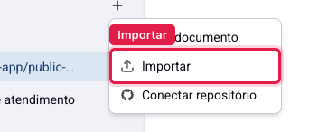
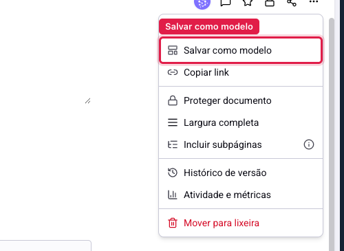
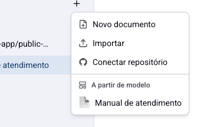

# Documentos - Importar arquivos e usar modelos

Nem todo documento começa do zero. Às vezes o conteúdo já existe num arquivo no seu computador; às vezes ele tem sempre a mesma estrutura, e o que muda é só o cliente.

Para o primeiro caso existe a importação. Para o segundo, os modelos.

## Como acessar

Os dois ficam no mesmo lugar: o botão **+** no topo da lista de documentos.

## Importar um arquivo

A opção **Importar** abre o seletor do seu computador. São aceitos quatro formatos:

**.md** e **.markdown**: o formato de texto com marcação simples, usado em documentação técnica. É o que importa melhor: títulos, listas, negrito e itálico viram blocos de verdade no editor.

**.html** e **.htm**: páginas da web salvas. A formatação é preservada quando o arquivo é simples.

**.txt**: texto puro. Cada linha vira um parágrafo, e nada mais, porque não há marcação para interpretar.

O documento nasce já com o conteúdo dentro, e o **título vem do nome do arquivo**, sem a extensão. "Manual de atendimento.md" vira a página "Manual de atendimento".

> **Atenção ao que não é aceito.** Arquivos do Word (.docx), PDF e planilhas não são importados por aqui. Para trazer um conteúdo desses, o caminho é copiar o texto da origem e colar no editor, ou salvá-lo antes como .html ou .txt.

> **Atenção à formatação de .txt.** Como o texto puro não tem títulos, o documento importado vem inteiro como parágrafos. Isso significa que ele não gera sumário lateral até você transformar as seções em cabeçalhos pelo menu de blocos.

A importação traz uma cópia: o arquivo original continua no seu computador e não fica ligado à página. Mudanças feitas no arquivo depois não aparecem no documento.

## Modelos

Modelo é um documento comum que você marcou como ponto de partida. A diferença é só essa: ele continua existindo, editável, no mesmo lugar.

### Marcar um documento como modelo

Abra o documento, clique nos três pontos e escolha **Salvar como modelo**.

A mesma opção serve para desfazer, e passa a se chamar **Remover de modelos**.

### Criar um documento a partir do modelo

Volte ao botão **+**. Agora existe a seção **A partir de modelo**, com os documentos marcados.

Clique em um e nasce um documento novo com o mesmo conteúdo, pronto para ser preenchido.

> **Atenção.** A seção **A partir de modelo** só aparece quando existe ao menos um documento marcado. Se ela sumiu do menu, é porque alguém removeu a marca do último modelo, e não porque o recurso deixou de existir.

## Modelo ou duplicar?

As duas opções criam uma cópia, e a escolha é de propósito.

**Duplicar** serve para uma cópia pontual: você vai mexer num documento e quer guardar o estado atual, ou precisa de uma variação para um caso específico. A cópia nasce ao lado da original, com o acesso dela.

**Modelo** serve para o que se repete: a ata de reunião, o roteiro de implantação, o relatório mensal. Ele fica no menu de criação, à vista de todo mundo, e sinaliza para a equipe "comece por aqui".

Na prática: se você vai usar uma vez, duplique. Se a equipe vai usar toda semana, faça um modelo.

## Como montar um bom modelo

Deixe no modelo a **estrutura**, não o exemplo. Cabeçalhos das seções, as perguntas a responder, a checklist a seguir. Texto de exemplo tende a ficar esquecido no documento final, e aí aparece um "nome do cliente aqui" num material entregue.

Vale também deixar uma linha no topo explicando para que serve aquele modelo e quando usá-lo. Quem vier depois não vai perguntar.

## Conclusão

Importar resolve o começo; modelo resolve a repetição. Se a sua equipe refaz o mesmo documento toda semana, o ganho de transformá-lo em modelo aparece já na segunda vez.

Antes de importar uma pilha de arquivos, converta-os para .md se puder. É o formato que chega inteiro, com títulos e listas preservados, e evita o retrabalho de reformatar tudo à mão.
