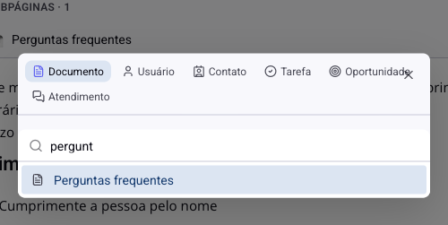
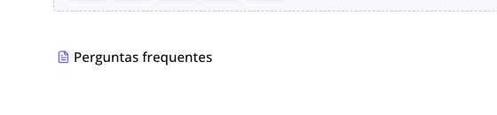

# Documentos - Mencionar pessoas e registros

Escrevendo um documento, você vai precisar apontar para alguma coisa: a pessoa responsável, o contato do cliente, a tarefa que trata daquilo, outro documento. Colar o link resolve mal, porque o leitor vê um endereço e não sabe para onde vai.

A menção resolve bem: você escolhe o registro, e ele entra no texto com nome, ícone e um clique que abre.

## Como acessar

No corpo do documento, digite **/** em uma linha vazia e escolha **Mencionar**. O atalho `@` também funciona no meio de uma frase.

## Os seis tipos

As abas no topo dizem o que você está procurando:

**Documento**: outra página do módulo. É a forma de ligar um procedimento ao manual que o explica, sem copiar conteúdo.

**Usuário**: uma pessoa da equipe.

**Contato**: um cliente ou lead do sistema.

**Tarefa**: uma tarefa de um quadro.

**Oportunidade**: uma negociação do CRM.

**Atendimento**: uma conversa do SAC.

Escolhida a aba, digite para filtrar e clique no resultado.

> **Atenção às duas abas que pedem um passo a mais.** **Tarefa** e **Oportunidade** existem dentro de um quadro ou de um funil, então o seletor pede primeiro qual deles, e só depois busca os registros. Se a busca parecer vazia, confira se o quadro escolhido é o certo: a palavra está sendo procurada só ali dentro.

## Como a menção fica no texto

Ela entra como um bloco único, com o ícone do tipo e o nome do registro, e abre ao ser clicada. Não é um texto que alguém editou: se o registro for renomeado, o documento continua apontando para ele.

Uma menção não quebra o parágrafo. Você escreve em volta normalmente, como faria com uma palavra qualquer.

## Mencionar uma pessoa é diferente

As outras menções são atalhos de leitura: elas ajudam quem está lendo a chegar ao registro. A menção a um **usuário** faz mais do que isso: a pessoa é **notificada** de que foi citada, com o link direto para o documento.

É a diferença entre escrever "o financeiro precisa conferir isso" e citar a pessoa do financeiro. No primeiro caso, alguém precisa ler o documento e repassar. No segundo, a pessoa é avisada.

Por isso, pense antes de citar um nome só para registrar quem fez. Toda citação vira um aviso para alguém.

## Menção e relação: parecidas, diferentes

O módulo tem dois jeitos de ligar um documento a um registro, e eles servem a coisas diferentes.

A **menção** está **dentro do texto**. Ela faz sentido naquele parágrafo: "siga o roteiro de [documento]", "o caso do [contato] é a exceção". Quem lê naquele ponto precisa daquilo.

A **relação**, no campo **Relações** do topo da página, vale para o **documento inteiro**. Ela diz "esta página é sobre este cliente", e por isso aparece dos dois lados: o documento mostra o registro, e o registro mostra o documento.

Na prática: use relação para dizer a que o documento pertence; use menção para apontar algo no meio de uma explicação. Um roteiro de implantação é **relacionado** ao contato do cliente, e **menciona** as tarefas de cada etapa.

## Conclusão

A menção é o que mantém o documento vivo em vez de virar um texto solto: cada ponta leva ao registro de verdade, atualizado, em vez de uma descrição que envelhece.

Use com moderação na citação de pessoas. Documento com muitos nomes citados vira uma enxurrada de notificações, e a equipe começa a ignorar os avisos, inclusive os que importam.
