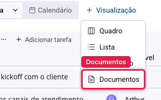
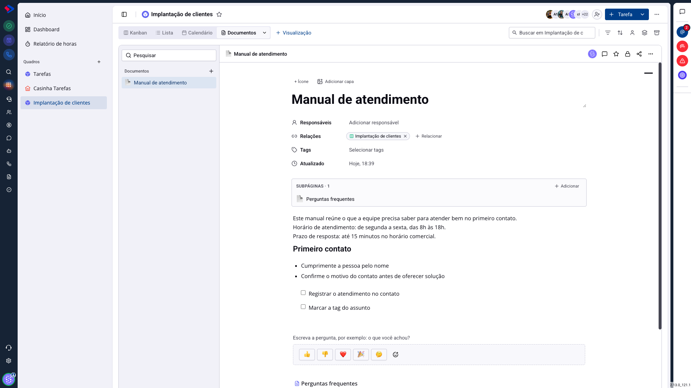

# Documentos - Ler e escrever sem sair da tela

Um documento raramente é lido por si. Ele é consultado no meio de outra coisa: durante um atendimento, com a tarefa aberta, enquanto se negocia uma oportunidade.

Por isso o módulo não vive só na própria tela. O documento pode ser aberto de dentro dos outros módulos, e é ali que ele costuma ser usado de verdade.

## No quadro de tarefas

É a forma mais completa: o quadro ganha uma visualização de documentos, ao lado de Kanban, Lista e Calendário.

### Como acessar

Abra o quadro, clique em **+ Visualização** e escolha **Documentos**.

A aba passa a existir no quadro, e fica salva: todo mundo que abrir aquele quadro a encontra.

### Como funciona

A tela divide em duas: a lista dos documentos ligados ao quadro, à esquerda, e o documento aberto, à direita, **editável ali mesmo**. Não é uma pré-visualização: você escreve, formata e comenta sem sair do quadro.

Dois botões montam essa lista:

**Novo documento** cria uma página já vinculada ao quadro.

**Vincular documento** traz uma página que já existe no módulo. Ela continua no lugar de origem, e passa a aparecer aqui também.

> **Atenção.** O documento vinculado **não** vira propriedade do quadro: é a mesma página, vista de outro lugar. Editar aqui altera o documento para todo mundo, inclusive para quem o abre pelo módulo Documentos. E o acesso continua sendo o da página: um colega com acesso ao quadro, mas sem acesso àquele documento, não o vê na lista.

Também aparecem ali os documentos ligados às **tarefas** daquele quadro, e não só os ligados ao quadro em si. É o que faz a aba virar o acervo do processo: o procedimento geral, mais o material de cada tarefa.

## Nas outras telas

Em um contato, uma oportunidade ou um atendimento, os documentos relacionados àquele registro aparecem num painel próprio, e abrem em uma gaveta lateral, sobre a tela em que você está.

A gaveta mostra o documento inteiro, com o título, as subpáginas e o conteúdo, e tem um botão para abrir em uma guia nova quando você precisar da tela cheia.

A vantagem é não perder o contexto: durante o atendimento, o roteiro fica à mão sem fechar a conversa.

## Como um documento chega a esses lugares

Pelo campo **Relações**, no topo da página, ou pelo botão de vincular dentro do próprio quadro. O vínculo vale dos dois lados: o documento mostra o registro, e o registro mostra o documento.

Vale conhecer a opção **Incluir subpáginas**, no menu de três pontos do documento. Com ela ligada, as páginas filhas acompanham a principal nos lugares em que ela aparece, e você relaciona uma vez em vez de uma por página.

## Qual caminho usar

**Para escrever**: o módulo Documentos. A tela cheia, a árvore de páginas e a busca estão todas lá.

**Para consultar durante o trabalho**: a gaveta no contato ou no atendimento. Ela existe para você não interromper o que estava fazendo.

**Para o material de um processo**: a visualização de documentos no quadro. É onde o procedimento fica junto das tarefas que ele descreve, e onde a equipe vai procurar.

## Conclusão

Documento que vive só no módulo de documentos é documento que ninguém abre na hora certa. O trabalho que faz diferença é o de relacioná-lo ao lugar onde ele será preciso: o quadro da equipe, o contato do cliente, o funil da negociação.

Se a sua equipe reclama que "ninguém lê a documentação", comece por aí antes de reescrever o texto.
