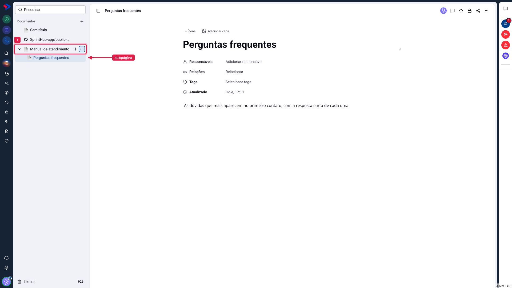
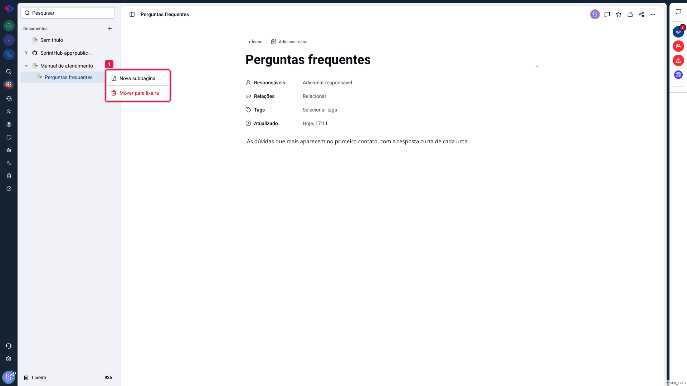
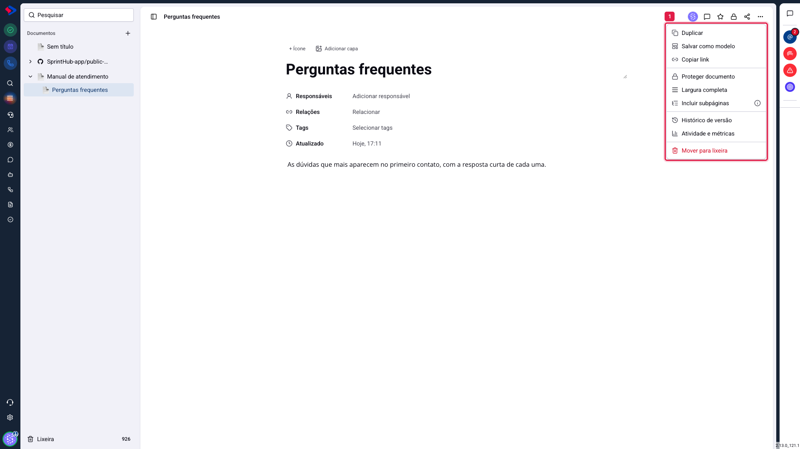
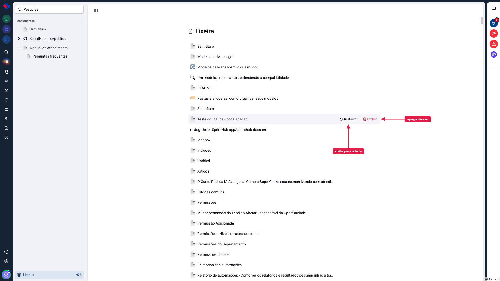

# Documentos - Como organizar: subpáginas, menus e lixeira

Depois do décimo documento, a lista deixa de se resolver sozinha. O módulo oferece três ferramentas para isso: subpáginas, que criam hierarquia; o menu de opções, que cuida de cada documento; e a lixeira, que separa o que saiu de circulação do que foi apagado para sempre.

## Como acessar

Tudo fica na lista à esquerda, em **Documentos**, e no menu de opções no canto superior direito do documento aberto.

## Subpáginas: documento dentro de documento

Qualquer documento pode ter páginas filhas. Elas aparecem recuadas na lista, e a seta ao lado do nome do pai abre e fecha o grupo.

Para criar uma, passe o mouse sobre o documento na lista e clique em **Nova subpágina**, ou use o menu de três pontos daquela linha.

A hierarquia serve para duas coisas. A primeira é óbvia: agrupar o que é do mesmo assunto, como um manual com um capítulo por tela. A segunda é menos: **o que acontece com o pai acontece com os filhos**. Mandar o pai para a lixeira leva as subpáginas junto, e o mesmo vale para a restauração.

> **Atenção.** Não existe limite de níveis, mas a lista fica difícil de ler a partir do terceiro. Se você sentir necessidade de um quarto nível, provavelmente são dois documentos diferentes, e não um com muitos degraus.

## O menu de opções do documento

Com o documento aberto, o botão de três pontos no canto superior direito traz tudo que se pode fazer com aquela página.

**Duplicar**: cria uma cópia com o mesmo conteúdo, ícone, capa, responsáveis, tags, relações **e as mesmas regras de acesso** do original. O que a cópia não leva: o link público (ela nasce privada, com endereço próprio), a proteção, o favorito e o vínculo com repositório.

**Salvar como modelo**: guarda a estrutura da página para servir de ponto de partida de outras. Útil para documentos que se repetem, como ata de reunião ou roteiro de treinamento.

**Copiar link**: copia o endereço interno, aquele que abre o documento para quem tem acesso e está logado. Não é o link público.

**Proteger documento**: tranca o conteúdo. Com a proteção ligada, o texto entra em modo somente leitura para todo mundo, e nem quem tem permissão de editar consegue alterar sem destravar antes. Serve para um material já aprovado que não pode mudar por engano.

**Largura completa**: faz o texto ocupar toda a largura da tela, em vez da coluna central. Ajuda em documentos com tabelas largas.

**Incluir subpáginas**: quando esta página está relacionada a um contato, uma oportunidade, um quadro ou um funil, as subpáginas dela passam a aparecer junto. Assim você relaciona só a página principal e o resto vai atrás.

**Histórico de versão** e **Atividade e métricas**: têm artigo próprio.

**Mover para lixeira**: tira o documento de circulação.

## A lixeira

A lixeira fica no rodapé da lista, com a contagem do que está lá dentro. Ela é um estágio intermediário: o documento sai da lista, perde o link público, mas continua existindo.

Passe o mouse sobre uma linha e aparecem as duas ações:

**Restaurar** devolve o documento à lista, no lugar onde ele estava, com as subpáginas, os comentários e o acesso que tinha.

**Excluir** apaga de vez. Essa ação não tem volta.

> **Atenção ao link público.** Mandar para a lixeira derruba o link público daquele documento na hora. Quem tiver o endereço vai receber uma página de erro, não o conteúdo. Se você restaurar depois, o link volta a funcionar com o mesmo endereço.

> **Atenção ao excluir em cascata.** Excluir um documento que tem subpáginas apaga as subpáginas também. A lista da lixeira mostra cada página separadamente, mas a exclusão segue a hierarquia.

## Conclusão

Para quem está montando a organização agora, o caminho mais simples é um documento por assunto grande e subpáginas para os capítulos. Evite criar dez documentos soltos na raiz: a lista cresce, e a busca passa a ser a única forma de achar qualquer coisa.

E vale lembrar da diferença entre as duas saídas: a lixeira guarda, a exclusão apaga. Quando a dúvida for "será que alguém ainda usa isso?", mande para a lixeira e espere. Ela não tem prazo de validade.
