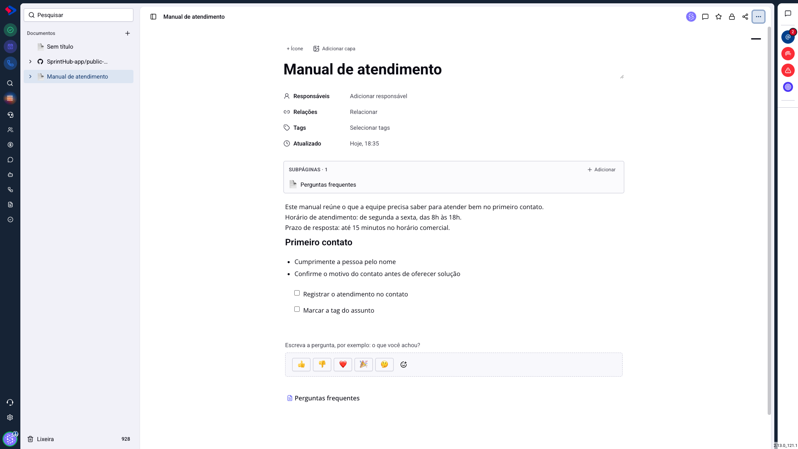
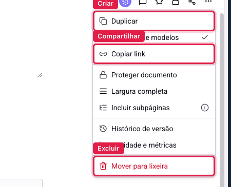

# Documentos - O que cada pessoa pode fazer

O módulo tem dois controles diferentes, e confundi-los é a causa da maior parte dos chamados sobre documentos.

**As permissões do sistema** dizem o que o seu perfil pode fazer no módulo inteiro: criar, editar, excluir, compartilhar, comentar, exportar, conectar repositório.

**O acesso do documento** diz quem enxerga e quem mexe em uma página específica.

O primeiro é configurado uma vez, por perfil, por um administrador. O segundo é configurado documento a documento, e só quando você precisa restringir algum.

## Como acessar

As **permissões do sistema** ficam em **Menu >> Configurações >> Usuários**, no grupo de permissões de cada perfil. Quem configura é um administrador.

O **acesso do documento** fica dentro da própria página, no cadeado do canto superior direito, e tem artigo próprio.

## As permissões do módulo

**Visualizar documentos** é a que abre a porta. Sem ela, o item nem aparece no menu.

**Criar documentos** libera o botão de nova página, a importação e a criação a partir de modelo.

**Editar documentos** libera escrever no texto, mudar título, ícone, capa, responsáveis, relações e tags.

**Excluir documentos** libera mandar para a lixeira e apagar de vez.

**Compartilhar documentos** libera gerar o link público e copiar o link interno.

**Comentar em documentos** libera escrever comentários e responder. Quem tem permissão de editar comenta por consequência: não faz sentido deixar alguém reescrever o texto e proibir que ele deixe uma observação ao lado.

**Exportar documentos** libera baixar o conteúdo.

**Conectar repositório** e **Desconectar repositório** controlam a ligação com o GitHub, que é um recurso à parte do dia a dia de escrita. São separadas de propósito: conectar traz conteúdo novo para dentro da central, desconectar tira, e nem todo mundo que conecta deve poder desligar.

## Onde isso aparece na tela

O sistema esconde o que você não pode fazer, em vez de deixar o botão falhar no clique. É por isso que dois colegas abrem o mesmo documento e veem menus diferentes.

Então, quando alguém diz "não tenho a opção de excluir", quase nunca é bug: é permissão.

## A regra que mais confunde

> **Atenção.** O acesso do documento **restringe**, nunca **concede**. Colocar uma pessoa na lista de acesso de uma página não dá a ela a permissão de editar documentos; apenas garante que, entre quem já pode editar, ela é uma das que enxergam aquela página.

Na prática, para alguém editar um documento precisam valer as duas coisas ao mesmo tempo: a permissão de editar, no perfil, e o acesso àquele documento. Faltando uma, não edita.

É o mesmo raciocínio para ver, comentar e compartilhar.

## Administradores

Administradores passam por cima dos dois controles: têm todas as permissões e enxergam todos os documentos, inclusive os restritos. Isso é proposital, para que uma página importante não fique inacessível quando a pessoa que a criou sai da empresa.

Vale lembrar disso antes de usar um documento para guardar algo realmente sensível: restringir o acesso não esconde a página de quem administra o sistema.

## O que fazer quando falta uma opção

**O botão não existe na tela**: o seu perfil não tem aquela permissão. Quem resolve é um administrador, em Configurações.

**O botão existe mas o documento não aparece na lista**: é o acesso daquela página. Quem resolve é quem administra o documento, pelo cadeado.

**Tudo some, inclusive o menu Documentos**: falta a permissão de visualizar, que é a base de todas as outras.

## Conclusão

Ao montar os perfis da equipe, a divisão que funciona na maioria das operações é dar visualizar e comentar para todo mundo, criar e editar para quem produz conteúdo, e excluir, compartilhar e conectar repositório para poucas pessoas.

E guarde a regra de ouro: permissão é o que você **pode** fazer; acesso é **onde** você pode fazer. Quando algo não funciona, a pergunta é qual das duas está faltando.
