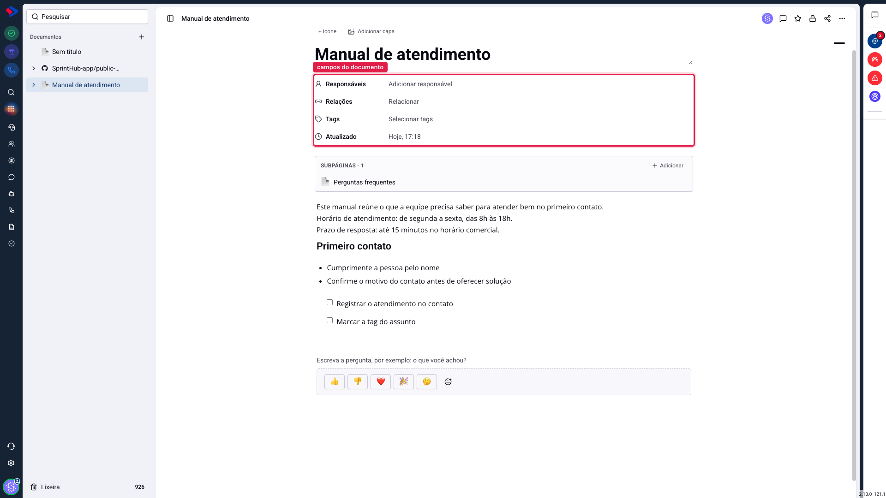
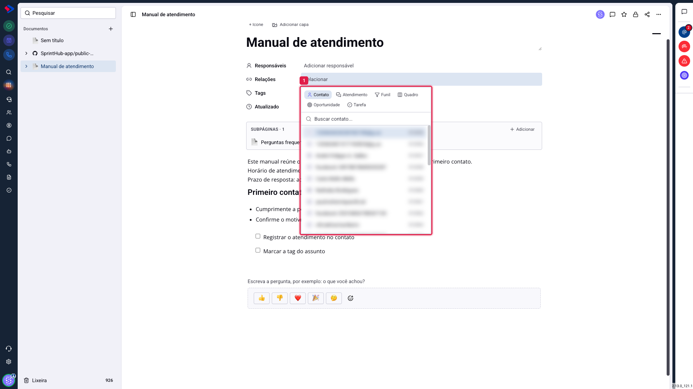
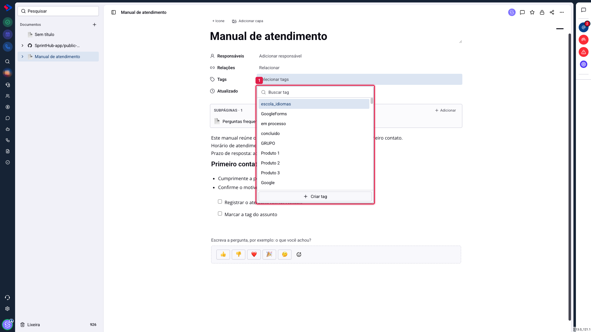

# Documentos - Responsáveis, relações e tags

Logo abaixo do título ficam quatro campos. Eles parecem decoração e não são: respondem quem cuida daquele conteúdo, a que registro ele pertence e como encontrá-lo depois.

## Como acessar

Os campos ficam sempre visíveis no topo do documento aberto. Clique no valor ao lado do nome do campo para editá-lo.

## Responsáveis

Diz quem responde pelo conteúdo. É a pessoa que a equipe procura quando o documento está desatualizado.

Tem um efeito prático importante: **quem é responsável sempre vê e edita o documento**, mesmo que o acesso esteja restrito a outras pessoas e ela não esteja na lista. Faz sentido, porque quem responde por um material não pode ficar trancado do lado de fora dele.

## Relações

Liga o documento a um registro do sistema. Ao clicar em **Relacionar**, você escolhe o tipo e busca o registro.

Os tipos são: **Contato**, **Atendimento**, **Funil**, **Quadro**, **Oportunidade** e **Tarefa**.

O vínculo vale dos dois lados: o documento passa a mostrar aquele registro, e o registro passa a mostrar o documento. Na prática:

- o roteiro de implantação de um cliente, ligado ao **contato** dele, aparece para quem abrir o cadastro;
- o escopo acordado, ligado à **oportunidade**, fica junto da negociação;
- o procedimento de uma equipe, ligado ao **quadro** de tarefas dela, fica a um clique de quem está trabalhando.

> **Dica.** Quando um documento tem subpáginas e você o relaciona a um registro, vale ligar a opção "Incluir subpáginas", no menu de três pontos. Assim as páginas filhas acompanham a principal nos lugares em que ela aparece, e você relaciona uma vez só.

## Tags

As tags são as mesmas etiquetas que você já usa nos contatos: a lista é compartilhada, e criar uma tag aqui a torna disponível no resto do sistema.

Elas servem para agrupar documentos por assunto, por área ou por situação, independentemente de onde o documento está na árvore. Um documento pode ter várias.

> **Atenção.** As tags são compartilhadas com os contatos e com o restante do sistema. Antes de criar uma tag nova para organizar documentos, confira se não existe uma equivalente, para não acabar com "treinamento", "Treinamentos" e "treino" convivendo.

## Atualizado

Mostra a data e a hora da última alteração no conteúdo. Não é editável: serve para você saber, de relance, se aquele material ainda está em uso.

## Conclusão

Dos quatro campos, o que mais muda o dia a dia é **Relações**: é o que tira o documento do módulo e o coloca onde o trabalho acontece, no contato, na oportunidade, no quadro.

Responsáveis vale a pena em qualquer material que precise ser mantido, nem que seja para ter a quem perguntar daqui a seis meses. E as tags só ajudam se forem poucas e consistentes: uma tag por assunto grande resolve mais do que vinte tags específicas.
