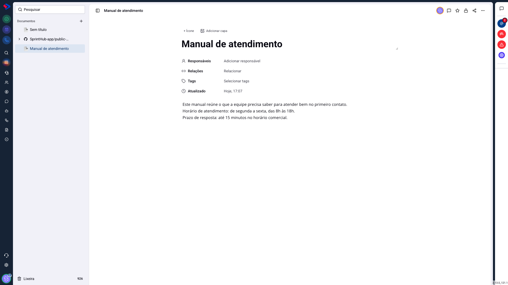
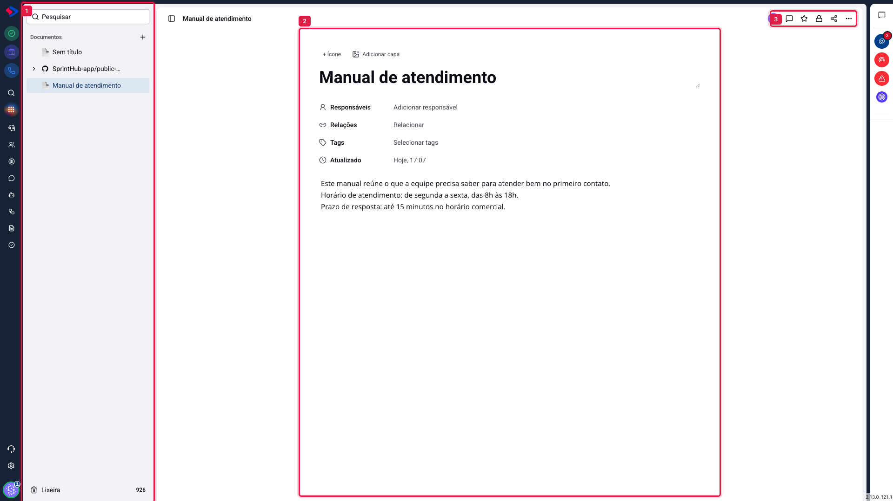
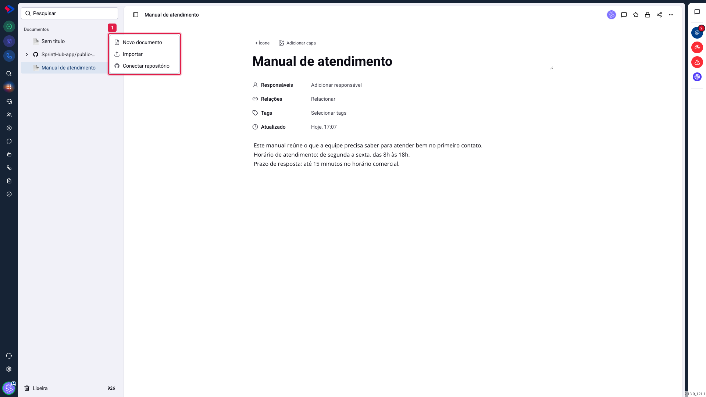

# Documentos - Visão geral do módulo

O módulo de Documentos é onde a sua empresa escreve o que precisa ficar registrado: manual de atendimento, política de desconto, passo a passo de uma rotina, roteiro de treinamento. É um editor de páginas, com uma lista de documentos à esquerda e o texto no meio da tela.

A diferença para um editor de texto comum está em três coisas. O conteúdo fica dentro do SprintHub, junto dos contatos, oportunidades e atendimentos, e pode ser ligado a eles. Cada documento tem controle de quem vê e quem edita. E, quando você quiser, um documento vira uma página pública, com endereço próprio, para quem não tem acesso ao sistema.

## Como acessar

No menu lateral, clique no ícone de **Documentos**. Você também pode abrir direto pelo endereço `/sh/documents`.

## As três partes da tela

**1. A lista de documentos.** Fica à esquerda e mostra tudo que você pode ver. Os documentos ficam em árvore: um documento pode ter subpáginas dentro dele, e a seta ao lado do nome abre e fecha. No alto há a busca, e no rodapé a Lixeira.

**2. O documento.** Ocupa o meio da tela e é a área de escrita. O título fica no topo, seguido dos campos do documento (responsáveis, relações, tags e a data da última alteração) e, abaixo, o conteúdo.

**3. As ações do documento.** No canto superior direito ficam os comentários, o favorito, o controle de acesso, o compartilhamento e o menu de opções.

## Como criar um documento

Clique no **+** ao lado da palavra "Documentos", no topo da lista. O menu abre com três caminhos.

**Novo documento**: cria uma página em branco, pronta para escrever. É o caminho do dia a dia.

**Importar**: traz um arquivo que você já tem. O módulo aceita arquivos `.md`, `.markdown`, `.txt`, `.html` e `.htm`. O conteúdo vira um documento normal, que você edita como qualquer outro.

**Conectar repositório**: liga um repositório do GitHub e lê os arquivos de documentação que já existem lá. Esse caminho tem artigo próprio, porque muda a forma de trabalhar: o conteúdo continua sendo escrito no GitHub, e aqui ele é só lido.

## O que cada documento guarda

Além do texto, todo documento tem:

**Título**: o nome que aparece na lista e no topo. Enquanto você não escrever um, ele aparece como "Sem título".

**Ícone e capa**: dois enfeites que ajudam a reconhecer o documento na lista. O ícone fica ao lado do nome; a capa é a faixa de imagem no alto da página.

**Responsáveis**: quem responde por aquele conteúdo. Quem é responsável sempre enxerga e edita o documento, mesmo que o acesso esteja restrito a outras pessoas.

**Relações**: o vínculo com um contato, uma oportunidade, um atendimento ou outro documento. É o que faz o manual de um cliente aparecer junto do registro dele.

**Tags**: as mesmas etiquetas que você já usa nos contatos, para agrupar documentos por assunto.

**Atualizado**: a data e a hora da última alteração.

## O conteúdo salva sozinho

Não existe botão de salvar. O que você escreve é gravado automaticamente, poucos instantes depois de parar de digitar, e a data em "Atualizado" acompanha.

> **Atenção ao fechar a aba logo após escrever.** O salvamento acontece em segundo plano. Se você fechar a janela no exato momento em que terminou de digitar, o sistema ainda guarda o texto, mas vale conferir o documento ao reabrir quando a conexão estiver instável.

## Quem enxerga o que você cria

Um documento novo nasce **aberto**: quem tem permissão de ver documentos no SprintHub vê este também, e quem tem permissão de editar pode editá-lo. Não é um documento particular.

Para restringir, use o controle de acesso (o cadeado, no canto superior direito) e escolha quem entra e com qual papel. Isso tem artigo próprio.

> **Atenção.** Escrever um documento sem mexer no acesso significa deixá-lo visível para a equipe. Se o conteúdo for sensível (dados de contrato, informação de pessoal, senha de sistema), ajuste o acesso antes de escrever, e não depois.

## Conclusão

O módulo de Documentos resolve três necessidades que antes ficavam espalhadas: escrever um material interno, controlar quem lê, e publicar um conteúdo para fora quando for o caso.

Para a maioria das equipes, o começo é simples: crie um documento, escreva, e deixe o acesso como está. Quando o material crescer, use subpáginas para organizar, tags para agrupar e o controle de acesso para separar o que é da equipe do que é da empresa inteira.
