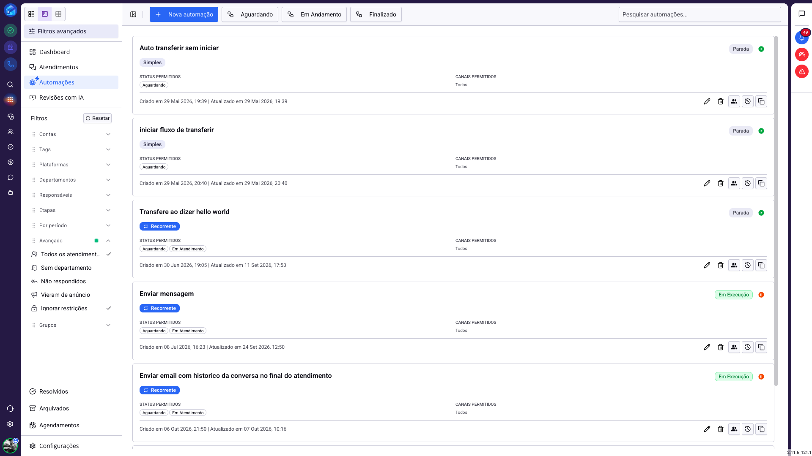
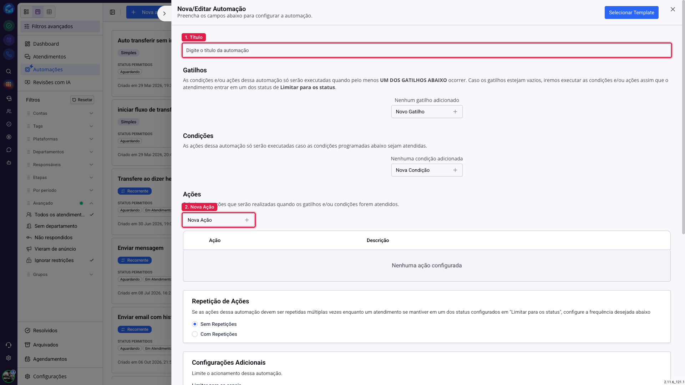
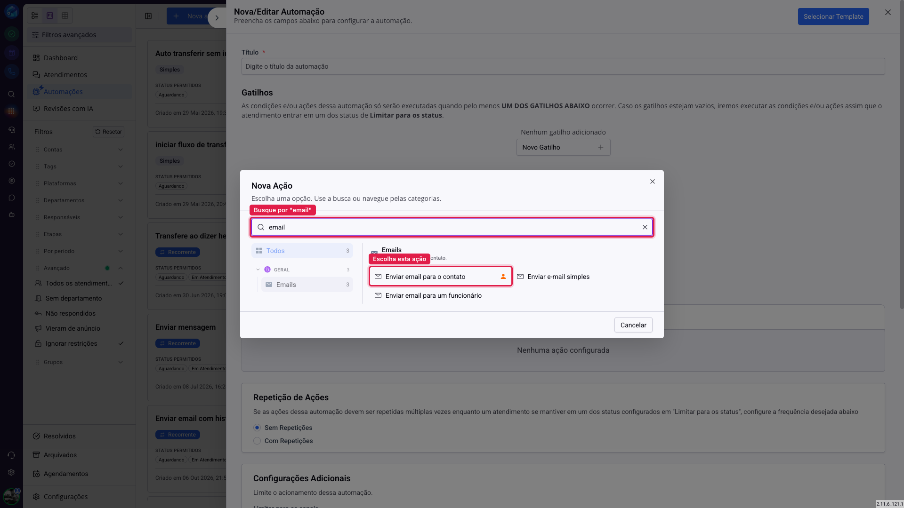
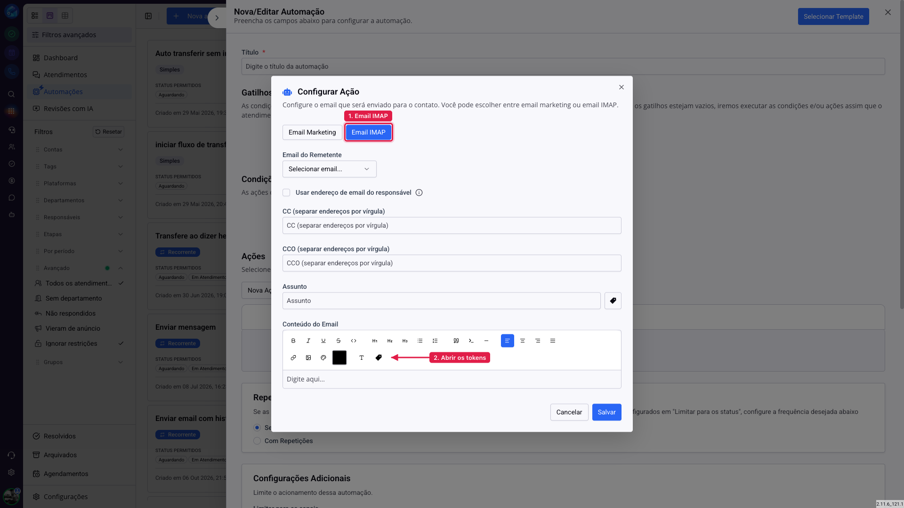
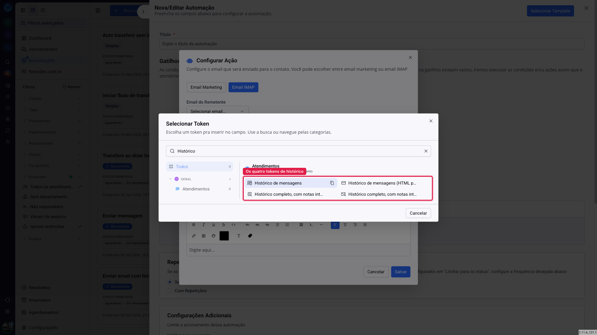
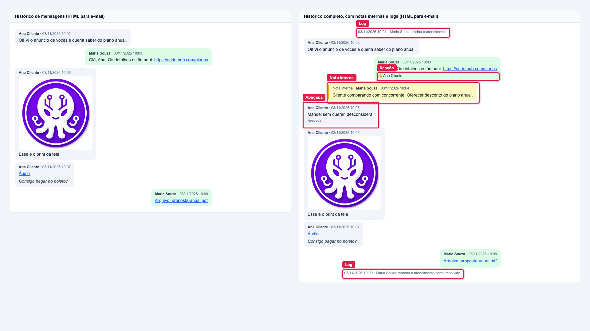
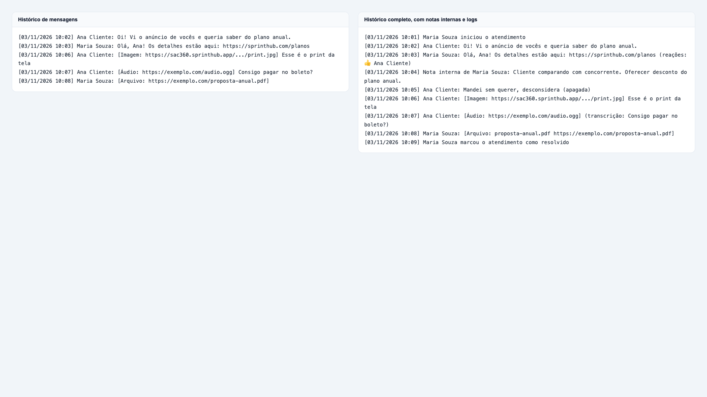
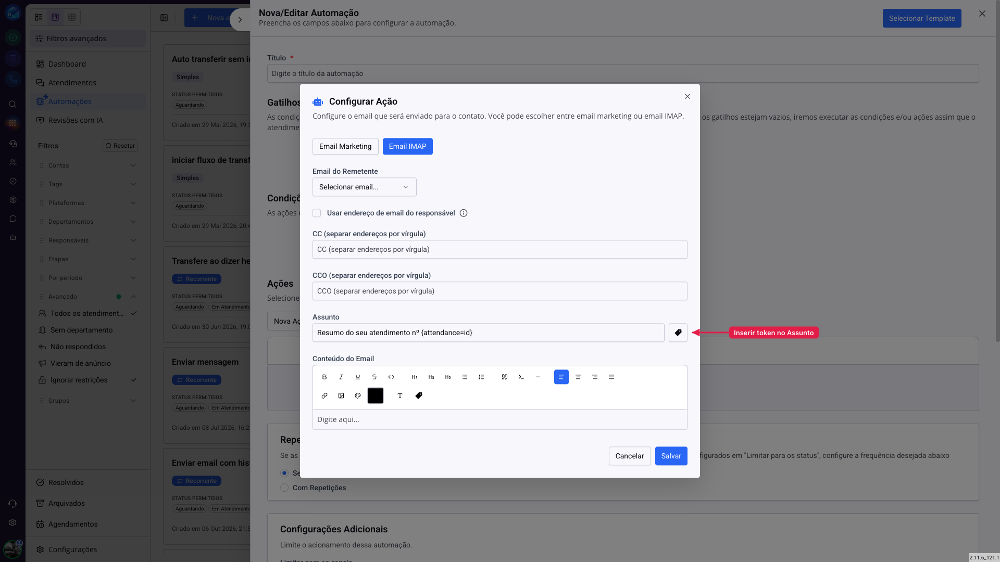

# SAC - Como enviar o histórico da conversa com tokens

Quando um atendimento termina, muitas vezes a conversa precisa ir para outro lugar: um e-mail para o cliente com o resumo do que foi combinado, uma cópia para o gestor, uma anotação no CRM ou um sistema externo que recebe tudo por webhook. Para isso existem os **tokens de histórico**. Você coloca o token no texto de uma ação e, quando ela é executada, o token vira a conversa do atendimento.

São quatro tokens, e a escolha entre eles responde a duas perguntas: **o que entra na conversa** e **onde ela vai aparecer**.

## Como acessar

Os tokens ficam no seletor de tokens, na categoria **Atendimentos**. O caminho mais comum é numa automação do SAC:

`SAC >> Automações >> Nova automação >> Ações >> Nova Ação >> Enviar email para o contato`

Passo a passo:

**1. Abra as automações do SAC.** No menu do SAC, clique em **Automações**. A tela lista as automações que já existem. Clique em **Nova automação**, no topo.



**2. Dê um título e adicione uma ação.** A automação abre num painel lateral. Preencha o **Título** e, na seção **Ações**, clique em **Nova Ação**.



**3. Escolha a ação de e-mail.** Na janela de ações, digite "email" na busca e escolha **Enviar email para o contato**.



**4. Escolha Email IMAP e abra os tokens.** Na configuração da ação, clique em **Email IMAP**. Depois, na barra de ferramentas do **Conteúdo do Email**, clique no ícone de etiqueta.



**5. Escolha o token de histórico.** Digite "Histórico" na busca do seletor para ver só os quatro. Os nomes mais longos aparecem cortados no seletor; para diferenciar, as duas versões em HTML para e-mail têm um ícone de envelope. Ao clicar num token, ele é inserido no conteúdo do e-mail.



## Quais são os tokens?

| No seletor | Token | O que entra | Formato |
|---|---|---|---|
| Histórico de mensagens | `{attendance=messages}` | Só a conversa com o contato | Texto |
| Histórico de mensagens (HTML para e-mail) | `{attendance=messagesHtml}` | Só a conversa com o contato | E-mail |
| Histórico completo, com notas internas e logs | `{attendance=fullMessages}` | Tudo o que aconteceu no atendimento | Texto |
| Histórico completo, com notas internas e logs (HTML para e-mail) | `{attendance=fullMessagesHtml}` | Tudo o que aconteceu no atendimento | E-mail |

## O que muda entre o histórico de mensagens e o histórico completo?

O **histórico de mensagens** traz o que o contato e a equipe trocaram: textos, imagens, áudios e arquivos. Ficam de fora as notas internas, os registros do sistema (início, transferência, resolução), as reações e as mensagens apagadas. É a conversa como o contato a viu, e por isso é a versão certa para mandar ao próprio contato.

O **histórico completo** traz o atendimento inteiro, sem filtro:

- **Notas internas** que a equipe escreveu no atendimento, identificadas com o nome de quem escreveu.
- **Registros do sistema**, com a mesma frase que aparece no chat: "Maria Souza iniciou o atendimento", "transferiu o atendimento de Maria Souza para João Lima", "marcou o atendimento como resolvido".
- **Mensagens apagadas**, com o texto original e a marcação de apagada.
- **Mensagens editadas**, com o texto final e a marcação de editada.
- **Reações** e **respostas a outra mensagem**, junto da mensagem a que se referem.
- **Todos os anexos** de cada mensagem, com o nome do arquivo.

O histórico completo é o registro do atendimento. Ele serve para auditoria, para o gestor entender o que aconteceu, para guardar no CRM ou para alimentar outro sistema.

Na comparação abaixo, a mesma conversa aparece nas duas versões. Os itens marcados são os que só o histórico completo traz.



> **Atenção às notas internas.** O histórico completo leva para fora do SAC tudo o que a equipe anotou, inclusive comentários que nunca seriam ditos ao cliente, como "cliente comparando com concorrente". Se o e-mail ou o webhook vai para o contato, use o histórico de mensagens.

## O que muda entre texto e HTML?

As versões em **texto** escrevem uma linha por mensagem, com a data, o autor e o conteúdo:

```
[03/11/2026 10:02] Ana Cliente: Oi! Vi o anúncio de vocês e queria saber do plano anual.
[03/11/2026 10:03] Maria Souza: Olá, Ana! Os detalhes estão aqui: https://sprinthub.com/planos
[03/11/2026 10:06] Ana Cliente: [Imagem: https://...] Esse é o print da tela
```

Imagens, áudios e arquivos aparecem entre colchetes, com o link. Use a versão em texto quando o destino não entende HTML: mensagem de WhatsApp, webhook, anotação, campo do CRM, instrução para um agente de IA.



As versões em **HTML para e-mail** desenham a conversa em balões, como no chat: o contato à esquerda, a equipe à direita. Os links ficam clicáveis, a imagem aparece em miniatura e abre no tamanho original com um clique, e áudios e arquivos viram links. No histórico completo, as notas internas aparecem num balão amarelo e os registros do sistema numa linha cinza no centro (veja a comparação da seção anterior). Use a versão HTML no corpo de um e-mail.

> **Dica.** Se você colocar um token de texto no corpo de um e-mail, ele também funciona: as linhas são separadas corretamente. A diferença é só visual. A versão HTML fica com cara de conversa, e a de texto fica como uma lista de linhas.

> **Atenção.** Não use as versões HTML fora do e-mail. Numa mensagem de WhatsApp ou num webhook, o contato ou o sistema recebe o código HTML em vez da conversa.

## Como enviar a conversa por e-mail quando o atendimento termina?

1. Em `SAC >> Automações`, clique em **Nova automação** e dê um título.
2. Configure o gatilho e as condições para o momento em que a automação deve rodar. Por exemplo, quando o atendimento for resolvido.
3. Em **Ações**, clique em **Nova Ação** e escolha **Enviar email para o contato**.
4. Escolha **Email IMAP** e preencha os campos:
   - **Email do Remetente**: a caixa de e-mail que vai enviar a mensagem.
   - **CC** e **CCO**: endereços que recebem uma cópia, separados por vírgula. Útil para mandar a conversa também para o gestor.
   - **Assunto**: o assunto do e-mail. O ícone de etiqueta ao lado do campo insere um token no fim do texto. Por exemplo, "Resumo do seu atendimento nº " seguido do token **Número** do atendimento.
   - **Conteúdo do Email**: escreva a mensagem e, na linha em que a conversa deve aparecer, insira o token de histórico pelo ícone de etiqueta.
5. Salve a ação e a automação.



> **Atenção ao Assunto.** O seletor do Assunto mostra todos os tokens, inclusive os de histórico. Não coloque o histórico no Assunto: a conversa inteira viraria o título do e-mail. No Assunto, use tokens curtos, como o número do atendimento ou o nome do contato.

## Comportamentos que valem saber

**O token só é trocado quando a ação sabe de qual atendimento se trata.** Numa automação do SAC isso acontece sozinho. Num lugar sem atendimento ligado, o token não é trocado e chega no texto do jeito que foi escrito, como `{attendance=messages}`. Antes de usar o token em outra tela, teste com um envio para você mesmo.

**Texto alternativo para quando não há conversa.** Você pode escrever um texto depois de uma barra vertical, dentro do token: `{attendance=messages|Sem mensagens neste atendimento}`. Ele aparece quando o atendimento existe, mas não tem nada para mostrar.

**Canais.**
- O histórico de mensagens funciona em WhatsApp (oficial e não oficial), Instagram, Facebook, chat ao vivo e na extensão de WhatsApp. Em atendimentos de e-mail, de comentários e do Mercado Livre ele fica vazio, e aparece o texto alternativo.
- O histórico completo funciona em todos os canais, inclusive e-mail, comentários e Mercado Livre. Também inclui os e-mails enviados de dentro de um atendimento de outro canal.

**Quantidade de mensagens.** O histórico de mensagens traz até as 1.000 mensagens mais recentes do atendimento. O histórico completo não tem limite.

> **Atenção a conversas longas por e-mail.** O Gmail corta e-mails muito grandes e mostra "Mensagem cortada", com um link para ver o resto. Numa conversa com algumas centenas de mensagens, principalmente no histórico completo, o e-mail pode chegar cortado. O conteúdo não se perde, mas fica atrás de um clique.

**Áudios.** O áudio aparece como link. A transcrição só aparece se ela já tiver sido feita antes no sistema; o token nunca transcreve por conta própria.

**Links de anexos.** Quando um arquivo não tem um link que abra fora do SAC, o histórico mostra só o tipo, como "[Imagem]", sem link. Isso pode acontecer com arquivos antigos do WhatsApp não oficial.

**Nomes e datas.**
- As mensagens da equipe aparecem com o nome que o atendente usa no atendimento, quando ele tiver um configurado. Se não tiver, aparecem com o nome e o sobrenome do cadastro.
- Mensagens enviadas por fora do sistema, como pelo celular ou pelo aplicativo da Meta, aparecem como "Enviado externamente".
- As datas seguem o fuso horário configurado na conta.

**Modelos de mensagem do WhatsApp oficial.** Os tokens de histórico também aparecem no seletor da criação de modelos, mas não use: a Meta não aceita quebra de linha nas variáveis do modelo, e o envio falha.

## Qual token escolher?

Comece pela pergunta **"quem vai ler?"**.

- Se é o **contato**, use o **histórico de mensagens**. Ele mostra a conversa que o contato já conhece, sem expor as anotações da equipe.
- Se é a **equipe**, o **gestor** ou **outro sistema**, use o **histórico completo**. Ele guarda o registro inteiro do atendimento: quem atendeu, quando transferiu, o que foi anotado e o que foi apagado.

Depois, pergunte **"onde vai aparecer?"**.

- **Corpo de e-mail**: versão HTML.
- **Qualquer outro lugar** (WhatsApp, webhook, anotação, campo do CRM, agente de IA): versão em texto.

Um uso comum é combinar os dois numa mesma automação: um e-mail para o contato com o histórico de mensagens em HTML e outro, para o gestor, com o histórico completo.
