# Quiz - Como salvar as respostas em objetos customizados

O quiz já sabia guardar as respostas no contato: nome, e-mail, telefone e os campos que você criou para ele. Mas muita informação não cabe bem no contato. Um tutor pode ter três pets, um cliente pode ter dois carros, um paciente pode ter vários exames. Para isso existem os objetos customizados, e agora o quiz consegue criar e atualizar esses objetos com as respostas de quem responde.

Este artigo explica como configurar isso, qual a diferença entre criar e atualizar um objeto, e o que acontece com o contato em cada caso.

## O que é salvar respostas em um objeto customizado?

Um objeto customizado é um cadastro que você monta do seu jeito e liga ao contato: Pet, Carro, Imóvel, Contrato. Cada objeto tem os próprios campos (no Pet, por exemplo: Nome, Nascimento, Raça e Cor) e aparece numa aba própria na ficha do contato.

Quando você configura um objeto no quiz, as respostas escolhidas viram os campos desse objeto, e ele fica vinculado ao contato que respondeu. Exemplos de uso:

- Um pet shop pergunta o nome e a raça do pet e cria um objeto **Pet** para cada tutor que responde.
- Uma concessionária pergunta modelo, ano e placa e cria um objeto **Carro** ligado ao cliente.
- Uma clínica faz um quiz de retorno e **atualiza** o objeto **Paciente** que o contato já tem, só com as respostas novas.

## Como acessar

`Menu de serviços (ícone de grade na barra lateral) >> Converter >> Quiz`

Abra o quiz que você quer configurar. A configuração fica na aba **Flow**, dentro do bloco **Envio de Dados**.

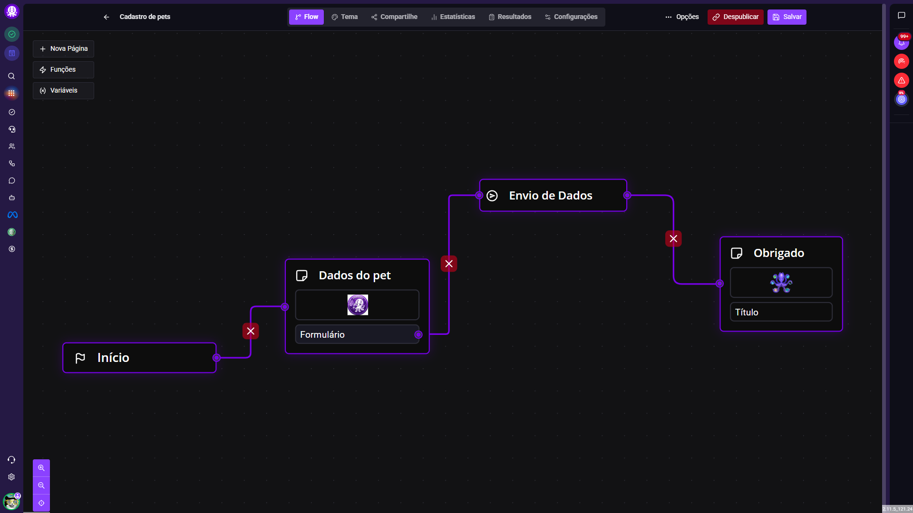

## Onde fica a configuração?

Os objetos customizados são configurados no bloco **Envio de Dados**, o mesmo que já salvava as respostas no contato. Se o seu quiz ainda não tem esse bloco, adicione um pelo botão **Funções**, no canto superior esquerdo, e ligue o bloco depois das páginas com as perguntas.

Clique no bloco para selecioná-lo. Uma barra aparece em cima dele: o primeiro botão abre as configurações do bloco.

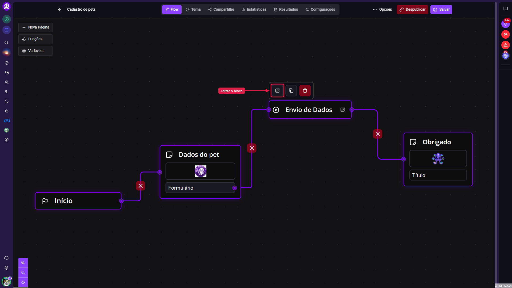

> **Atenção ao lápis ao lado do nome do bloco.** Ele só renomeia o bloco. Para chegar nas configurações, use o botão de editar da barra que aparece em cima do bloco selecionado.

## O que vai para o contato e o que vai para o objeto?

O bloco tem duas configurações que funcionam de forma independente. Entender isso evita a maior parte das dúvidas.

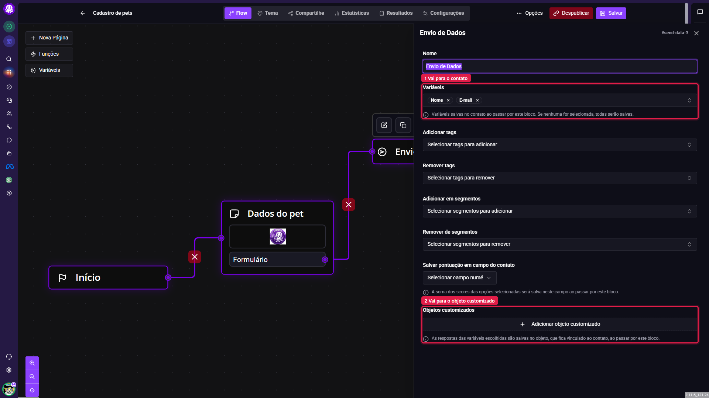

**Variáveis**: define quais respostas são salvas **no contato** quando o visitante passa pelo bloco. Se a lista ficar vazia, todas as respostas que estão ligadas a um campo do contato são salvas.

**Objetos customizados**: define quais respostas vão **para o objeto**. Cada objeto recebe as variáveis que você ligou aos campos dele, mesmo que elas não estejam na lista **Variáveis**.

Na prática, você pode deixar em **Variáveis** só o nome e o e-mail, que identificam o contato, e mandar as respostas sobre o pet direto para o objeto. As respostas do pet não aparecem nos campos do contato.

## Como configurar um objeto no bloco?

Role o painel até a seção **Objetos customizados** e clique em **Adicionar objeto customizado**. Um quadro novo aparece, com três partes.

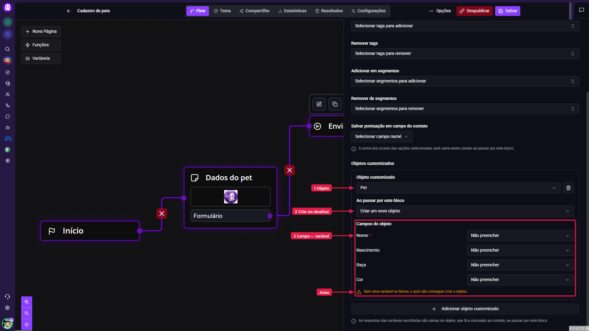

**Objeto customizado**: escolha qual tipo de objeto o quiz vai gravar. Só aparecem os objetos que podem ser ligados direto a um contato. Objetos que pertencem a outro objeto, como o Motorista de um Carro, ficam de fora da lista.

**Ao passar por este bloco**: escolha se o quiz cria um objeto novo ou atualiza o que o contato já tem. A diferença entre os dois está na próxima seção.

**Campos do objeto**: para cada campo, escolha qual variável do quiz vai preenchê-lo. Os campos que você deixar em **Não preencher** ficam em branco no objeto. O **Nome** tem um asterisco porque todo objeto precisa de um nome.

O ícone de lixeira, ao lado do objeto escolhido, remove o quadro inteiro. Para gravar mais de um objeto no mesmo bloco, clique de novo em **Adicionar objeto customizado**. Cada quadro é independente: você pode, por exemplo, criar um Pet e atualizar um Plano no mesmo envio.

> **Atenção ao aviso do Nome.** Enquanto o campo **Nome** estiver sem variável, aparece o aviso "Sem uma variável no Nome, o quiz não consegue criar o objeto". O quiz salva a configuração mesmo assim, mas o objeto não é criado quando alguém responde.

## Criar um novo objeto ou atualizar o vinculado?

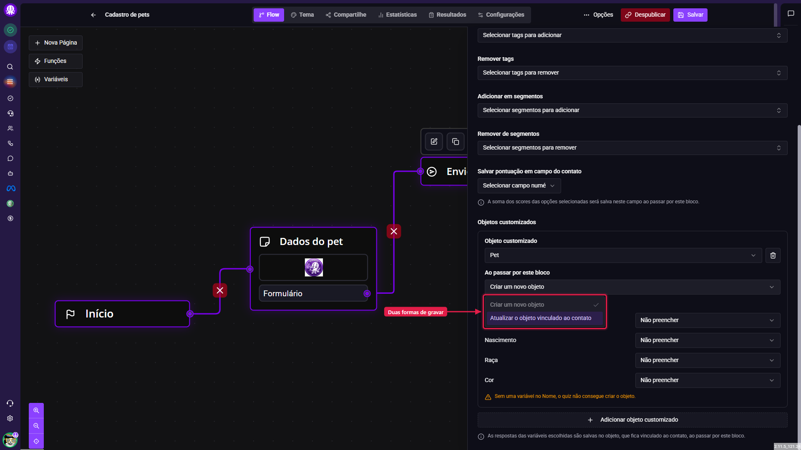

### Criar um novo objeto

Cada vez que alguém passa pelo bloco, o quiz cria um objeto novo com as respostas e vincula ao contato. Se a mesma pessoa responder duas vezes, ela fica com dois objetos.

Use quando cada resposta representa uma coisa nova: um pet a mais, um pedido, uma inscrição em evento.

Existe uma exceção que evita duplicados. Se o tipo de objeto tiver campos marcados como **Identificador Único** e as respostas baterem com um objeto que já existe, o quiz não cria outro: ele vincula esse objeto ao contato e atualiza os campos que foram respondidos. Na concessionária, por exemplo, se a placa for identificador único, um carro já cadastrado com a mesma placa é reaproveitado.

### Atualizar o objeto vinculado ao contato

O quiz procura, entre os objetos daquele tipo ligados ao contato, o que foi vinculado mais recentemente, e atualiza esse objeto só com os campos respondidos. Os campos que ficaram sem resposta mantêm o valor que já tinham.

Se o contato ainda não tiver nenhum objeto desse tipo, o quiz cria um novo, como no modo anterior.

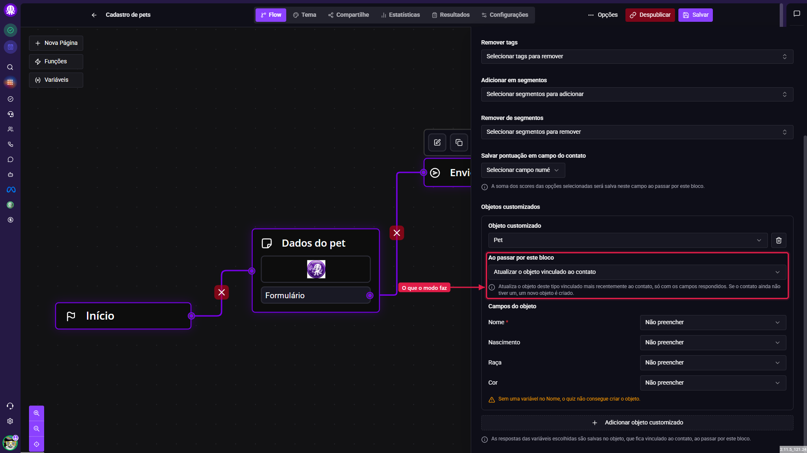

Use quando o contato tem um cadastro só daquele tipo e o quiz serve para completar ou corrigir: o quiz de retorno da clínica, a atualização do plano contratado, a pesquisa que confirma os dados do imóvel.

### Diferença prática

**Criar um novo objeto** → cada resposta soma um objeto ao contato. Bom para coisas que se acumulam.

**Atualizar o objeto vinculado ao contato** → a resposta mexe no objeto mais recente do contato. Bom para um cadastro único que muda com o tempo.

> **Atenção se o contato tiver vários objetos do mesmo tipo.** O modo Atualizar mexe só no vinculado mais recentemente. Um tutor com três pets que responde o quiz vai ter só o último pet atualizado, mesmo que as respostas falem de outro.

## Como escolher as variáveis?

Ao abrir um campo do objeto, você vê todas as variáveis do quiz, inclusive as que não estão na lista **Variáveis** do bloco.

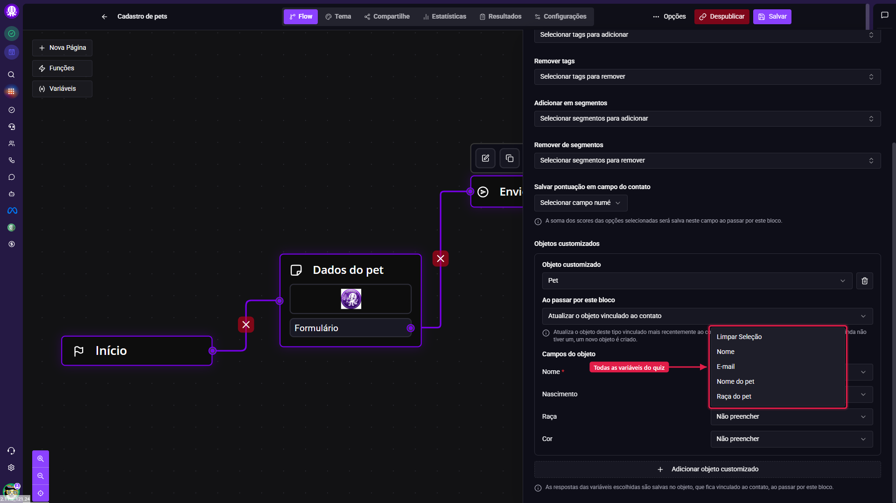

Escolha, para cada campo, a variável que guarda a resposta certa. Uma mesma variável pode preencher campos de objetos diferentes. Depois de configurar, salve o quiz pelo botão **Salvar**, no alto da tela. Sem salvar, a configuração não vale para quem responde.

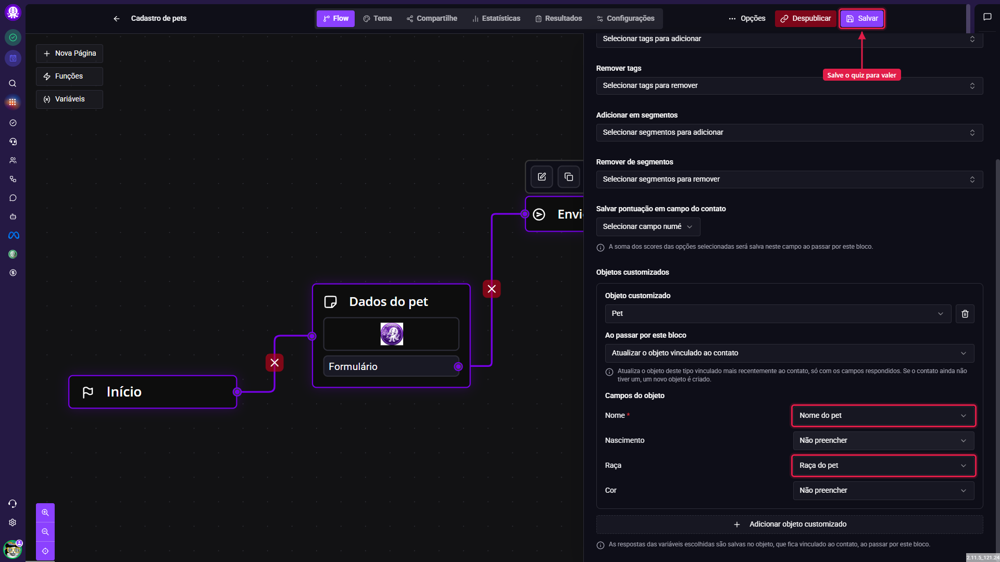

> **Atenção ao tipo do campo.** A resposta precisa caber no tipo do campo do objeto: um texto livre não entra num campo de número, e uma data mal escrita não entra num campo de data. Quando a resposta não serve, o objeto não é gravado e quem responde o quiz não vê erro nenhum. Prefira perguntas com o mesmo formato do campo e teste o quiz antes de divulgar.

## Onde ver o resultado?

Os objetos aparecem na ficha do contato, numa aba com o nome do tipo de objeto no plural. Se você não encontrar a aba na barra, procure no menu **...**, no fim da barra de abas.

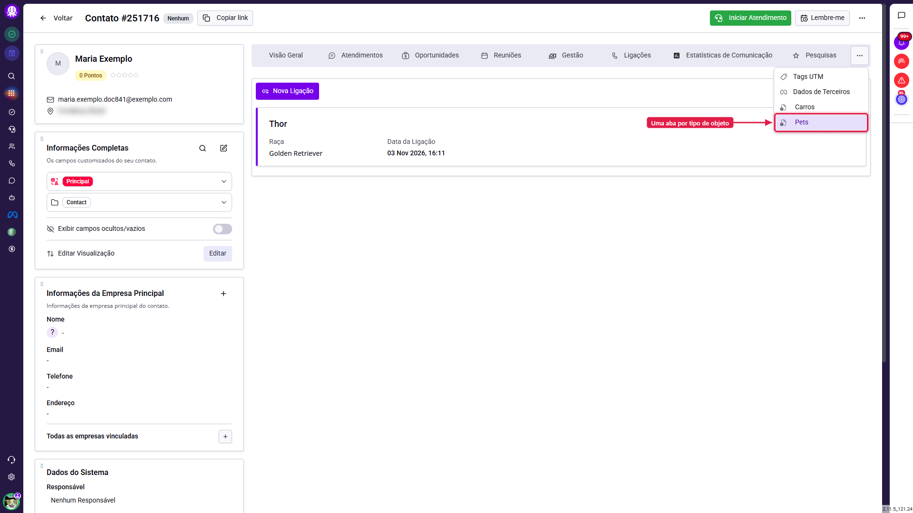

Na aba, cada objeto mostra os campos preenchidos e a **Data da Ligação**, que é quando o objeto foi vinculado ao contato.

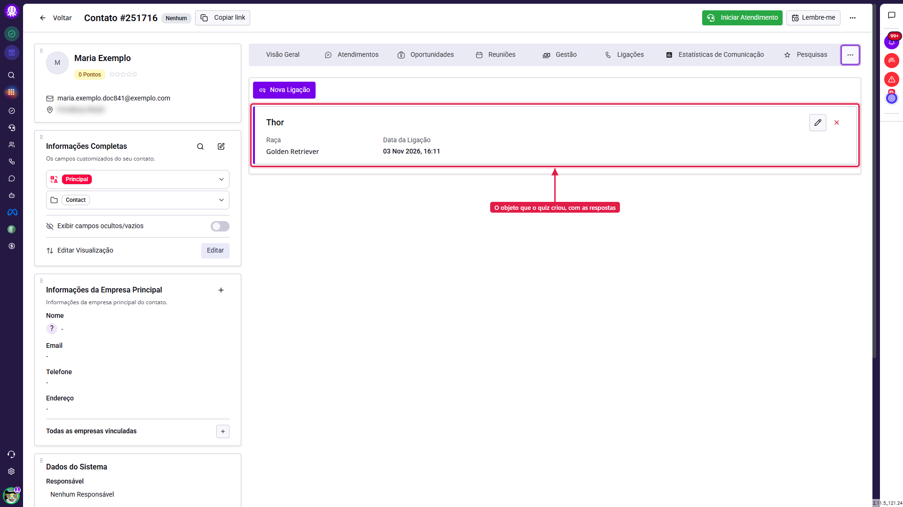

No **Histórico de Atividades**, na Visão Geral do contato, aparecem dois registros: "Objeto customizado adicionado", com o nome do objeto, e "Enviou parcialmente o formulário", com as respostas que foram para o contato. Repare que o envio lista só as variáveis da lista **Variáveis**: as respostas do pet foram para o objeto e não para o contato.

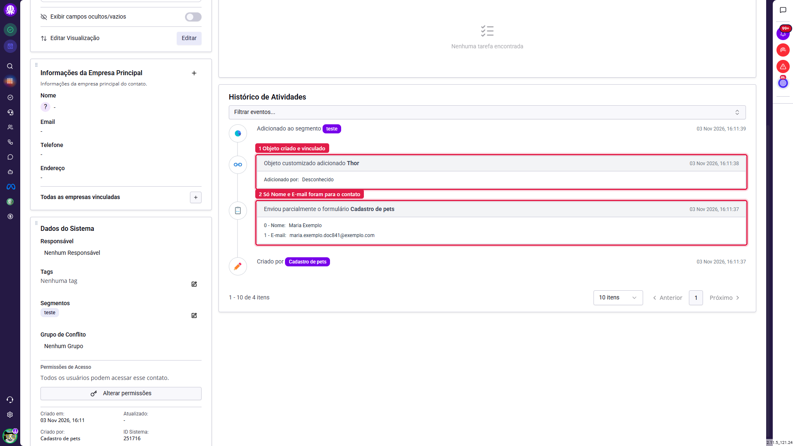

O registro do objeto mostra "Adicionado por: Desconhecido". Isso é esperado: quem vinculou foi o quiz, e não um usuário do sistema.

## O que mais vale saber antes de publicar?

> **Atenção: o objeto só é gravado quando o visitante passa pelo bloco.** Se a pessoa abandonar o quiz antes de chegar ao bloco **Envio de Dados**, nenhum objeto é criado. Coloque o bloco logo depois das perguntas que alimentam o objeto, e não só no fim do quiz.

> **Atenção às respostas em branco.** O quiz só grava os campos que foram respondidos. Se nenhuma das variáveis ligadas ao objeto tiver resposta, o objeto não é criado nem atualizado.

> **Atenção à criação dinâmica.** Para o quiz criar objetos, o tipo de objeto precisa estar com **Permitir criação dinâmica de objetos?** marcado como sim, na configuração do próprio objeto. Se estiver como não, o quadro mostra um aviso, e o quiz só consegue atualizar objetos que o contato já tem.

> **Atenção ao fim do quiz.** Quando o visitante chega a uma página sem continuação, o quiz faz um envio final com todas as respostas. Nesse envio, toda variável que estiver ligada a um campo do contato é salva no contato, mesmo que esteja fora da lista **Variáveis** do bloco. Se uma resposta deve ir só para o objeto, deixe a variável dela sem campo do contato na tela de variáveis do quiz.

> **Atenção: atualizar não deixa rastro.** Quando o quiz atualiza um objeto que o contato já tinha, nada novo aparece no histórico do contato, e as automações não são disparadas. O registro no histórico e o gatilho de automação só acontecem quando o objeto é vinculado ao contato.

> **Dica: use automações para o que vem depois.** O gatilho **Um objeto customizado for vinculado ao lead** dispara quando o quiz cria e vincula um objeto. Com ele você pode, por exemplo, mandar uma mensagem de boas-vindas ao pet novo ou abrir uma tarefa para a equipe revisar o cadastro.

## Conclusão

Use a lista **Variáveis** para o que identifica e descreve a pessoa, e os objetos customizados para tudo o que ela tem ou contrata. Na hora de escolher o modo, pense se a resposta é uma coisa nova, que soma ao que o contato já tem, ou uma correção do cadastro que já existe: no primeiro caso, **Criar um novo objeto**; no segundo, **Atualizar o objeto vinculado ao contato**.

Antes de divulgar o quiz, responda você mesmo uma vez e confira a aba do objeto e o histórico do contato. É o jeito mais rápido de ver se cada resposta foi parar no lugar certo.
