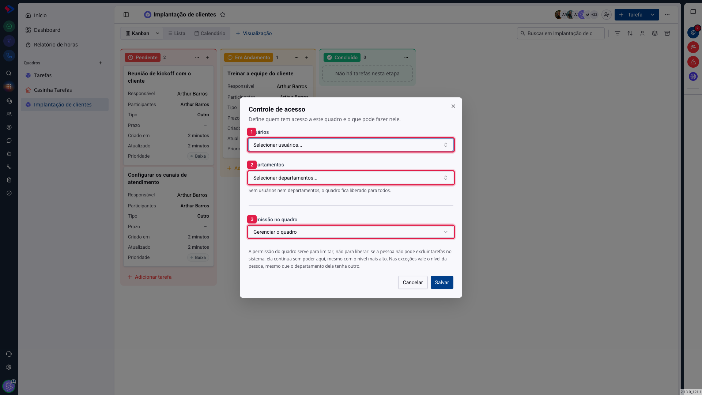
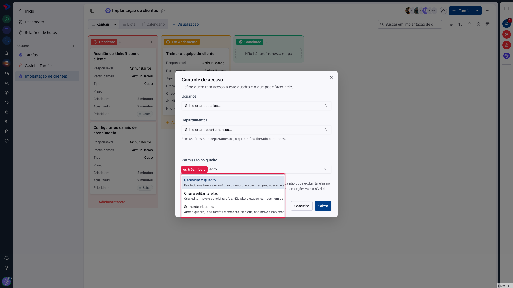

# Tarefas - Controle de acesso do quadro

Nem todo quadro é para todo mundo, e nem todo mundo que vê um quadro deveria poder mexer nele. O controle de acesso resolve as duas coisas: **quem entra** e **o que cada um faz lá dentro**.

Antes de mais nada, a regra que explica a maioria das dúvidas: **a permissão do quadro serve para limitar, não para liberar**. Se o grupo de permissões da pessoa não deixa excluir tarefas no sistema, ela continua sem excluir aqui, mesmo com o nível mais alto no quadro.

## Como acessar

No quadro, abra o menu de três pontos ao lado do nome e escolha **Controle de acesso**.

## Quem entra

**1. Usuários**: as pessoas que podem abrir este quadro.

**2. Departamentos**: o mesmo, por departamento inteiro.

Se você deixar os dois vazios, **o quadro fica liberado para todo o sistema**, para quem tiver permissão de ver tarefas. É o padrão de um quadro novo, e é o certo para processos que a empresa inteira acompanha.

## O que cada um faz

**3. Permissão no quadro** define o nível padrão de quem tem acesso.

**Gerenciar o quadro**: faz tudo nas tarefas e ainda configura o quadro, ou seja, etapas, campos, acesso e exclusão.

**Criar e editar tarefas**: cria, edita, move e conclui tarefas. Não altera etapas, campos nem as configurações do quadro.

**Somente visualizar**: abre o quadro, lê as tarefas e comenta. Não cria, não move e não conclui.

A diferença que mais importa é entre os dois primeiros. "Criar e editar" é o nível de quem trabalha no quadro; "Gerenciar" é o de quem é dono do processo. A distância entre eles aparece no dia em que alguém apaga uma etapa com tarefas dentro.

## Exceções por pessoa

Abaixo do nível padrão ficam as exceções: você escolhe uma pessoa ou um departamento e dá a ela um nível diferente do padrão.

Quando a mesma pessoa se encaixa pelos dois caminhos, por exemplo está como exceção com "Somente visualizar" e pertence a um departamento com "Criar e editar", **vale o nível da pessoa**. Isso existe para que dar "somente leitura" a alguém de um time que edita realmente funcione.

> **Atenção.** O administrador e quem criou o quadro passam por cima dessas regras: eles sempre gerenciam. Isso evita o quadro sem dono, no qual ninguém mais consegue arrumar nada.

## Como combinar com as permissões do sistema

As duas camadas se somam, e a mais restritiva vence:

| Permissão no sistema | Nível no quadro | Resultado |
|---|---|---|
| Pode editar tarefas | Criar e editar | Edita neste quadro |
| Pode editar tarefas | Somente visualizar | **Não** edita neste quadro |
| Não pode editar tarefas | Gerenciar o quadro | **Não** edita em lugar nenhum |

Se alguém reclamar que "o botão sumiu", é quase sempre uma dessas linhas. Confira primeiro o grupo de permissões, depois o nível no quadro.

## Conclusão

Para a maioria dos quadros, o ajuste certo é simples: deixe liberado para todos e mantenha o nível padrão em "Criar e editar". Suba para "Gerenciar" apenas quem cuida do processo.

Restrinja por usuários ou departamentos só quando o conteúdo justificar, como um quadro de recrutamento ou de assuntos financeiros. Quadro restrito demais tem um custo escondido: o trabalho fica invisível para quem precisaria ajudar.
