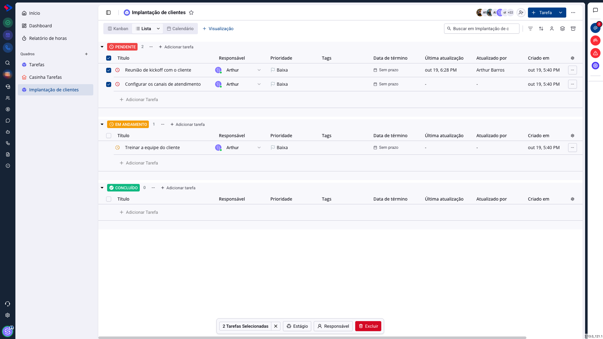
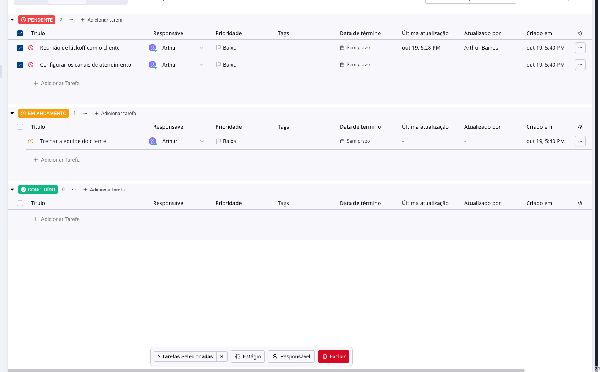
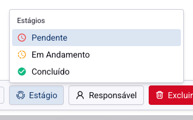
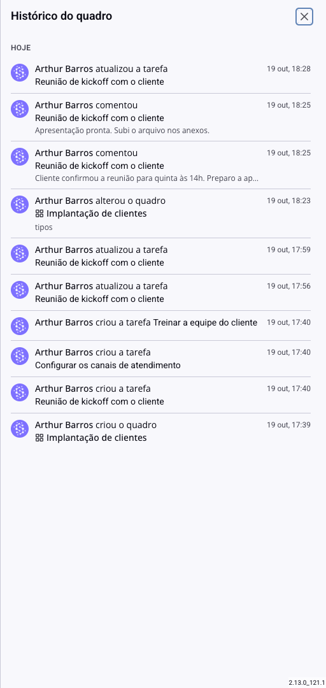

# Tarefas - Mexer em várias tarefas de uma vez

Arrastar cartão por cartão funciona com três tarefas. Com trinta, não. A visualização em lista permite marcar várias e mudar todas juntas: a etapa, o responsável, ou apagar o lote.

## Como acessar

Abra o quadro e escolha a visualização **Lista**. Cada linha ganha uma caixa de marcação na frente do título.

Marque as tarefas que quer mudar. A caixa no cabeçalho de cada etapa marca todas as tarefas daquela etapa de uma vez.

## A barra de ações

Assim que você marca a primeira tarefa, uma barra sobe no rodapé com a contagem e três ações. O **X** ao lado da contagem desmarca tudo, e a tecla **Esc** faz o mesmo.

### Estágio

Move todas as tarefas marcadas para a etapa escolhida. É o uso mais comum: fechar de uma vez tudo que foi entregue na semana.

> **Atenção às tarefas recorrentes.** Mover para uma etapa de conclusão dispara a recorrência de cada tarefa marcada, e as próximas ocorrências nascem na hora. Fazendo faxina no quadro, você pode criar sem querer uma leva de tarefas novas. Se a intenção é limpar o quadro, confira antes se há recorrentes no meio da seleção.

### Responsável

Troca o responsável de todas as marcadas. Resolve em um passo o que mais dá trabalho na mão: redistribuir a fila de quem saiu de férias.

A lista de pessoas tem busca, e só aparecem as que têm acesso ao quadro.

### Excluir

Apaga as tarefas marcadas, com uma confirmação antes.

> **Atenção.** A exclusão não tem volta, e leva junto as subtarefas, os comentários, os anexos e as horas apontadas naquelas tarefas. Horas apagadas somem também do relatório: se o período já foi faturado, exporte antes. Para tirar a tarefa da frente sem perder o registro, prefira movê-la para uma etapa de conclusão.

## Quando usar a lista e quando usar o kanban

O kanban é melhor para trabalhar: ele mostra o fluxo e o arrastar é natural.

A lista é melhor para arrumar: ela mostra muitas tarefas juntas, com as colunas de prazo, responsável e atualização lado a lado, e é a única que permite mexer em várias ao mesmo tempo.

Na prática, a equipe vive no kanban e vai para a lista no fechamento da semana ou do mês.

## Conferir o que mudou

Toda ação em massa fica registrada. No menu do quadro, **Histórico** abre a lista do que aconteceu, com o nome de quem fez e a hora, dia a dia.

É onde se esclarece o "sumiu uma tarefa do quadro" e o "quem moveu tudo para concluído?". O histórico carrega aos poucos, e o botão do rodapé traz os dias anteriores.

## Conclusão

Ação em massa economiza muito tempo e erra muito rápido. O hábito que protege é olhar a contagem na barra antes de confirmar: "2 Tarefas Selecionadas" quando você esperava vinte, ou vinte quando esperava duas, é o aviso de que a seleção não é a que você pensa.

E para apagar, pare um segundo a mais. Mover é reversível; excluir não.
