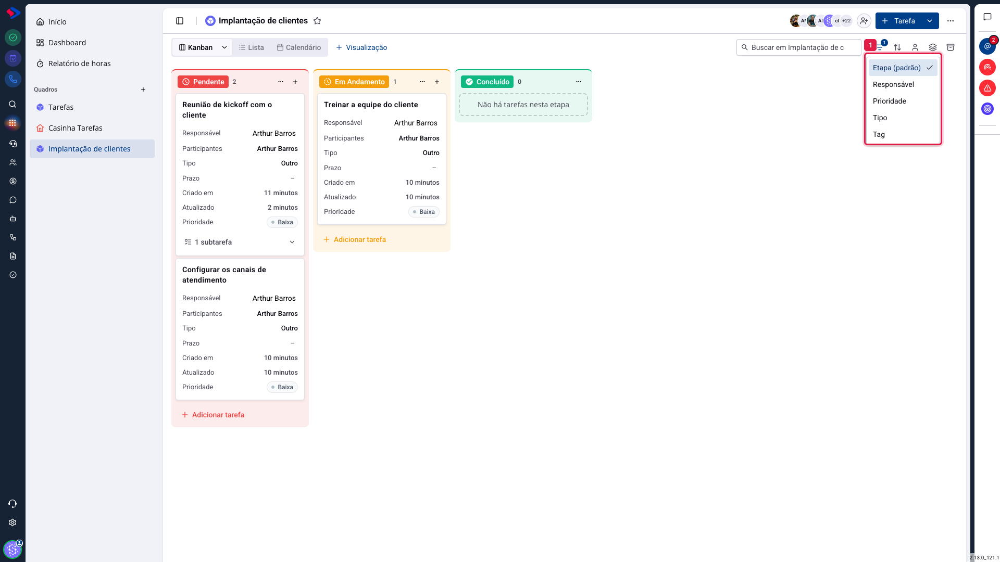
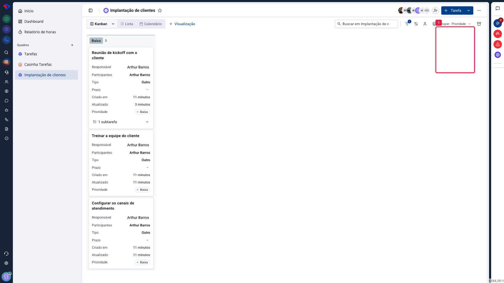

# Tarefas - Agrupar o quadro

Por padrão, as colunas do kanban são as etapas do processo. O agrupamento troca esse critério: em vez de colunas por etapa, você vê colunas por responsável, por prioridade, por tipo ou por tag.

É a mesma informação, recortada por outra pergunta. "Em que ponto está cada tarefa?" vira "quanto cada pessoa tem na mão?".

## Como acessar

No quadro, clique no ícone de **camadas**, à direita da busca.

## As opções

**Etapa (padrão)**: as colunas do processo. É o kanban como ele foi desenhado, com arrastar entre colunas e todas as ações.

**Responsável**: uma coluna por pessoa. Responde quem está sobrecarregado e quem está livre. É a visão de quem distribui trabalho.

**Prioridade**: colunas de Urgente, Alta, Média e Baixa. Mostra se o time está tocando o que importa ou o que é mais fácil.

**Tipo**: colunas por tipo de tarefa (reunião, bug, visita). Útil para ver a composição do trabalho: um mês com muito "bug" diz algo sobre a qualidade da entrega anterior.

**Tag**: colunas por etiqueta. Uma tarefa com duas tags aparece nas duas colunas.

## O que muda quando você agrupa por outro critério

Agrupado por **Etapa**, o quadro tem tudo: arrastar para mover, adicionar tarefa na coluna, carregar mais conforme rola.

Agrupado por **qualquer outro critério**, as colunas são de leitura. Elas organizam o que já está carregado na tela para você enxergar a distribuição, e não para mover trabalho.

> **Atenção.** Em quadros grandes, os agrupamentos que não são por etapa consideram as tarefas já carregadas na tela. Se o quadro tem muitas tarefas, role até o fim antes de tirar conclusões da contagem por pessoa.

## O agrupamento pertence à visualização

Como o filtro, o agrupamento fica guardado na visualização ativa, e é só seu. Vale criar uma visualização "Carga do time", agrupada por responsável, para a reunião semanal, mantendo a visualização do dia a dia agrupada por etapa.

## Conclusão

Agrupar por responsável uma vez por semana costuma revelar o que nenhuma reunião revela: a diferença real de carga entre as pessoas do time.

Para trabalhar, volte sempre ao agrupamento por etapa. É o único em que o quadro funciona como quadro, com o arrastar que faz o trabalho andar.
