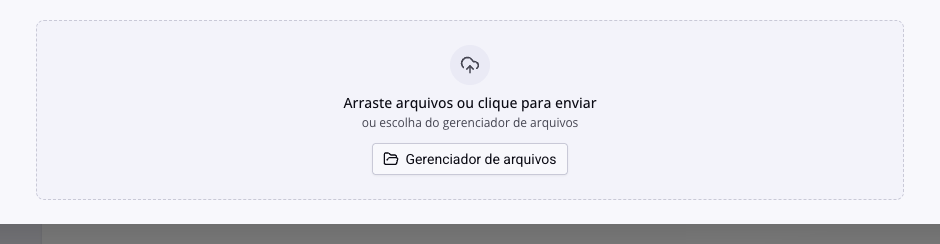
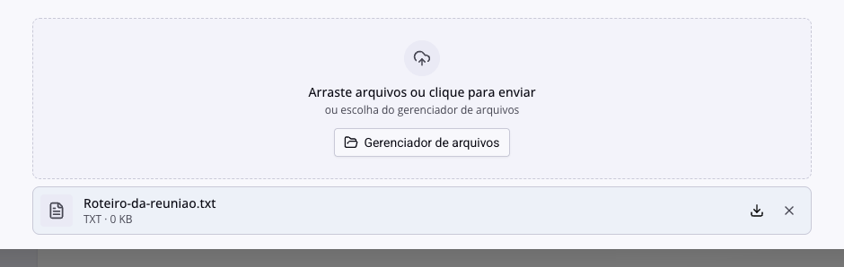
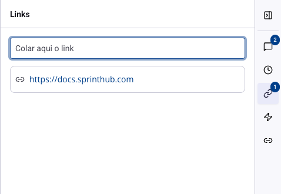

# Tarefas - Anexos e links

Boa parte do trabalho mora fora da tarefa: a planilha do cliente, o contrato assinado, a pasta no drive, a página do fornecedor. Anexar o arquivo e guardar o endereço na própria tarefa evita a pergunta que atrasa tudo: "onde está aquele arquivo?".

## Como acessar

Abra a tarefa e role até a área de envio, logo abaixo das subtarefas.

Há dois caminhos:

**Arraste ou clique**: envia um arquivo do seu computador.

**Gerenciador de arquivos**: escolhe algo que já está no sistema, sem subir de novo. Use quando o material já foi usado em outro lugar, como um modelo de contrato ou um material de apresentação.

## O que acontece depois do envio

O arquivo entra numa lista com o nome, o formato e o tamanho. Passando o mouse, aparecem as ações:

**Visualizar**: abre o arquivo sem baixar, quando o formato permite.

**Baixar**: salva no seu computador.

**Remover**: tira o arquivo da tarefa.

Quando a lista cresce, ela mostra os primeiros e esconde o resto atrás de um "Ver mais".

> **Atenção.** O anexo pertence à tarefa, não à subtarefa. Quem abrir a subtarefa não encontra ali o arquivo que você subiu na tarefa mãe: se o material é de um passo específico, anexe dentro dele.

## Links

O painel de **Links** fica na barra de ícones à direita da tarefa. Cole o endereço no campo e pressione Enter.

A diferença entre link e anexo é prática:

**Anexo** é uma cópia. Ele fica como está hoje, mesmo que o original mude depois. Bom para o que precisa ser preservado: contrato assinado, comprovante, versão aprovada.

**Link** aponta para o original. Ele acompanha as mudanças, mas depende de quem abre ter acesso àquele endereço. Bom para o que vive mudando: planilha colaborativa, pasta compartilhada, painel externo.

Na dúvida sobre documento que será revisado várias vezes, prefira o link. Anexar uma versão intermediária costuma criar a situação em que metade da equipe trabalha com o arquivo antigo.

> **Atenção.** O sistema não verifica se o endereço funciona nem se as outras pessoas têm permissão de abri-lo. Um link para uma pasta restrita vai parecer quebrado para quem não tem acesso, e a tarefa não avisa.

## Onde mais o arquivo aparece

Tudo que entra na tarefa também pode ser localizado pelo gerenciador de arquivos do sistema. Por isso vale nomear o arquivo antes de enviar: "proposta.pdf" se perde entre dezenas iguais, "Proposta - Cliente X - out.pdf" não.

## Conclusão

A escolha entre anexar e linkar se resume a uma pergunta: isso precisa ficar como está, ou precisa acompanhar as mudanças?

E sempre que o arquivo for a razão da tarefa, deixe um comentário dizendo o que ele é. Uma lista de anexos sem explicação obriga quem chega depois a abrir todos para descobrir qual importa.
