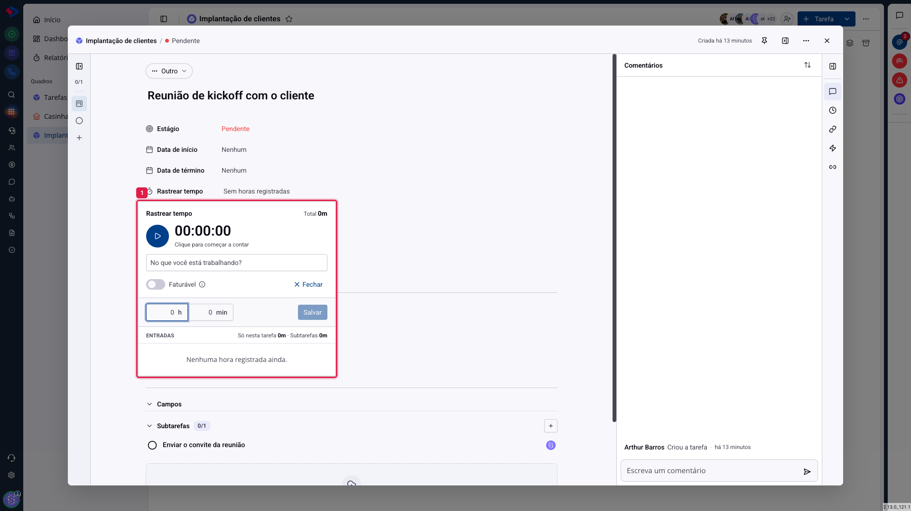

# Tarefas - Apontar horas manualmente

Nem todo trabalho acontece com a tarefa aberta na tela. A reunião de uma hora, a visita ao cliente, a ligação de vinte minutos: tudo isso precisa ser lançado depois, e é para isso que serve o apontamento manual.

## Como acessar

Abra a tarefa, clique em **Rastrear tempo** e depois em **Adicionar manualmente**.

Preencha **h** (horas) e **min** (minutos) e clique em **Salvar**. A entrada aparece na lista, identificada com o seu nome e o horário do lançamento.

A chave **Faturável** vale também para o lançamento manual: ligue-a antes de salvar se aquele tempo entra na cobrança do cliente.

## A lista de entradas

Cada lançamento, do cronômetro ou manual, vira uma linha em **Entradas**. A lista mostra quem lançou e quanto, e é por ela que se corrige um engano.

Abaixo do total, as duas linhas de composição separam o que foi lançado **nesta tarefa** do que veio das **subtarefas**.

> **Atenção ao apontamento de outra pessoa.** Lançar ou alterar horas de um colega depende de uma permissão específica. Se você precisa ajustar o apontamento de alguém e não consegue, é essa a causa: fale com quem administra o sistema.

## Como as horas viram relatório

Tudo que é lançado aqui aparece no **Relatório de horas**, no menu lateral do módulo, onde dá para ver por pessoa, por quadro e por período, com os valores quando o quadro tem cobrança ligada. O relatório tem artigo próprio.

> **Atenção à hora lançada no lugar errado.** Como o relatório soma por tarefa e por quadro, um lançamento na tarefa errada desloca o número de dois clientes ao mesmo tempo: o que recebeu a hora a mais e o que ficou sem ela. Vale conferir a tarefa antes de salvar.

## Conclusão

A regra que mantém o apontamento confiável é lançar no mesmo dia. Memória de uma semana atrás arredonda tudo para cima, e o relatório passa a medir impressão em vez de trabalho.

Para equipes que cobram por hora, vale combinar o significado de "faturável" antes de começar: sem esse acordo, cada pessoa decide por conta própria e o número do mês não quer dizer nada.
