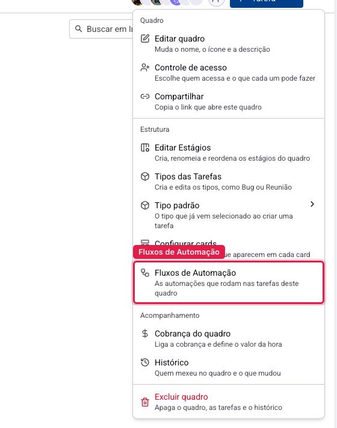
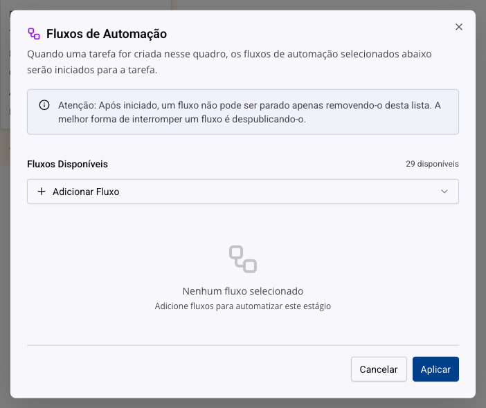
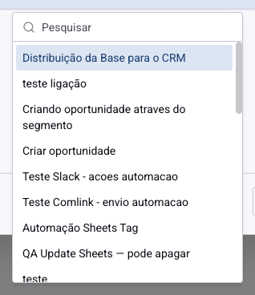
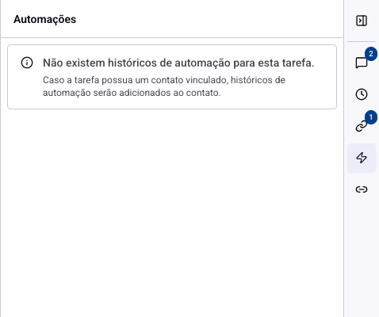
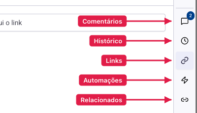

# Tarefas - Fluxos de automação no quadro

Um fluxo de automação é uma sequência que o sistema executa sozinho: enviar uma mensagem, criar um registro, avisar alguém, esperar um tempo e seguir. Ligar um fluxo a um quadro de tarefas faz essa sequência começar sempre que uma tarefa nasce ali, sem ninguém apertar nada.

É o que transforma um quadro em processo: a tarefa de implantação que sempre dispara o mesmo e-mail de boas-vindas não depende mais de alguém lembrar.

## Como acessar

Abra o quadro, clique nos três pontos do canto superior direito e escolha **Fluxos de Automação**.

## Dois lugares, dois gatilhos

Esta é a distinção que define o comportamento, e ela não está escrita na tela com todas as letras.

**No quadro**: os fluxos começam quando uma tarefa é **criada** naquele quadro.

**Na etapa**: os fluxos começam quando uma tarefa é criada **ou movida** para aquela etapa. O acesso é pelo raio roxo no cabeçalho da coluna, no kanban, e ele só aparece para administradores.

Ou seja: fluxo de quadro é "toda tarefa daqui passa por isso"; fluxo de etapa é "quando chegar neste ponto, faça isso". O segundo é o que cobre a maior parte dos casos reais, porque o processo costuma ter um momento certo para agir.

## A tela

**Fluxos Disponíveis** abre a lista de tudo que existe publicado, com busca.

Escolhido, o fluxo entra em **Fluxos Selecionados**, e cada um ganha três controles do lado direito.

**Limitar por tipo** (o ícone de caixa) restringe o fluxo a tarefas de um tipo específico. Sem limite, ele roda em todas; com limite, só nas que forem do tipo escolhido. É o que permite ter um fluxo para reuniões e outro para bugs no mesmo quadro.

**Iniciar em massa** (o botão de play) roda o fluxo nas tarefas que **já existem**, e não apenas nas próximas.

**Remover** (o X) tira o fluxo da lista.

Confirme em **Aplicar**. Enquanto você não aplicar, nada do que montou ali vale.

> **Atenção: remover não para o que já começou.** Um fluxo iniciado segue o seu curso mesmo depois de sair desta lista, porque ele já está rodando para aquelas tarefas. Tirar da lista só impede que **novas** tarefas o iniciem. Para interromper um fluxo que está em andamento, a saída é despublicá-lo na tela de automações.

> **Atenção ao iniciar em massa.** Essa ação atinge as tarefas existentes de uma vez e não tem desfazer. Por segurança, o sistema permite uma execução em massa por hora para cada fluxo; o botão fica desabilitado nesse intervalo e o balão mostra a data da última. Antes de usar, confira o limite por tipo: sem ele, o fluxo roda em tudo que estiver no quadro.

## Fluxo despublicado

Um fluxo que foi despublicado continua na lista, marcado como **Despublicado**, mas não inicia mais nada. Vale conferir essa marca quando uma automação "parou de funcionar sem motivo": quase sempre é isso.

## O que aconteceu em cada tarefa

Abra uma tarefa e clique no ícone de **raio**, na barra da direita.

Ali fica o registro do que os fluxos fizeram naquela tarefa: qual disparou, quando foi executado, quando ficou esperando um gatilho ou um tempo, quando pulou de grupo, quando terminou antes da hora e, principalmente, **quando falhou** e por quê.

É o primeiro lugar a olhar quando a automação não fez o que devia. A mensagem de erro aparece ali, com o nome do fluxo.

> **Atenção.** Quando a tarefa tem um contato vinculado, parte do registro vai para o histórico do contato, e não para o da tarefa. Se o painel estiver vazio mas você tem certeza de que o fluxo rodou, procure no contato.

## Conclusão

Automação economiza trabalho repetitivo e multiplica erro na mesma velocidade. Antes de ligar um fluxo num quadro movimentado, teste com uma tarefa só: crie uma, veja o painel de automações dela e confirme que o que aconteceu é o que você esperava.

E documente a escolha no próprio quadro, numa tarefa ou num documento vinculado. Daqui a seis meses, ninguém vai lembrar por que toda tarefa criada ali dispara um e-mail.
