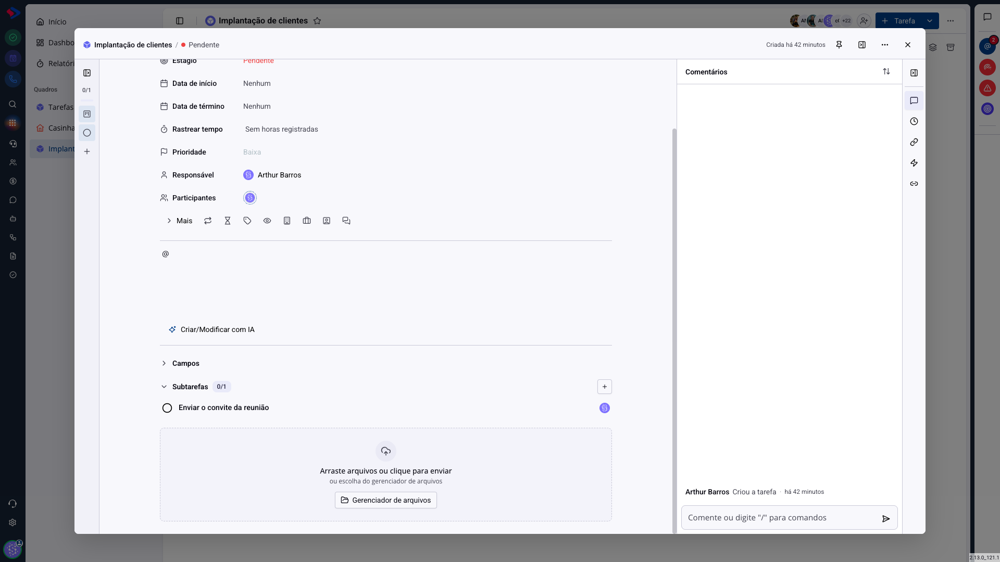
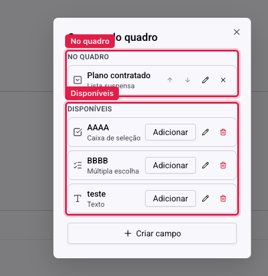
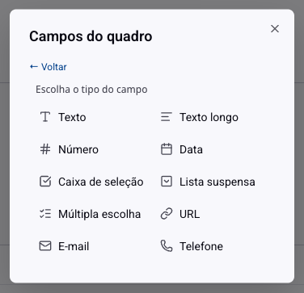
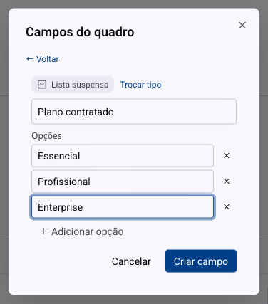
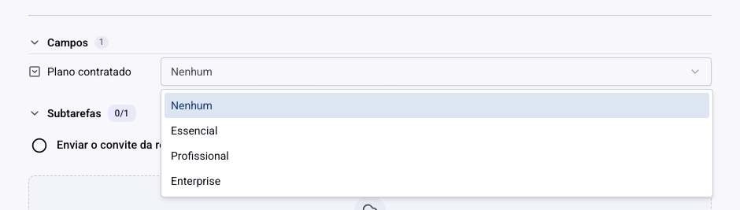

# Tarefas - Campos personalizados

Os campos que vêm prontos servem a qualquer tarefa: responsável, prazo, prioridade, tipo. O que eles não guardam é o que só faz sentido no **seu** processo: o plano contratado do cliente, o número do contrato, a data da visita técnica.

É para isso que existem os campos personalizados. Você cria o campo uma vez e ele passa a aparecer em todas as tarefas do quadro.

## Como acessar

Abra uma tarefa e role até a seção **Campos**, abaixo da descrição.

Ao lado do título da seção há um ícone de engrenagem, que abre **Campos do quadro**. É ali que se cria, habilita e desabilita campo.

## Dois conceitos que parecem um só

O diálogo tem duas listas, e entender a diferença entre elas evita o erro mais caro deste recurso.

**No quadro**: os campos que aparecem nas tarefas deste quadro. Você reordena com as setas, edita com o lápis e tira com o X.

**Disponíveis**: os campos que existem no sistema mas ainda não foram habilitados aqui. O botão **Adicionar** traz o campo para o quadro.

Ou seja: o campo é do **sistema**, e o quadro escolhe quais usar. Dois quadros podem usar o mesmo campo "Plano contratado", e o valor preenchido continua sendo de cada tarefa.

> **Atenção à diferença entre tirar e excluir.** O **X** na lista "No quadro" apenas deixa de mostrar o campo naquele quadro. A **lixeira** na lista "Disponíveis" apaga o campo do sistema inteiro, e ele sai de todos os quadros que o usavam. O aviso aparece na confirmação, e não há volta.

## Criar um campo

O botão **Criar campo** abre o formulário em dois passos.

### Passo 1: o tipo

São dez tipos:

**Texto**: uma linha. Para código de contrato, nome de sistema, número de pedido.

**Texto longo**: várias linhas. Para uma observação que não cabe no título.

**Número**: só dígitos. Use quando for somar ou comparar depois.

**Data**: uma data, separada do prazo da tarefa. Boa para "data da visita" ou "vencimento do contrato", que não são a mesma coisa que o prazo de execução.

**Caixa de seleção**: sim ou não. Para conferência simples, como "contrato assinado".

**Lista suspensa**: uma opção entre várias. É o tipo que mantém o dado limpo, porque ninguém digita.

**Múltipla escolha**: várias opções ao mesmo tempo. Para marcar os módulos contratados, por exemplo.

**URL**, **E-mail** e **Telefone**: texto com o formato esperado do dado.

> **Atenção.** O tipo **não muda depois**. Ao editar um campo já criado, você altera o nome e as opções, mas o tipo fica fixo. Se errou, crie outro campo e remova o antigo, ciente de que remover do sistema apaga os valores preenchidos.

### Passo 2: o nome e as opções

Dê um nome curto e específico. "Plano" é ambíguo num quadro que trata de planos de ação e de planos contratados; "Plano contratado" não é.

Para lista suspensa e múltipla escolha, **Adicionar opção** monta a lista. Escreva as opções como a equipe fala, não como o sistema interno chama.

Ao salvar, o campo já entra no quadro em que você está, e também passa a aparecer na lista **Disponíveis** dos outros quadros.

## Preencher na tarefa

Na tarefa, o campo aparece na seção **Campos**, com o contador de quantos existem. Clique no valor e preencha. A gravação é imediata, sem botão de salvar.

Campo vazio mostra um traço. Isso é informação: num quadro em que "Plano contratado" importa, os traços mostram quais tarefas estão incompletas.

## Como escolher bem

**Prefira lista suspensa a texto** sempre que as respostas forem previsíveis. Texto livre vira "Profissional", "profissional" e "Plano Profissional" na mesma coluna, e aí não dá para filtrar nem contar.

**Não crie campo para o que já existe.** Prazo, responsável, prioridade, tipo e tags já são campos nativos, e o quadro inteiro (filtro, agrupamento, relatório) entende esses. Um campo personalizado chamado "Responsável técnico" é legítimo; um chamado "Responsável" só duplica trabalho.

**Comece com poucos.** Cada campo é mais uma coisa para a equipe preencher. Três campos que todo mundo preenche valem mais que dez em branco.

## Conclusão

O campo personalizado é o que transforma um quadro genérico no processo da sua operação. O ganho real aparece depois: com o dado preenchido de forma padronizada, dá para separar as tarefas por aquilo que importa para o seu negócio, e não só por etapa e prazo.

Antes de criar, combine o nome com quem vai preencher. Campo que só uma pessoa entende volta vazio.
