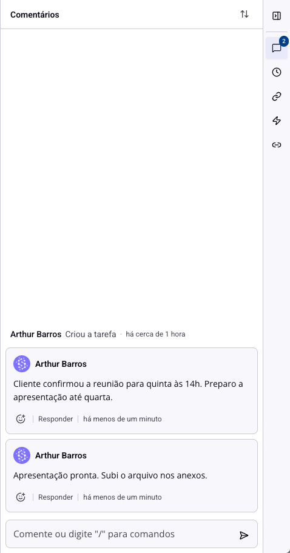
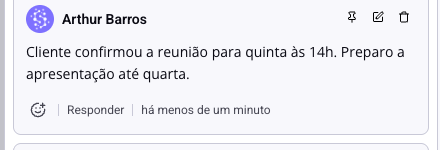
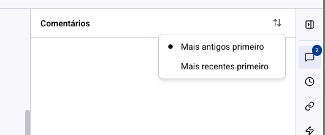

# Tarefas - Comentários e conversa na tarefa

A conversa sobre uma tarefa costuma acontecer no chat, e some. Comentando dentro da tarefa, ela fica onde quem assumir o trabalho depois vai procurar: ao lado do que precisa ser feito.

## Como acessar

Abra a tarefa. A coluna da direita já abre em **Comentários**, com o campo de escrever no rodapé.

Escreva e pressione Enter para enviar. O comentário aparece com o seu nome, a foto e o tempo decorrido.

## As cinco ações de um comentário

Passe o mouse sobre um comentário e as ações aparecem.

**Reagir** (a carinha): responde sem escrever. Serve para o "ok, vi" que não merece um comentário novo.

**Responder**: cria uma resposta encaixada embaixo do comentário, formando uma conversa. É o que mantém dois assuntos paralelos separados, em vez de uma lista de falas soltas.

**Fixar** (o alfinete): prende o comentário no topo da lista. Use para a informação que todo mundo que abrir a tarefa precisa ver primeiro, como a decisão que mudou o escopo ou o link do material aprovado.

**Editar**: corrige o que você escreveu.

**Excluir**: remove o comentário.

> **Atenção aos limites.** Só o autor edita o próprio comentário, e **só até uma hora depois de escrever**. Passada essa hora, o botão continua lá mas a correção é recusada pelo sistema: a saída é escrever um novo comentário corrigindo. Excluir, por sua vez, é do autor ou de um administrador.

> **Atenção ao fixar.** Só comentário de primeiro nível pode ser fixado. Respostas não, porque uma resposta fixada no topo apareceria longe da pergunta que respondeu, e ninguém entenderia o contexto.

## Respostas

Quando uma conversa cresce, as respostas antigas ficam recolhidas atrás de um "Ver respostas anteriores". A ideia é que a lista mostre o estado atual da discussão, não o histórico inteiro, e você abre o resto quando precisa.

## A ordem da lista

O botão no cabeçalho do painel troca entre **Mais antigos primeiro** e **Mais recentes primeiro**.

Essa escolha é sua e vale para todas as tarefas, em qualquer quadro. Ela não muda o que os colegas veem: cada pessoa lê na ordem que prefere.

Mais antigos primeiro é melhor quando a tarefa conta uma história e você quer acompanhá-la do começo. Mais recentes primeiro é melhor em tarefa longa, em que o que importa é o que aconteceu hoje.

## As outras abas da mesma coluna

A faixa de ícones na borda direita troca o conteúdo dessa coluna:

**Comentários**: a conversa, com o contador de quantos existem.

**Histórico**: o que mudou na tarefa e quem mudou, incluindo os comentários no meio da linha do tempo. É onde se responde "quem moveu isso para concluído?".

**Links**: endereços da web ligados à tarefa.

**Automações**: o que os fluxos automáticos fizeram nesta tarefa.

**Relacionados**: as ligações com outras tarefas.

## Mencionar alguém

Dentro do comentário, digite **@** e escolha a pessoa. Ela recebe a notificação com o link direto para esta tarefa.

É a diferença entre comentar e ser lido: um comentário sem menção fica esperando que alguém abra a tarefa; com menção, a pessoa é avisada.

## Conclusão

A regra que faz a diferença é simples: decisão tomada vira comentário. Combinação feita no chat, no corredor ou na reunião não existe para quem pegar a tarefa na semana que vem.

E lembre da hora de prazo para editar. Comentário é registro, não rascunho: releia antes de enviar, porque depois a correção vira um comentário novo.
