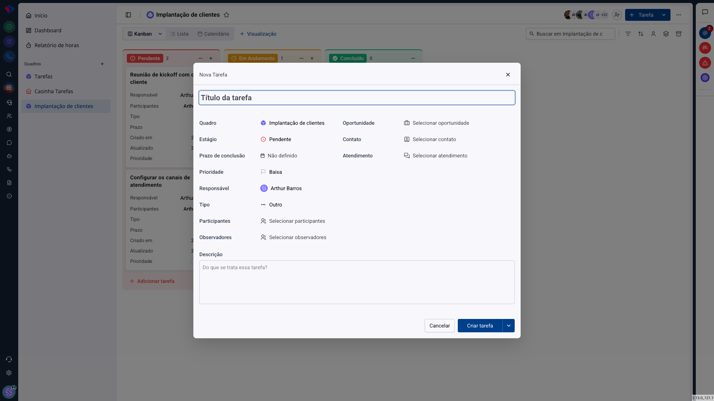

# Tarefas - Criar uma tarefa

Criar tarefa é a operação mais repetida do módulo, e ela tem dois caminhos: o rápido, direto na coluna do quadro, e o completo, pelo botão **Tarefa**. Os dois criam a mesma coisa; a diferença é quanta informação você preenche na hora.

## Como acessar

**Caminho rápido**: no quadro, clique em **Adicionar tarefa** no pé da coluna, escreva o título e pressione Enter. A tarefa nasce naquela etapa, com você como responsável, e você completa o resto depois.

**Caminho completo**: clique em **+ Tarefa**, no canto superior direito.

## Os campos

**Título**: o que precisa ser feito. Prefira uma frase que comece por verbo ("Configurar os canais de atendimento") a um substantivo solto ("Canais"), porque a lista fica legível.

**Quadro**: onde a tarefa vai nascer. Vem preenchido com o quadro aberto, e dá para mudar aqui mesmo, o que é útil quando você percebe no meio do caminho que a tarefa é de outro processo.

**Estágio**: a etapa inicial. Em geral a primeira, mas nada impede criar algo já em andamento.

**Prazo de conclusão**: a data e a hora limite. É o campo que alimenta os indicadores de "vencendo hoje" e "atrasadas": tarefa sem prazo não entra em nenhum deles.

**Prioridade**: Baixa, Média, Alta ou Urgente. Serve para ordenar e filtrar, e aparece colorida no card.

**Responsável**: quem vai fazer. É a pessoa cobrada pelo prazo e a que verá a tarefa na página inicial dela.

**Tipo**: a classificação da tarefa dentro do quadro ("Reunião", "Bug", "Visita"). Os tipos são configurados por quadro, e o quadro pode ter um tipo padrão.

**Participantes**: quem trabalha junto. Eles enxergam a tarefa, recebem notificação e podem editá-la.

**Observadores**: quem acompanha sem executar. Recebem as notificações, mas não são cobrados pelo prazo.

**Oportunidade, Contato e Atendimento**: os vínculos com o resto do sistema. É o que faz a tarefa aparecer dentro do registro do cliente e o que permite, depois, responder "quanto trabalho esta conta deu".

**Descrição**: o detalhamento. Aceita formatação, listas, imagens e menção a pessoas.

## Delegar para outra pessoa

Trocar o responsável para um colega é **delegar**. A tarefa passa a contar no indicador "Delegadas por mim" da sua página inicial, e a pessoa recebe uma notificação.

> **Atenção.** Criar tarefa para outra pessoa depende de uma permissão específica. Se o seletor de responsável só mostra o seu nome, é isso: o seu grupo não tem "criar para outros". Fale com quem administra o sistema.

## O que acontece depois de criar

A tarefa aparece na coluna escolhida, e o responsável a vê na página inicial dele. A partir daí, o trabalho acontece dentro dela: comentários, subtarefas, apontamento de horas e mudança de etapa. Isso tem artigo próprio.

> **Dica para o dia a dia.** Vale criar pelo caminho rápido e completar depois, em vez de deixar de registrar porque o formulário é longo. Uma tarefa com título e sem prazo é melhor do que uma tarefa que ninguém criou. Só não esqueça de voltar: a lista "Sem prazo", na página inicial, existe exatamente para isso.

## Conclusão

Dos campos todos, dois mudam o comportamento do sistema: **prazo** e **responsável**. Sem prazo, a tarefa não entra em nenhum indicador de tempo; sem o responsável certo, ela aparece na página inicial da pessoa errada.

Os vínculos com contato, oportunidade e atendimento não são obrigatórios, mas é o que transforma o quadro em algo conectado ao cliente, e não em uma lista paralela.
