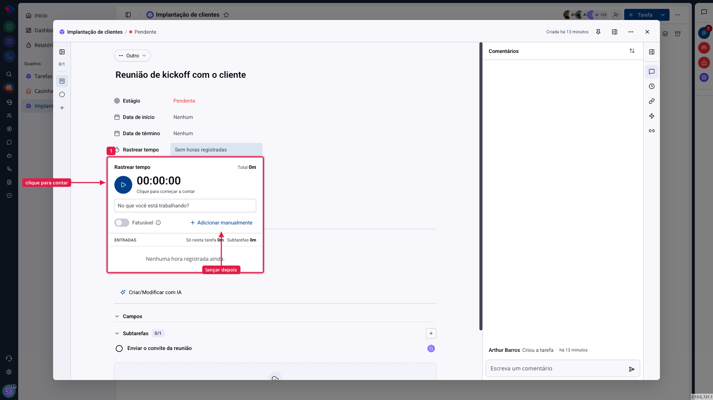

# Tarefas - Cronômetro: contar o tempo enquanto trabalha

O cronômetro mede o tempo gasto em uma tarefa enquanto você a executa. É a alternativa a lembrar no fim do dia quanto tempo cada coisa levou, que é onde a conta sempre erra.

## Como acessar

Abra a tarefa e clique no campo **Rastrear tempo**.

## Como funciona

**Clique no relógio** (`00:00:00`) para começar a contar. Ele passa a correr, e você pode fechar o painel e continuar trabalhando: a contagem segue.

Clique de novo para parar. O tempo medido vira uma **entrada** na lista, com a sua identificação e o horário.

**Faturável**: a chave ao lado diz se aquele tempo entra na cobrança do cliente. Ela vale para o que você registrar enquanto estiver ligada.

## O total e a composição

No topo do painel fica o **Total**, e abaixo da lista a composição: **"Só nesta tarefa"** e **"Subtarefas"**.

Essa separação importa em tarefas grandes: o total inclui o tempo lançado nas subtarefas, e as duas linhas mostram quanto é de cada lugar. Sem isso, não dá para saber se as cinco horas são da tarefa ou da soma dos passos.

> **Atenção ao cronômetro esquecido.** Ele continua contando depois do expediente se você não parar. Antes de fechar o dia, confira se não há tempo correndo: uma entrada de catorze horas estraga o relatório do mês e a conta do cliente.

## Quando usar o cronômetro e quando lançar manualmente

**Cronômetro** para o trabalho que você faz na frente do computador, com a tarefa aberta. Ele é exato e não depende de memória.

**Lançamento manual** para o que aconteceu fora da tela: a reunião, a visita, a ligação. Tem artigo próprio.

## Conclusão

O cronômetro só serve se virar hábito, e o hábito depende de uma coisa: abrir a tarefa antes de começar a trabalhar, não depois. Quem abre só no fim acaba lançando de memória, que é o que o recurso existe para evitar.

Se a sua operação cobra por hora, o cuidado maior é com a chave **Faturável**: é ela que separa o que o cliente paga do que é interno.
