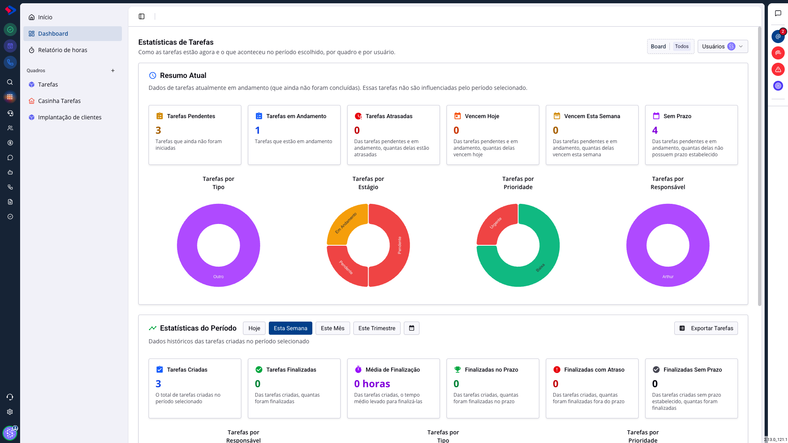
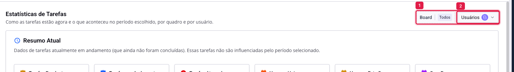
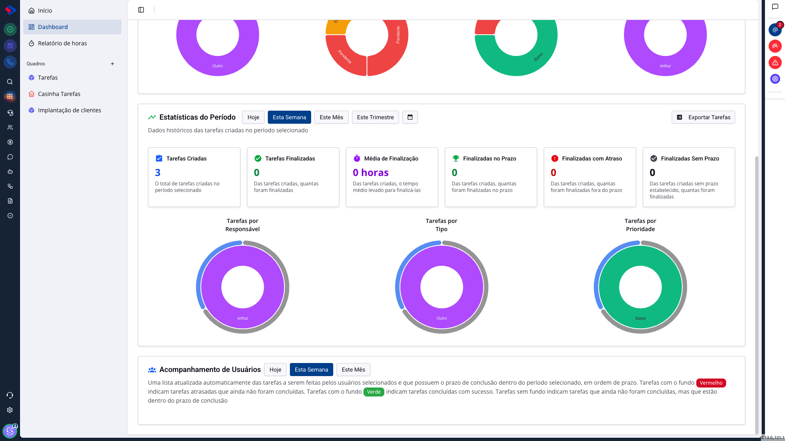
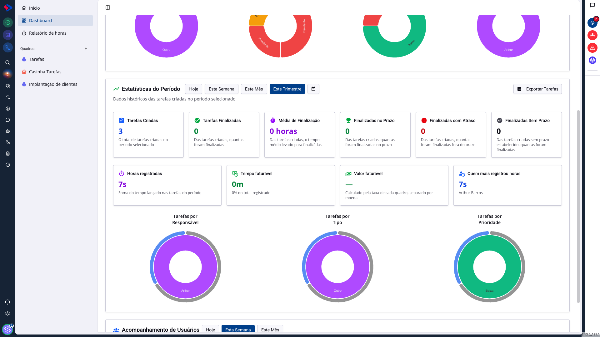

# Tarefas - O painel de estatísticas

O quadro mostra as tarefas uma a uma. O painel mostra o conjunto: quantas estão paradas, quantas atrasaram, quem está com mais trabalho e quanto tempo a equipe levou para fechar o que criou.

É a tela de quem coordena. Quem executa resolve o dia na página inicial; quem responde pelo time precisa de número.

## Como acessar

Em **Tarefas**, clique em **Dashboard**, na barra lateral.

## Os dois recortes

Antes de olhar qualquer número, entenda que a tela tem duas metades que respondem a perguntas diferentes.

**Resumo Atual** fala do presente: o que está em aberto agora. Esses números **não** mudam quando você troca o período. Uma tarefa criada no ano passado e ainda pendente conta aqui hoje.

**Estatísticas do Período** fala do passado: o que foi criado dentro do intervalo escolhido e o que aconteceu com essas tarefas. Trocar o período muda tudo nessa metade.

Confundir as duas é o engano mais comum. "Tenho 3 pendentes, mas criei 3 no mês e nenhuma foi finalizada" não é contradição: são contas diferentes.

## Os filtros do topo

**Board** (1) limita a análise a um quadro. Em **Todos**, o painel soma todos os quadros a que você tem acesso, o que mistura processos diferentes. Para comparar desempenho, escolha um quadro.

**Usuários** (2) limita a quem você quer analisar.

> **Atenção.** O seletor de usuários só lista outras pessoas para quem tem permissão de ver tarefas dos outros. Sem ela, o painel mostra apenas as suas, e nenhuma mensagem avisa disso: você vai achar que o time tem pouca tarefa, quando na verdade está vendo só a sua parte.

## O Resumo Atual

Seis números do que está em aberto:

**Tarefas Pendentes**: ainda não foram iniciadas.

**Tarefas em Andamento**: alguém já pegou.

**Tarefas Atrasadas**: das pendentes e em andamento, as que passaram do prazo. É o número que pede ação hoje.

**Vencem Hoje** e **Vencem Esta Semana**: o que está prestes a virar atraso. Olhar esses dois evita que o primeiro cresça.

**Sem Prazo**: tarefas sem data de término. Um número alto aqui explica um "Atrasadas" baixo: o que não tem prazo nunca atrasa, e some do radar.

Abaixo, quatro gráficos de rosca repartem as tarefas em aberto por **tipo**, **estágio**, **prioridade** e **responsável**. O de responsável é o que mostra desequilíbrio de carga em um segundo.

## As Estatísticas do Período

Na primeira vez, o período é a semana; há atalhos para hoje, mês e trimestre, e o botão de calendário abre um intervalo livre.

O período escolhido fica guardado no seu navegador, então a tela reabre no que você usou por último. Isso explica o painel que "abre no mês" para você e "na semana" para o colega: não é configuração do sistema, é a escolha de cada um.

**Tarefas Criadas**: quantas nasceram no período.

**Tarefas Finalizadas**: dessas, quantas já fecharam. A conta é sempre sobre as criadas no período, nunca sobre as fechadas no período. Uma tarefa de dois meses atrás concluída ontem não entra aqui.

**Média de Finalização**: o tempo médio entre criar e concluir. É o indicador de ritmo, e o que mostra se o processo está enroscando em alguma etapa.

**Finalizadas no Prazo**, **com Atraso** e **Sem Prazo**: a qualidade da entrega. O terceiro é o alerta silencioso: se quase tudo foi concluído sem prazo, os dois primeiros números não querem dizer nada.

## As horas do período

Quando alguém apontou tempo no período, aparece mais uma faixa com **Horas registradas**, **Tempo faturável**, **Valor faturável** e **Quem mais registrou horas**.

> **Atenção.** Esse bloco **não aparece** quando ninguém apontou tempo no intervalo escolhido. A ausência dele não é falha: é a resposta de que não houve registro. Ao trocar o período, ele pode sumir e voltar.

O **Valor faturável** só vira dinheiro nos quadros com valor da hora configurado. Sem isso, mostra um traço. A análise completa de horas fica no relatório próprio, com gráfico por dia e aprovação.

## Acompanhamento de Usuários

No rodapé, uma lista das tarefas das pessoas selecionadas que têm prazo dentro do período, em ordem de vencimento. O código de cores é o que se lê de longe:

- **fundo vermelho**: atrasada e ainda aberta;
- **fundo verde**: concluída;
- **sem fundo**: em dia.

Esse bloco tem seletor de período próprio, independente do resto da tela. Se ele aparecer vazio, quase sempre é porque as tarefas da equipe não têm prazo no intervalo escolhido, e não porque não há trabalho.

## Exportar

O botão **Exportar Tarefas** baixa as tarefas criadas no período, já com os filtros de quadro e de usuário aplicados. Serve para a conversa que o painel não resolve: cruzar com uma planilha de cliente, montar uma apresentação, conferir caso a caso.

A exportação depende de permissão específica. Para quem não a tem, o botão aparece desabilitado.

## Conclusão

Para a reunião semanal, o caminho curto é: escolha o quadro, olhe **Atrasadas** e **Vencem Esta Semana** no Resumo Atual, e depois **Finalizadas no Prazo** no período. Os três juntos dizem se o time está entregando e se vai continuar entregando.

E desconfie sempre do **Sem Prazo**. Ele é o número que faz todos os outros parecerem melhores do que são.
