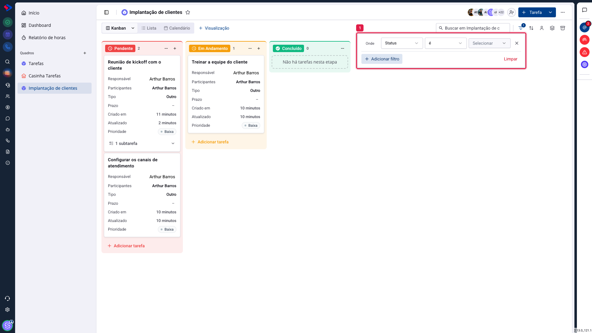
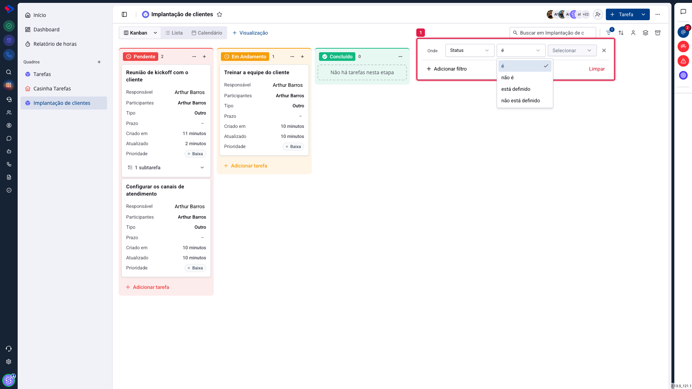

# Tarefas - Filtros do quadro

O filtro responde à pergunta "mostre só o que me interessa agora". Num quadro com duzentas tarefas, é o que separa o acompanhamento do time da sua fila pessoal.

Ele é montado por condições, e cada condição tem três partes: **campo**, **operador** e **valor**. "Responsável é Maria", "Prioridade é Urgente", "Prazo não está definido".

## Como acessar

No quadro, clique no ícone de **filtro**, à direita da caixa de busca.

**Adicionar filtro** cria a primeira condição. Cada nova condição entra abaixo, e você escolhe se elas se somam ou se alternam.

## Os campos

Dá para filtrar por:

**Status**: a etapa da tarefa.

**Prioridade**, **Tipo**, **Responsável** e **Título**.

**Horas registradas**, **Tempo faturável** e **Tempo estimado**: os campos do apontamento de horas, úteis para achar o que ninguém apontou ou o que passou do estimado.

**Recorrente**: separa as tarefas que se repetem das avulsas.

**Contato**, **Oportunidade** e **Atendimento**: os vínculos. É assim que se responde "o que ainda está aberto para este cliente".

## Os operadores

**é** e **não é**: comparação direta com um valor.

**está definido** e **não está definido**: a presença ou ausência de valor. São os mais subestimados do conjunto. "Responsável não está definido" encontra o trabalho que ninguém assumiu; "Prazo não está definido" encontra o que nunca foi datado.

## Combinar condições

Com mais de uma condição, você escolhe entre **E** e **OU**:

**E** exige todas: "Prioridade é Urgente **E** Responsável é João" mostra só as urgentes do João.

**OU** aceita qualquer uma: "Prioridade é Urgente **OU** Prioridade é Alta" mostra as duas faixas.

## O filtro pertence à visualização

O filtro que você aplica fica guardado na **visualização ativa**. Criando uma visualização chamada "Minhas urgentes" com esse filtro, ela volta filtrada toda vez, sem você refazer nada.

E, como a visualização é sua, o filtro também é: ninguém mais vê o quadro filtrado por causa do que você configurou.

> **Atenção.** Com filtro ativo, o quadro mostra **menos** tarefas do que existem, e as contagens das colunas acompanham o filtro. Se um colega disser "a tarefa sumiu", a primeira pergunta é se há filtro ligado. O ícone fica destacado quando há.

## Conclusão

Três filtros resolvem a maior parte da rotina: o seu ("Responsável é você"), o do risco ("Prioridade é Urgente") e o da faxina ("Prazo não está definido").

Salve o primeiro como visualização e use-o como tela padrão. Os outros dois funcionam melhor como revisão semanal, para achar o que está escapando antes de virar problema.
