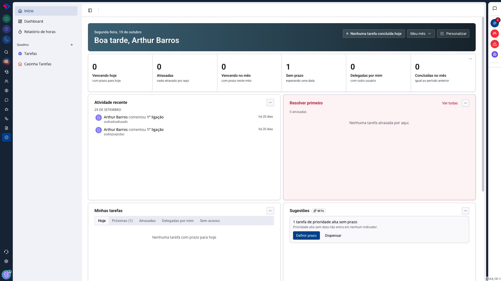
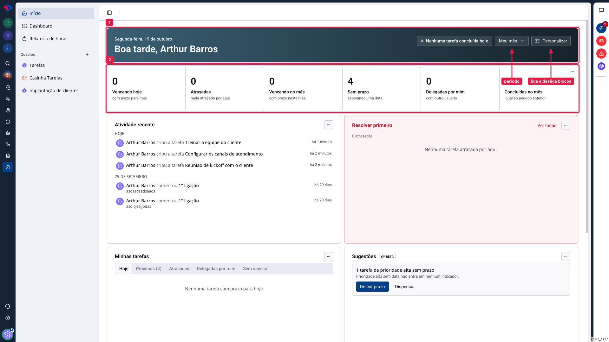
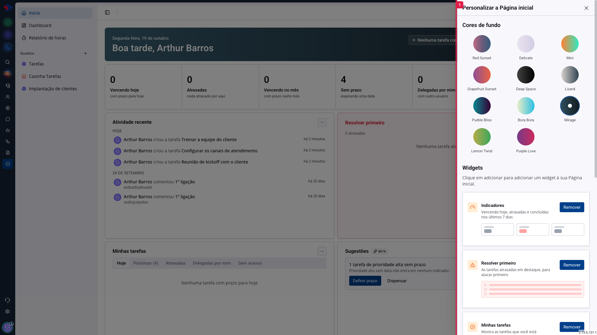

# Tarefas - A página inicial e os indicadores

A página inicial do módulo é a sua visão pessoal do trabalho, e não a do time. Ela responde o que você precisa resolver hoje, o que ficou para trás e o que você passou para outra pessoa. O quadro mostra o processo; aqui aparece a sua parte dele.

## Como acessar

Abra **Tarefas** no menu lateral. A página inicial é a primeira tela, também acessível pelo item **Início**.

## Os indicadores

**1. A faixa de saudação** mostra a data, o seu nome e quantas tarefas você concluiu hoje. À direita dela ficam o seletor de período e o botão de personalizar.

**2. Os seis indicadores**, cada um com um número e o que ele significa:

**Vencendo hoje**: tarefas suas com prazo para hoje.

**Atrasadas**: prazo vencido e tarefa não concluída. Não depende do período escolhido: uma atrasada de julho continua aparecendo em outubro, que é o comportamento certo para uma pendência.

**Vencendo no mês** (ou na semana): segue o período selecionado no cabeçalho.

**Sem prazo**: tarefas suas que ninguém datou. É a lista que costuma esconder trabalho esquecido.

**Delegadas por mim**: o que você criou e passou para outra pessoa. Serve para acompanhar sem cobrar na mão.

**Concluídas no mês** (ou na semana): o que você fechou no período, comparado com o período anterior.

**Clicar em um indicador abre a lista daquelas tarefas**, em um painel lateral. Dali você conclui pelo círculo ou abre a tarefa inteira com um clique.

## O seletor de período

O botão **Meu mês / Minha semana** muda a janela de dois indicadores: "Vencendo no mês/na semana" e "Concluídas no mês/na semana". Os outros quatro são absolutos de propósito, porque atraso, ausência de prazo e delegação não pertencem a um mês.

## Os blocos da página

Abaixo dos indicadores ficam os blocos, e você escolhe quais aparecem:

**Resolver primeiro**: até cinco tarefas atrasadas, com a mais antiga em destaque. É a fila de prioridade do dia.

**Minhas tarefas**: cinco abas, com contador em cada uma: Hoje, Próximas, Atrasadas, Delegadas por mim e Sem acesso. A última reúne tarefas em que você aparece mas cujo quadro você não pode abrir.

**Quadros**: os seus quadros com "N tarefas, N atrasadas" e um atalho para criar outro.

**Minhas Anotações**: um bloco de notas livre, que salva sozinho. Serve para o rascunho do dia que não merece virar tarefa.

**Atividade recente**: o que aconteceu nas tarefas que você acompanha, agrupado por dia.

**Sugestões**: avisos do próprio sistema sobre coisas que merecem atenção, como uma tarefa de prioridade alta sem prazo, com a ação já pronta ao lado.

## Personalizar

O botão **Personalizar** abre a configuração da página: escolha a cor de fundo do cabeçalho e ligue ou desligue cada bloco. Os blocos também podem ser arrastados e redimensionados direto na página.

**Atividade recente** e **Sugestões** vêm desligados; ligue-os aqui se quiser.

A configuração é **sua**: cada pessoa monta a própria página, e o que você muda não afeta ninguém.

> **Atenção à aba "Sem acesso".** Ela mostra tarefas em que você é responsável, participante ou observador, mas cujo quadro não está liberado para você. Isso acontece quando alguém de outro time delega algo a você. Nesse caso, o título aparece, mas não dá para abrir a tarefa: peça o acesso ao quadro a quem o administra.

## Conclusão

Use os indicadores como fila do dia: **Atrasadas** primeiro, **Vencendo hoje** depois, e **Sem prazo** uma vez por semana, para datar o que ficou solto.

Se a sua rotina é acompanhar o time em vez de executar, a página inicial importa menos do que o quadro e o Dashboard. Ela foi desenhada para quem executa.
