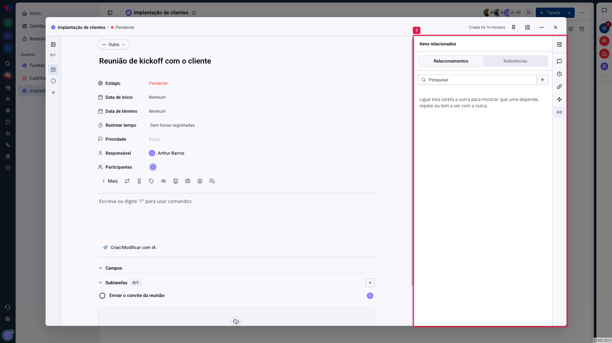

# Tarefas - Itens relacionados

Tarefas raramente vivem sozinhas. Uma depende de outra, uma repete o que já foi feito, outra trata do mesmo assunto. O painel **Itens relacionados** registra essas ligações, para que elas não existam só na cabeça de quem está tocando.

## Como acessar

Abra a tarefa e clique no ícone de **elo**, na barra de ícones da direita.

O painel tem duas abas.

## Relacionamentos

São as ligações que você cria de propósito: escolhe a outra tarefa e diz qual é a relação entre as duas. Serve para mostrar que uma **depende** da outra, que uma **repete** a outra, ou simplesmente que as duas **têm a ver**.

O vínculo vale dos dois lados: a tarefa relacionada também passa a mostrar esta no painel dela.

É o que resolve a conversa "não dá para começar isso antes daquilo": em vez de combinar no chat, a dependência fica registrada onde o trabalho acontece.

## Referências

São as ligações que aparecem sozinhas, porque alguém citou esta tarefa em outro lugar do sistema: num comentário, na descrição de outra tarefa, em um documento.

Você não cria referência; ela nasce da menção. É útil para descobrir quem está falando daquela tarefa sem que você tenha sido avisado.

## Quando usar

**Dependência**: quando a ordem importa. "Treinar a equipe" depende de "Configurar os canais".

**Repetição**: quando o trabalho de agora refaz algo anterior, e o histórico da outra ajuda.

**Assunto em comum**: quando duas tarefas de quadros diferentes tratam do mesmo cliente ou do mesmo problema. É a ligação que faz a informação atravessar os times.

> **Atenção.** O relacionamento é informativo: ele não impede nada. Marcar que uma tarefa depende de outra não bloqueia a conclusão da primeira, nem muda prazo. Serve para quem lê entender a ordem, não para o sistema impor.

## Conclusão

O painel vale mais em operações com várias equipes, onde o trabalho de uma trava o da outra. Registrar a dependência custa dois cliques e evita a pergunta "por que isso não andou?".

Se o seu time trabalha em um quadro só, com tarefas independentes, provavelmente você vai usar pouco este recurso, e tudo bem.
