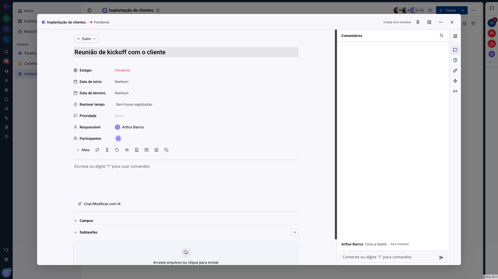
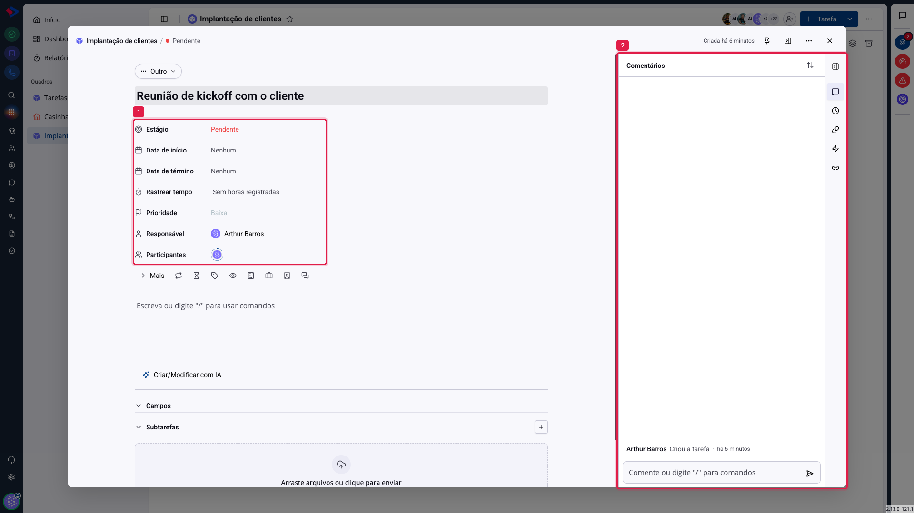

# Tarefas - A tela da tarefa

Clicar em um card abre a tarefa inteira. É nessa tela que o trabalho acontece: mudar a etapa, escrever o que foi feito, registrar horas, conversar com quem participa.

## Como acessar

No quadro, clique em qualquer card. A tarefa abre sobre a tela, e o endereço do navegador passa a apontar para ela, então o link pode ser copiado e enviado a um colega.

## As duas metades da tela

**1. À esquerda, a tarefa**: o tipo, o título, os campos e a descrição. É o conteúdo.

**2. À direita, o acompanhamento**: comentários, atividade, relações e automações, em abas. É a conversa em volta do conteúdo.

**O rail de ícones**, na borda direita, troca a aba do painel. Cada ícone traz um contador quando há algo lá dentro.

## Os campos

**Estágio**: em que coluna a tarefa está. Mudar aqui tem o mesmo efeito de arrastar o card no quadro.

**Data de início** e **Data de término**: o intervalo planejado. A data de término é o prazo que alimenta "vencendo hoje" e "atrasadas".

**Rastrear tempo**: o apontamento de horas daquela tarefa, com cronômetro. Tem artigo próprio.

**Prioridade**, **Responsável** e **Participantes**: como no formulário de criação.

**Mais** abre o restante: observadores, tags, recorrência, departamentos e os vínculos com oportunidade, contato e atendimento.

> **Dica.** O botão "Ocultar campos vazios", no menu da tarefa, limpa a tela deixando só o que está preenchido. Em quadros com muitos campos, é o que torna a tarefa legível. Um campo escondido reaparece assim que ganha valor.

## A descrição

Abaixo dos campos fica a descrição, com o mesmo editor dos Documentos: digite `/` para inserir listas, cabeçalhos, tabelas e imagens, e `@` para mencionar alguém. Há ainda **Criar/Modificar com IA**, que escreve ou reescreve o texto a partir do que você pedir.

## Campos, subtarefas e anexos

Abaixo da descrição ficam três blocos:

**Campos**: os campos personalizados daquele quadro, quando existirem.

**Subtarefas**: a quebra da tarefa em passos. Tem artigo próprio.

**Anexos**: arraste arquivos para a área indicada, ou use o gerenciador de arquivos do sistema.

## O painel da direita

**Comentários**: a conversa da tarefa. Mencionar uma pessoa notifica. Um comentário pode ser fixado no topo, o que é útil para a decisão que não pode se perder no meio da discussão.

**Atividade**: o histórico do que mudou, com autor e horário. É onde se descobre quem trocou o prazo ou moveu a tarefa.

**Itens relacionados**: outras tarefas e registros ligados a esta. Tem artigo próprio.

**Automações**: as automações que afetam esta tarefa.

## Conclusão

A tela da tarefa foi feita para ser o lugar único do assunto: o que fazer, quem faz, o que já foi feito e o que foi decidido. Quanto mais a conversa acontece aqui, em vez de no chat, menos informação se perde quando alguém entra no meio do trabalho.

Dois hábitos que rendem: registrar a decisão como comentário (e fixá-lo) e manter o estágio em dia. O resto do módulo, dos indicadores ao relatório, depende desses dois.
