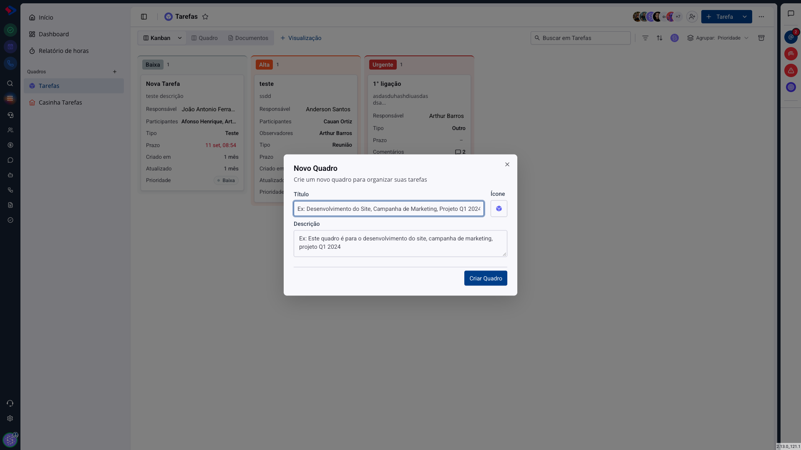
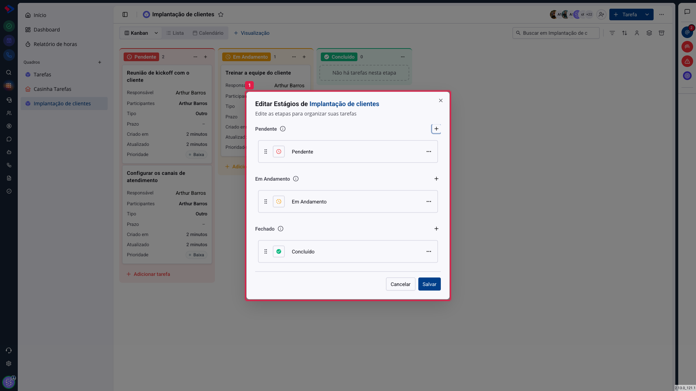
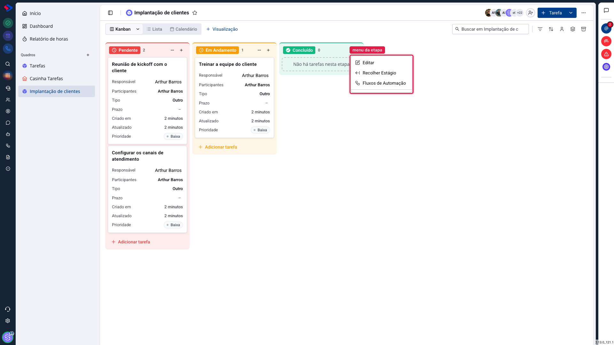
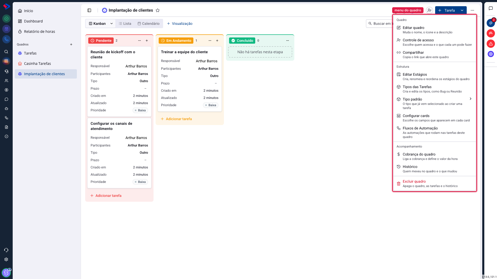

# Tarefas - Quadros, etapas e tipos

O quadro é o espaço de um processo: "Implantação de clientes", "Suporte", "Conteúdo". Dentro dele, as etapas são as colunas que mostram em que ponto cada tarefa está. Acertar esses dois nomes economiza muita confusão depois, porque todo o resto do módulo (filtros, relatórios, automações) se apoia neles.

## Como acessar

Em **Tarefas**, clique no **+** ao lado de "Quadros", na barra lateral.

**Título**: o nome do processo. Prefira o nome do fluxo ("Implantação de clientes") ao nome do time ("Equipe 2"), porque é o fluxo que define as etapas.

**Ícone**: ajuda a reconhecer o quadro na lista lateral quando houver vários.

**Descrição**: para quem entrar depois entender o que entra ali e o que não entra.

## As etapas e os três grupos

Todo quadro nasce com três etapas: Pendente, Em Andamento e Concluído. Para mexer nelas, abra o menu do quadro (os três pontos ao lado do nome, no alto) e escolha **Editar Estágios**.

Repare que as etapas ficam dentro de **três grupos**, e isso não é decoração:

**Pendente**: o trabalho ainda não começou.

**Em Andamento**: alguém está tocando.

**Fechado**: o trabalho terminou.

O grupo é o que o sistema usa para saber **o que conta como concluído**. Uma tarefa que chega a uma etapa do grupo Fechado é considerada concluída nos indicadores, no relatório e nas automações. Por isso, ao criar uma etapa nova, o grupo em que você a coloca importa mais do que o nome dela.

Você pode criar quantas etapas quiser dentro de cada grupo, arrastar para reordenar e renomear. Um processo de suporte, por exemplo, pode ter "Triagem" e "Aguardando cliente" em Pendente, "Em análise" em Em Andamento, e "Resolvido" e "Cancelado" em Fechado.

> **Atenção ao excluir uma etapa.** As tarefas que estão nela precisam ir para outro lugar. Antes de apagar uma coluna, mova as tarefas, ou você vai procurá-las depois.

## O menu da etapa

Cada coluna tem o próprio menu, no topo dela.

**Editar**: muda o nome e o ícone daquela etapa.

**Recolher Estágio**: encolhe a coluna, para liberar espaço na tela quando o quadro tem muitas etapas.

**Fluxos de Automação**: as automações que disparam quando uma tarefa entra naquela etapa.

## O menu do quadro

**Editar quadro**: nome, ícone e descrição.

**Controle de acesso**: quem entra e o que cada um pode fazer. Tem artigo próprio.

**Compartilhar**: copia o link que abre este quadro.

**Editar Estágios**: as etapas, explicadas acima.

**Tipos das Tarefas**: cria e edita os tipos usados no quadro, como "Bug", "Reunião" ou "Visita". O tipo é uma classificação da tarefa, independente da etapa: ele diz **o que** é o trabalho, enquanto a etapa diz **em que ponto** ele está.

**Tipo padrão**: o tipo que já vem selecionado ao criar uma tarefa, para ninguém precisar escolher toda vez.

**Configurar cards**: escolhe quais campos aparecem no card do kanban.

**Fluxos de Automação**: as automações do quadro.

**Cobrança do quadro**: liga a cobrança de horas e define o valor da hora. Tem artigo próprio, junto do relatório.

**Histórico**: quem mexeu no quadro e o que mudou.

**Excluir quadro**: apaga o quadro, as tarefas e o histórico.

> **Atenção.** Excluir um quadro leva junto as tarefas dele e o histórico. Não é como mandar uma tarefa para a lixeira: aqui não há restauração. Se a dúvida for "ainda vamos usar isso?", deixe o quadro parado em vez de apagar.

## Conclusão

Comece com as três etapas padrão e só crie novas quando a equipe sentir falta. Quadro com dez colunas no primeiro dia costuma virar quadro com três usadas e sete vazias.

E, ao criar qualquer etapa, decida primeiro **em qual grupo** ela entra. É isso que faz os números do módulo baterem com a realidade do time.
