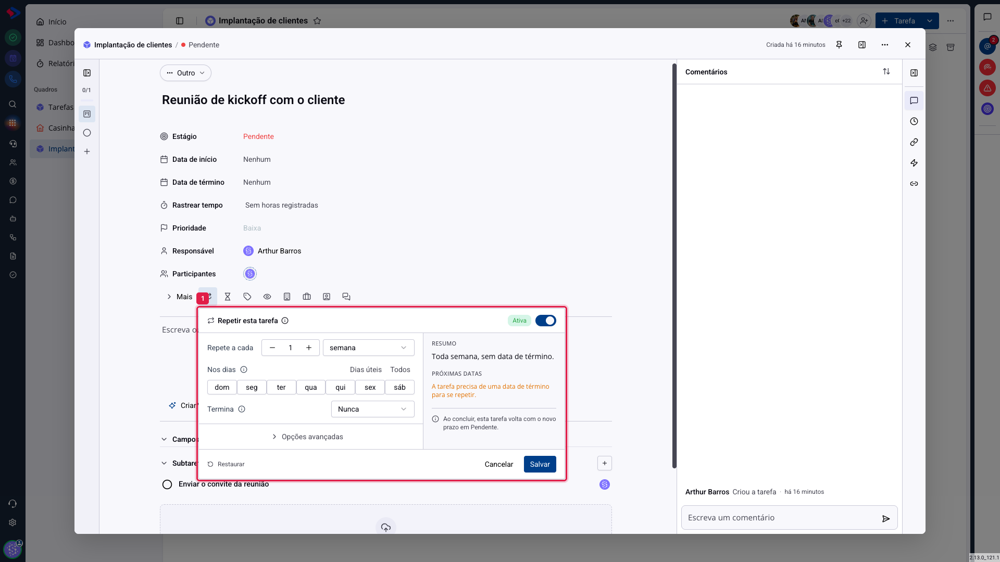
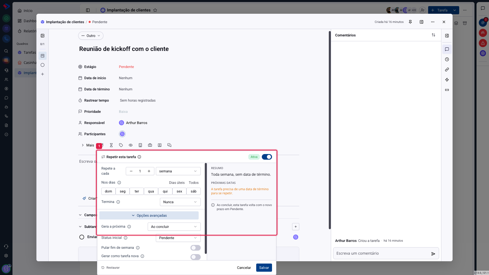

# Tarefas - Tarefas recorrentes

Trabalho que se repete não precisa ser recriado toda semana. A recorrência faz a tarefa voltar sozinha: o backup de sexta, a reunião de segunda, o relatório do dia 5, a revisão trimestral.

## Como acessar

Abra a tarefa, clique em **Mais** para abrir o restante dos campos e depois no campo de repetição, que mostra **"Não repete"** enquanto está desligado.

Ligue o interruptor **Repetir esta tarefa** e as opções aparecem.

## A frequência

**Repete a cada**: o número e a unidade, que pode ser dia, semana, mês ou ano. "A cada 2 semanas" é um intervalo quinzenal.

**Nos dias**: quando a unidade é semana, escolha os dias. Há atalhos para **Dias úteis** e **Todos**. Marcar segunda, quarta e sexta cria três ocorrências por semana.

**Termina**: quando a repetição para. As opções são nunca, depois de um número de ocorrências, ou em uma data.

À direita, o **Resumo** traduz a configuração em uma frase ("Toda semana, sem data de término") e **Próximas datas** mostra quando as próximas ocorrências cairiam. É a forma de conferir se o que você montou é o que você queria antes de salvar.

> **Atenção.** A tarefa precisa de **data de término** para se repetir, porque é a partir dela que a próxima ocorrência é calculada. Sem prazo, a configuração fica salva mas nada acontece, e o painel avisa isso.

## As opções avançadas

**Gera a próxima**: quando a nova ocorrência nasce. "Ao concluir" é o padrão, e faz a tarefa voltar quando alguém a fecha. A alternativa é gerar na data, independentemente de alguém ter concluído.

**Status inicial**: a etapa em que a nova ocorrência aparece. Normalmente a primeira do quadro.

**Pular fim de semana**: quando a data calculada cai em sábado ou domingo, empurra para o próximo dia útil. Serve para rotinas que só fazem sentido em dia de trabalho.

**Gerar como tarefa nova**: em vez de reaproveitar a mesma tarefa, cria uma cópia com o novo prazo. A diferença aparece no histórico: reaproveitando, você tem uma tarefa com muitas conclusões; gerando cópia, tem uma tarefa por ocorrência, cada uma com os próprios comentários e horas.

## Qual escolher

**Reaproveitar a mesma tarefa** (padrão) é mais limpo para rotinas simples, como "conferir backup". O quadro não enche.

**Gerar como tarefa nova** é melhor quando cada ocorrência tem conversa, anexos ou horas próprias, como uma reunião mensal com ata. Você consegue voltar ao que aconteceu em cada mês.

> **Atenção ao concluir em massa.** Ao fechar várias tarefas de uma vez, as recorrentes também geram as próximas ocorrências. Se você estiver fazendo faxina no quadro, isso pode criar tarefas que você não esperava.

## Conclusão

A recorrência resolve a rotina que a equipe esquece de recriar, e o ganho real é não depender da memória de ninguém.

Antes de salvar, olhe o **Resumo** e as **Próximas datas**: é o lugar onde se descobre que "a cada mês" cairia no dia 31 e que você queria mesmo era a primeira segunda-feira.
