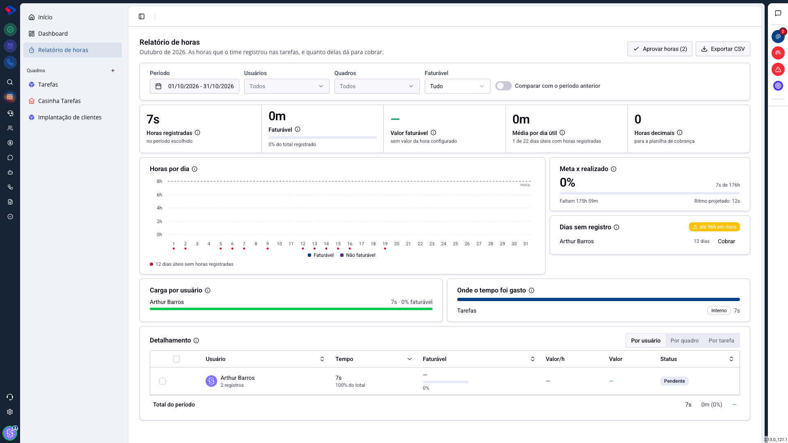

# Tarefas - Relatório de horas e cobrança

O relatório reúne tudo que o time apontou nas tarefas e responde três perguntas: quanto foi trabalhado, quanto disso dá para cobrar, e quem está deixando de registrar.

## Como acessar

Em **Tarefas**, clique em **Relatório de horas**, na barra lateral.

## Os filtros

No topo, quatro recortes:

**Período**: o intervalo analisado. O relatório abre no mês corrente.

**Usuários**: uma pessoa, algumas ou todas.

**Quadros**: limita a análise a um processo.

**Faturável**: mostra tudo, só o faturável ou só o não faturável.

**Comparar com o período anterior** acrescenta a variação em relação ao intervalo equivalente.

## Os cinco números

**Horas registradas**: o total apontado no período.

**Faturável**: quanto desse total é cobrável, com o percentual ao lado. É o número que separa o trabalho que vira receita do que é custo interno.

**Valor faturável**: o resultado em dinheiro. Ele só aparece quando o quadro tem **valor da hora configurado**; sem isso, mostra um traço e o aviso de que falta configurar.

**Média por dia útil**: o ritmo do período, com quantos dias úteis tiveram registro.

**Horas decimais**: o mesmo total em formato decimal, pronto para colar numa planilha de cobrança. Duas horas e meia aparecem como 2,5 em vez de 2h30.

## Os blocos de análise

**Horas por dia**: o gráfico do período, com faturável e não faturável separados, e uma linha de meta. Os pontos vermelhos marcam os dias úteis sem nenhum registro.

**Meta x realizado**: o quanto da meta do período já foi cumprido, com o que falta e o ritmo projetado.

**Dias sem registro**: as pessoas com dias úteis em branco, e quanto de hora isso representa em risco. É o bloco que pega o esquecimento antes do fechamento do mês.

**Carga por usuário**: quanto cada pessoa registrou e qual percentual é faturável.

**Onde o tempo foi gasto**: a divisão do tempo entre os trabalhos, com a marcação do que é interno.

## O detalhamento

A tabela do rodapé pode ser vista **por usuário**, **por quadro** ou **por tarefa**, com tempo, faturável, valor por hora, valor e status.

O **status** indica se aquelas horas já foram aprovadas. O botão **Aprovar horas**, no topo, trata as pendentes: é o passo de conferência antes de o número virar cobrança.

**Exportar CSV** leva a tabela para a planilha.

## Ligar a cobrança de um quadro

O valor por hora é configurado por quadro: abra o menu do quadro e escolha **Cobrança do quadro**. Lá você liga a cobrança e define o valor da hora.

Sem isso, o relatório continua medindo tempo, mas não calcula dinheiro, e "Valor faturável" fica vazio.

> **Atenção.** O valor é aplicado às horas do período conforme a configuração atual do quadro. Mudar o valor da hora altera o cálculo dos períodos exibidos, então faça a mudança com a virada de mês em mente, e exporte o fechamento antes de alterar.

> **Atenção ao que entra na conta.** Só entra no relatório o que foi apontado nas tarefas, pelo cronômetro ou manualmente. Trabalho feito e não apontado não aparece em lugar nenhum: para a equipe que cobra por hora, o relatório é tão confiável quanto a disciplina de registrar.

## Conclusão

Para quem administra, o caminho é sempre o mesmo: filtre o período, confira **Dias sem registro** para fechar as lacunas, aprove as horas e exporte.

Para quem executa, o que importa é mais simples: registrar no mesmo dia e marcar corretamente o que é faturável. O resto do relatório se monta sozinho a partir disso.
