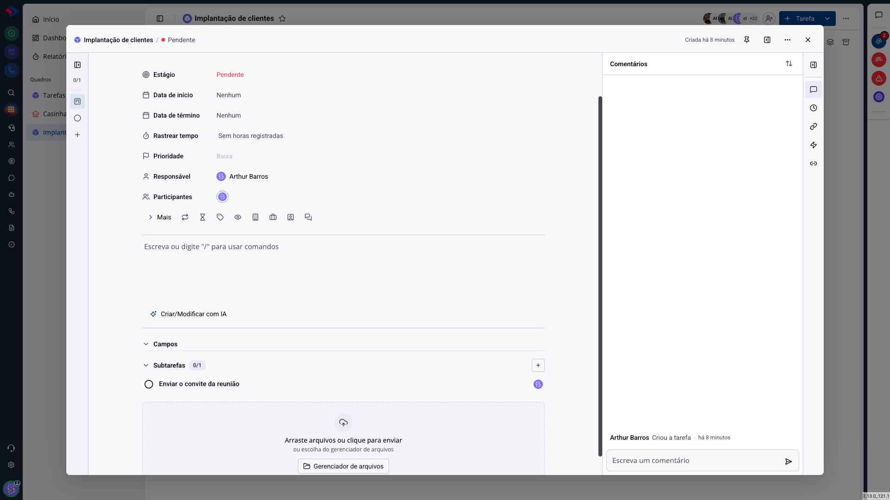
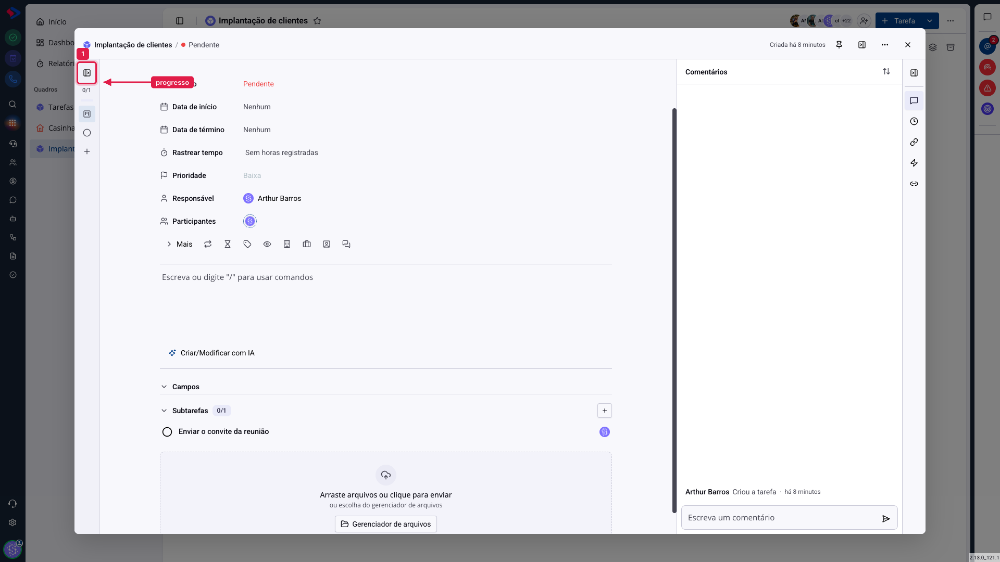

# Tarefas - Subtarefas

Nem todo trabalho cabe em uma linha. "Implantar o cliente" são oito coisas, feitas por pessoas diferentes, em dias diferentes. As subtarefas quebram uma tarefa nesses passos, sem poluir o quadro com oito cards.

A diferença para uma lista de itens na descrição é que a subtarefa é de verdade: tem responsável próprio, pode ser concluída individualmente e conta no progresso da tarefa principal.

## Como acessar

Abra uma tarefa e role até o bloco **Subtarefas**. O **+** à direita cria uma nova.

## Como funciona

Escreva o título e pressione Enter. A subtarefa aparece na lista com um círculo à esquerda, que marca a conclusão, e o avatar de quem é responsável à direita.

**O contador** ao lado do título do bloco mostra o progresso: `0/1` significa nenhuma concluída de uma. É o número que responde "quanto falta" sem ninguém precisar abrir a tarefa.

Clicar em uma subtarefa abre a barra lateral dela, onde você define responsável, prazo e descrição, como em uma tarefa comum.

## Quando usar subtarefa e quando usar tarefa

**Use subtarefa** quando os passos só fazem sentido juntos, e ninguém precisa acompanhá-los no quadro. "Enviar o convite" não é um trabalho que mereça um card próprio na coluna.

**Use tarefa** quando o passo tem vida própria: prazo que a equipe acompanha, responsável de outro time, ou quando ele precisa andar pelas etapas do quadro. Subtarefa não aparece como card e não se move entre colunas.

> **Atenção.** A subtarefa pertence à tarefa: ela não aparece no quadro, não entra nos indicadores da página inicial e não é contada nos relatórios como uma tarefa. Se o que você quer é acompanhar aquele passo nos números do time, ele precisa ser uma tarefa.

## Concluir

Marcar o círculo conclui a subtarefa e atualiza o contador. Concluir todas **não** conclui a tarefa principal: quem decide que o trabalho acabou é você, movendo a tarefa para uma etapa do grupo "Fechado".

## Conclusão

Subtarefa é a ferramenta para detalhar sem espalhar. Uma tarefa com cinco subtarefas continua sendo um card no quadro, e o time vê o progresso pelo contador.

A regra prática: se alguém fora da tarefa precisa enxergar aquele passo, ele é uma tarefa. Se o passo só interessa a quem está executando, ele é uma subtarefa.
