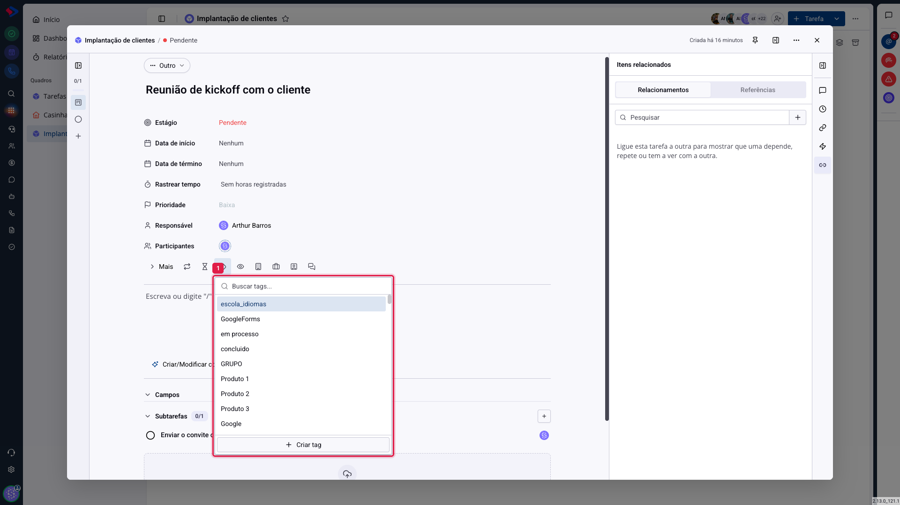

# Tarefas - Tags, menções e notificações

Dois recursos pequenos mudam bastante o dia a dia: a **tag**, que agrupa tarefas por assunto sem mexer na estrutura do quadro, e a **menção**, que chama uma pessoa para dentro de uma tarefa sem passar pelo chat.

## Tags

### Como acessar

Abra a tarefa, clique em **Mais** e depois no campo de **tags**.

As tags são as **mesmas** usadas nos contatos e no resto do sistema: a lista é compartilhada, e uma tag criada aqui passa a existir lá também.

### Para que servem

A etapa diz em que ponto a tarefa está; o tipo diz o que ela é; a tag diz **do que ela trata**. Uma tarefa pode ter várias.

Na prática, elas resolvem três coisas:

- **Filtrar** o quadro por assunto, sem criar uma coluna para isso.
- **Agrupar** o kanban por tag, para ver a distribuição do trabalho por tema.
- **Marcar visualmente** no card, já que a tag aparece colorida nele.

> **Atenção.** Como a lista de tags é compartilhada com o resto do sistema, ela cresce rápido e fica difícil de usar. Antes de criar uma tag nova, procure por uma equivalente: "urgente", "Urgente" e "URGENTE" viram três tags diferentes, e os filtros deixam de funcionar como você espera.

## Menções

Dentro de um comentário ou da descrição, digite **@** e escolha a pessoa. Ela recebe uma notificação de que foi citada naquela tarefa, com o link direto.

É o caminho para pedir uma opinião sem tirar a conversa de dentro da tarefa. Quem for mencionado consegue ler o contexto inteiro; no chat, veria só o pedaço que você colou.

## Quando o sistema avisa alguém

Três situações geram notificação:

**Atribuição**: quando alguém vira responsável por uma tarefa.

**Menção**: quando alguém é citado com `@` em um comentário ou na descrição.

**Movimentação acompanhada**: quem é responsável, participante ou observador acompanha o que acontece na tarefa, e vê as mudanças no bloco **Atividade recente** da página inicial.

A diferença entre participante e observador está aí: os dois acompanham, mas o observador não é cobrado pelo prazo nem aparece como executor.

## Conclusão

Tags funcionam melhor em pouca quantidade e com nomes combinados pela equipe. Cinco tags que todo mundo usa valem mais do que trinta que cada um inventou.

A menção é o hábito mais fácil de adotar e o que mais economiza tempo: em vez de "manda um print daquela tarefa para mim", um `@` resolve, e a conversa fica registrada onde quem vier depois vai procurar.
