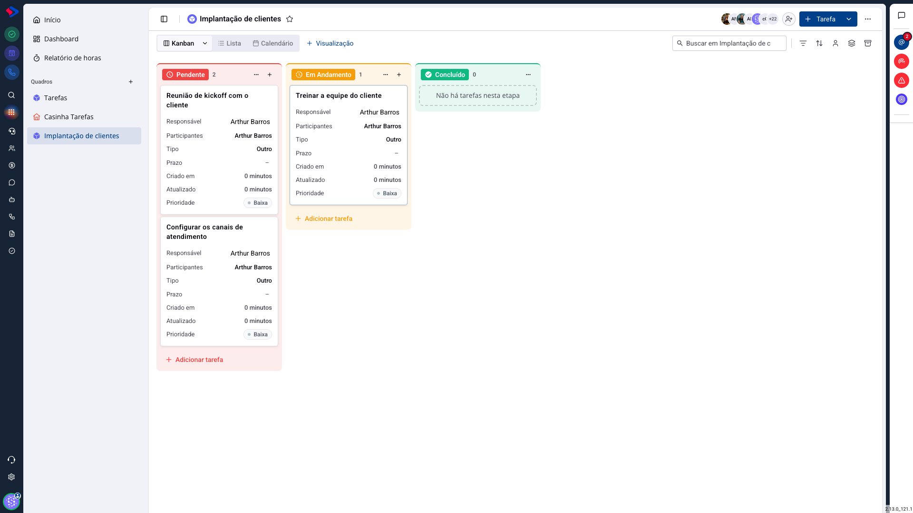
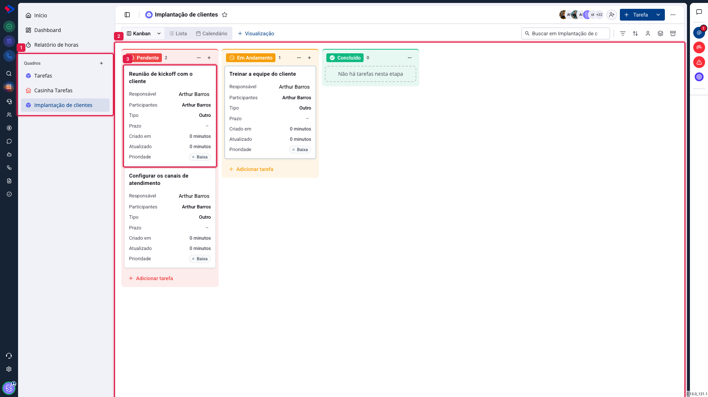

# Tarefas - Visão geral do módulo

O módulo de Tarefas organiza o trabalho da equipe em quadros no estilo kanban. É onde entra tudo que precisa ser feito por alguém, com prazo, responsável e situação visível para quem acompanha.

A estrutura tem quatro níveis, e entender essa hierarquia resolve a maior parte das dúvidas iniciais:

**Quadro** → **Etapa** → **Tarefa** → **Subtarefa**

O **quadro** é o espaço de um time ou de um processo ("Implantação de clientes", "Suporte", "Financeiro"). As **etapas** são as colunas que mostram em que ponto do processo cada trabalho está. A **tarefa** é a unidade de trabalho. E a **subtarefa** quebra uma tarefa grande em passos.

> **Não confunda com o funil do CRM.** O funil de vendas e o kanban do Atendimento são outros módulos, com outras regras. Aqui, o funil aparece apenas como vínculo opcional: uma tarefa pode estar ligada a uma oportunidade, a um contato ou a um atendimento, mas o quadro de tarefas é independente deles.

## Como acessar

No menu lateral, clique no ícone de **Tarefas**, ou abra `/sh/tasks`.

## As três partes da tela

**1. A lista de quadros**, à esquerda, com os atalhos de **Início**, **Dashboard** e **Relatório de horas** acima dela. O **+** ao lado de "Quadros" cria um quadro novo.

**2. As etapas**, as colunas do quadro. Cada uma mostra o nome, a contagem de tarefas e o botão de adicionar. Arrastar uma tarefa de uma coluna para outra muda a etapa dela.

**3. O card da tarefa**, que mostra os campos que você escolher: responsável, participantes, tipo, prazo, prioridade, tags, contagem de comentários. Clicar no card abre a tarefa inteira.

## As formas de ver o mesmo quadro

No alto ficam as visualizações: **Kanban**, **Lista** e **Calendário**. São três formas de ver as mesmas tarefas.

O kanban responde "em que pé está cada coisa". A lista responde "o que existe, em ordem, com quais campos". O calendário responde "o que vence quando". Você pode salvar visualizações próprias, com filtros e configurações diferentes, e isso tem artigo próprio.

## Os três pontos de entrada

**Início** é a sua página pessoal: o que vence hoje, o que está atrasado, o que foi delegado. Serve para começar o dia.

**Quadro** é o espaço do time: o processo inteiro, de todo mundo.

**Dashboard** e **Relatório de horas** são as visões de acompanhamento, para quem precisa de números em vez de cards.

## Quem vê o quê

O acesso tem duas camadas. A primeira é a permissão do seu grupo, definida pelo administrador: ela diz se você pode ver, criar, editar ou excluir tarefas no sistema. A segunda é o acesso do quadro, que restringe quem entra e o que faz dentro dele.

As duas se somam, e a do quadro **só restringe**: ela nunca dá o que a permissão do grupo não deu. Isso tem artigo próprio.

## Conclusão

Para começar, o caminho mais curto é: crie um quadro para o seu processo, ajuste as etapas para os passos que ele tem de verdade, e comece a lançar tarefas. Refine depois, quando a equipe estiver usando.

A tentação comum é criar muitos quadros no primeiro dia. Prefira um por processo real, com etapas que correspondam ao que acontece, em vez de um quadro por pessoa: quadro por pessoa transforma o kanban numa lista de afazeres individual e esconde o trabalho do time.
