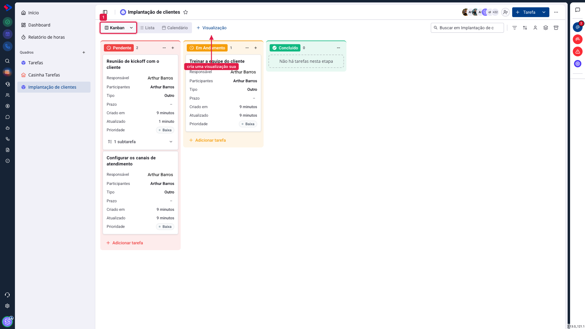
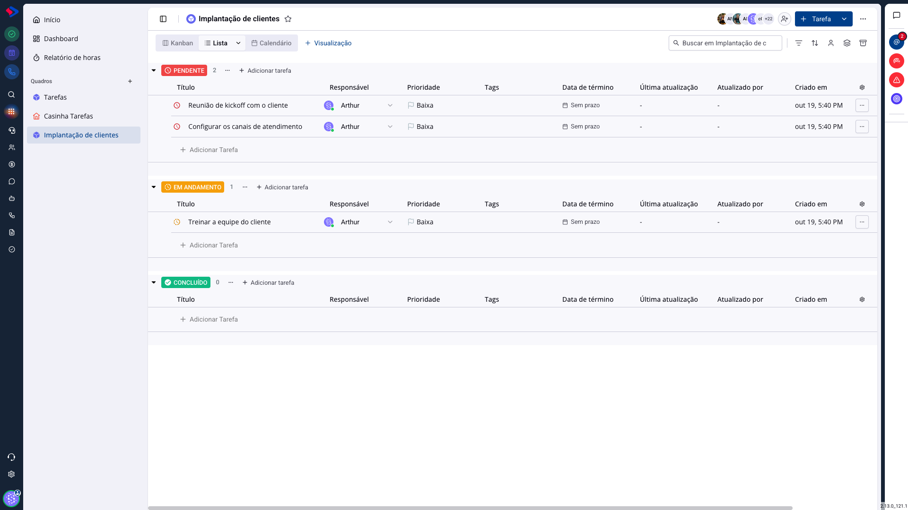
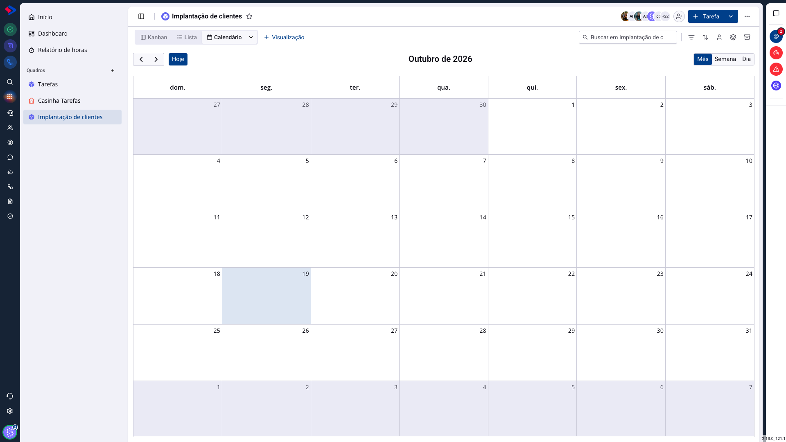

# Tarefas - Visualizações: kanban, lista e calendário

O mesmo quadro pode ser visto de três formas, e cada uma responde a uma pergunta diferente. Trocar de visualização não muda nada nas tarefas: muda o que você consegue enxergar.

## Como acessar

As abas ficam no alto do quadro, à esquerda.

## Kanban

As tarefas em colunas, por etapa. Responde **em que pé está cada coisa** e deixa mover o trabalho arrastando o card.

É a visão do acompanhamento diário, e a que mostra gargalo: uma coluna cheia enquanto as outras estão vazias diz mais do que qualquer relatório.

## Lista

As tarefas em linhas, agrupadas por etapa, com colunas de dados: título, responsável, prioridade, tags, data de término, última atualização, quem atualizou, criação e quem criou.

Responde **o que existe, com quais dados**. É a visão para revisar muita tarefa de uma vez, comparar prazos e achar o que está sem responsável. Também é a melhor para quadros grandes, porque mostra mais tarefas por tela do que o kanban.

## Calendário

As tarefas distribuídas pelos dias, com alternância entre mês, semana e dia. Responde **o que vence quando**.

É a visão do planejamento: mostra a semana sobrecarregada antes de ela chegar, e revela os dias em que ninguém colocou nada.

> **Atenção.** O calendário mostra tarefas **com data**. O que está sem prazo não aparece ali, o que é outro motivo para manter a lista "Sem prazo" da página inicial sob controle.

## Visualizações salvas

O botão **+ Visualização** cria uma visualização sua, com nome próprio. Ela guarda:

- o tipo (kanban, lista ou calendário);
- os filtros aplicados;
- o agrupamento escolhido;
- a ordenação e as colunas, na lista.

É o que permite ter, no mesmo quadro, uma visão "Minhas urgentes" em lista e outra "Semana da equipe" em calendário, sem reconfigurar tudo a cada troca.

As visualizações são **suas**: o que você cria não muda o que os colegas veem.

## Conclusão

A maioria das equipes trabalha no kanban e visita as outras duas quando precisa. Vale criar pelo menos uma visualização salva: a do seu recorte do dia a dia, já filtrada, para não reconstruir o mesmo filtro toda manhã.

Se o quadro tem muitas tarefas, experimente a lista por uma semana. É comum descobrir ali tarefas sem responsável ou sem prazo que passavam despercebidas no kanban.
